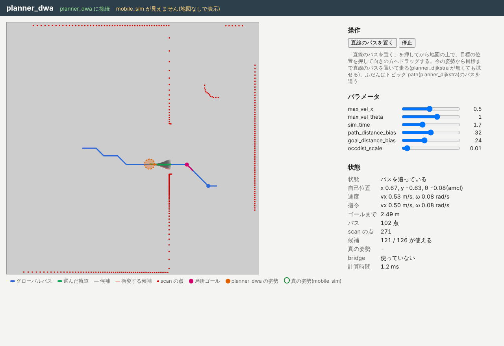

import { Aside } from '@astrojs/starlight/components';

Finally, look inside the running stack with the `juiz` command and the screens of the apps.
Use terminal 2, and keep the stack running from the previous page.

## The shape of the tree

List the containers visible from the root, navigation_hub (port 8006).

```sh
juiz -s http://localhost:8006 container list
```

```text
["ipc://localization_amcl/container/map::static_anchor", "ipc://localization_amcl/container/amcl_odom0::static_anchor", "ipc://localization_amcl/container/amcl0::amcl", "ipc://localization_amcl/container/robot0::mobile_robot", "ipc://localization_amcl/container/lidar0::mobile_lidar", "ipc://localization_amcl/container/world::static_anchor", "ipc://localization_amcl/container/sim0::mobile_sim", "ipc://localization_amcl/container/odom0::static_anchor", "ipc://planner_dijkstra/container/planner0::dijkstra_planner", "ipc://planner_dwa/container/dwa0::dwa_planner"]
```

- Under `ipc://localization_amcl/...` you see localization_amcl's own `amcl0`, `map` and `amcl_odom0`, and also `sim0`, `robot0` and others of mobile_sim connected below it. Seen from navigation_hub, mobile_sim is "a subsystem of a subsystem".
- `ipc://planner_dijkstra/...` and `ipc://planner_dwa/...` are direct subsystems of navigation_hub.

As in the figure in the [overview](/exercises/navigation/), it is one tree with navigation_hub as the root.

## The topic relays

Look at navigation_hub's own Processes too.

```sh
juiz -s http://localhost:8006 process list
```

```text
["http://localhost:8006/process/relay_odom::nav_relay", "http://localhost:8006/process/relay_scan::nav_relay", "http://localhost:8006/process/relay_lidar_mount::nav_relay", "http://localhost:8006/process/relay_cmd_vel::nav_relay", "http://localhost:8006/process/relay_amcl_pose::nav_relay", "ipc://localization_amcl/process/version0::localization_amcl_version"]
```

The five `relay_...` Processes receive topics and publish them again under other names.

| Process | Subscribes to | Publishes to | Flow |
| --- | --- | --- | --- |
| `relay_odom` | `odom` | `nav/odom` | mobile_sim → planner_dwa |
| `relay_scan` | `scan` | `nav/scan` | mobile_sim → planner_dwa |
| `relay_lidar_mount` | `lidar_mount` | `nav/lidar_mount` | mobile_sim → planner_dwa |
| `relay_amcl_pose` | `amcl_pose` | `nav/amcl_pose` | localization_amcl → planner_dijkstra, planner_dwa |
| `relay_cmd_vel` | `cmd_vel_dwa` | `cmd_vel` | planner_dwa → mobile_sim |

When `navigation-manager stack` starts planner_dijkstra and planner_dwa as leaves, it renames the topics they subscribe to as `nav/...`, and the topic planner_dwa publishes as `cmd_vel_dwa`, with the `--remap` option of `juiz run` (for example `--remap odom=nav/odom --remap cmd_vel=cmd_vel_dwa`). The pairs are written in `leaves/planner_dijkstra.yaml` and `leaves/planner_dwa.yaml` in the `.juizapp` of navigation_hub.
Through the relays at the root, apps on different branches are connected by topics.

## The local planner

Open the planner_dwa screen (http://localhost:8004/) and give a goal on the navigation_manager screen.



DWA tries many velocity pairs (forward speed and turning speed) within what the robot can reach from its current velocity, and draws the trajectory of each a little ahead (`sim_time` seconds).
Among them it picks one that does not collide, stays close to the global path and gets closer to the goal.

| Drawing | Meaning |
| --- | --- |
| Gray lines | Candidate trajectories it tried |
| Red lines | Candidates dropped because they would hit an obstacle |
| Green line | The chosen trajectory (its velocity goes to `cmd_vel`) |
| Pink circle | The local goal (a point a little ahead on the global path) |

In this setup planner_dwa does not have mobile_sim as a subsystem, so the top of the screen says `mobile_sim が見えません(地図なしで表示)` (mobile_sim is not visible; shown without a map), and no map is drawn. The path and scan points are drawn.

The sliders on the right change the parameters. The names and meanings are the same as ROS's dwa_local_planner.

| Parameter | Meaning | Try changing it |
| --- | --- | --- |
| `max_vel_x` | Maximum forward speed [m/s] | Lower: drives slowly and carefully |
| `max_vel_theta` | Maximum turning speed [rad/s] | Lower: takes longer to turn |
| `sim_time` | How many seconds ahead each candidate is drawn | Short: only looks just ahead; long: considers distant obstacles |
| `path_distance_bias` | How much it prefers trajectories close to the global path | Higher: sticks to the path |
| `goal_distance_bias` | How much it prefers trajectories towards the local goal | Higher: hurries ahead even off the path |
| `occdist_scale` | How much it prefers trajectories away from obstacles | Higher: keeps away from walls |

You can also change the parameters by calling the ContainerProcess `dwa_set_params`.

```sh
juiz -s http://localhost:8004 container-process call -p "http://localhost:8004/container_process/set_params0::dwa_set_params:dwa0" '{"params": {"max_vel_x": 0.3}}'
```

It returns all the parameters after the change. The sliders on the screen call the same `dwa_set_params`.
In Windows PowerShell, how `"` inside JSON is passed differs between versions, so use the sliders on the screen.

<Aside type="note" title="Parameters go back on restart">
The values you change here go back to the defaults when you stop the stack.
</Aside>

## Making it fail on purpose

Try these on the navigation_manager screen.

- **Put a goal on an obstacle**: drag on a pillar or a wall. planner_dijkstra cannot find a path, and after three replans the state becomes `failed` (`the goal is on an obstacle`).
- **Put a goal right next to an obstacle**: with a goal right next to a pillar or the round obstacle (closer than 0.5 m), planner_dwa may decide it would collide as it gets close and stop, going `stuck` → replan → `failed` (`local planner is stuck`). This is because planner_dijkstra plans without considering the robot's size (radius 0.2 m).
- **Cancel halfway**: press キャンセル (cancel) while driving. planner_dwa stops and the state becomes `canceled`.

## Localization

The localization_amcl screen (http://localhost:8002/) shows the particles, the estimated pose and the error ellipse.
While the robot drives, check that the particles stay gathered around the robot.

Try pressing 大域的な推定(粒子を地図全体に撒く) (global localization: scatter particles over the whole map). The particles spread over the whole map, and the estimate becomes "I don't know where I am".
If you keep driving, the particles may gather again, or they may gather at a different place that looks similar.
To recover, press 初期位置を真の姿勢に (set the initial pose to the true pose) on the navigation_manager screen. It tells localization_amcl the true position from mobile_sim as the initial pose (a shortcut only a simulator allows).

## Summary

- The five apps are connected as one tree with navigation_hub as the root. The `relay_...` Processes at the root relay the topics.
- DWA tries candidate trajectories and picks a velocity. You can change its parameters on the screen or with `dwa_set_params`.
- planner_dijkstra does not consider the robot's size, so goals right next to obstacles tend to get stuck.

This is the end of the autonomous navigation exercise. Go back to the [list of exercises](/exercises/), or read how the apps are built in their repositories.
