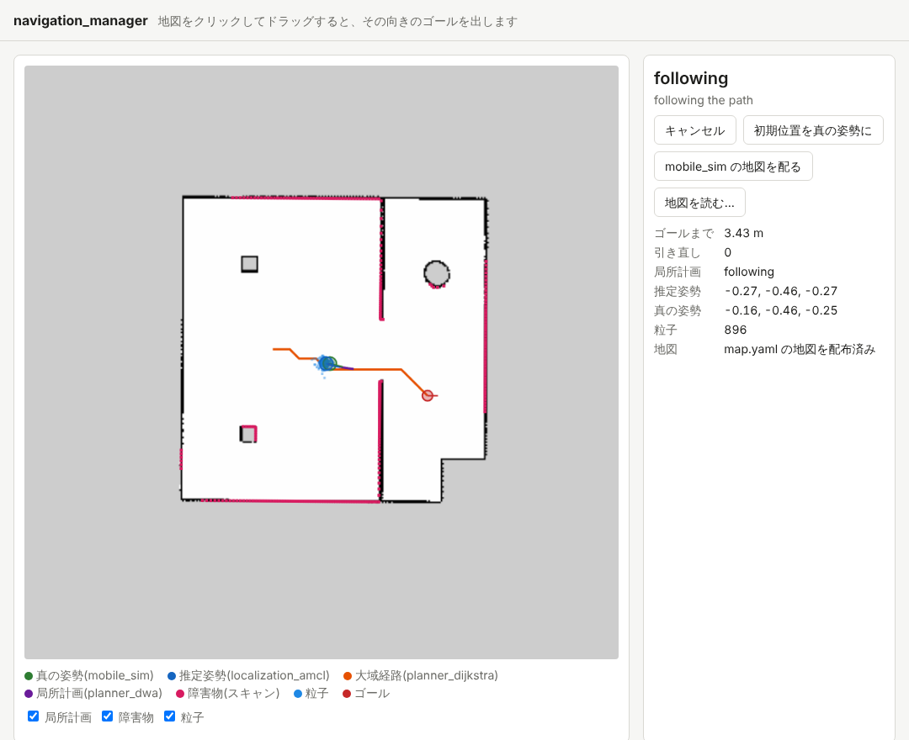
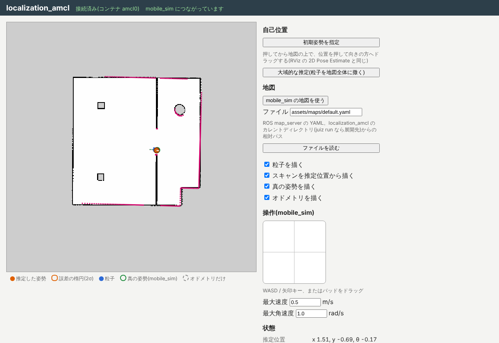

import { Aside, Tabs, TabItem } from '@astrojs/starlight/components';

On the previous page you used the map the simulator has (the answer map).
A real robot does not have the answer map, so it drives on a map built with SLAM. Here you use the map you saved in the [SLAM exercise](/exercises/slam/mapping/).

## Restarting with the map

Press Ctrl+C in terminal 1 to stop the stack, and start it again with the map YAML given to `--map`.
This assumes `map.yaml` and `map.png`, named by `image` in it, are in the working directory.

<Tabs syncKey="platform">
<TabItem label="Linux">

```sh
navigation-manager stack mobile_sim-<version>.juizapp \
    localization_amcl-<version>.juizapp planner_dijkstra-<version>.juizapp \
    planner_dwa-<version>.juizapp navigation_hub-<version>.juizapp \
    --map map.yaml
```

</TabItem>
<TabItem label="macOS">

```sh
navigation-manager stack mobile_sim-<version>.juizapp \
    localization_amcl-<version>.juizapp planner_dijkstra-<version>.juizapp \
    planner_dwa-<version>.juizapp navigation_hub-<version>.juizapp \
    --map map.yaml
```

</TabItem>
<TabItem label="Windows">

```powershell
navigation-manager stack mobile_sim-<version>.juizapp `
    localization_amcl-<version>.juizapp planner_dijkstra-<version>.juizapp `
    planner_dwa-<version>.juizapp navigation_hub-<version>.juizapp `
    --map map.yaml
```

</TabItem>
</Tabs>

When navigation_manager starts, it distributes this map to both planner_dijkstra (the map for planning paths) and localization_amcl (the map to match scans against).
Reload http://localhost:8005/ and the screen draws the map you built with SLAM, and the 地図 (map) row on the right reads `map.yaml の地図を配布済み` (the map.yaml map has been distributed).



The SLAM map is built 20 m square, so there is a gray (unknown) margin around the room. planner_dijkstra does not pass through unknown cells, so paths stay inside the room.

<Aside type="tip" title="Changing the map without restarting">
You can also press 地図を読む… (load a map…) on the screen and select `map.yaml` and `map.png` **together** to distribute that map.
mobile_sim の地図を配る (distribute the mobile_sim map) goes back to the simulator's map.
Both stop the robot first if it is driving.
</Aside>

## Driving

As on the previous page, drag on the map to give goals. For example, try these goals in turn (the coordinates are approximate positions on the map).

| Goal | Roughly where |
| --- | --- |
| x 3.0, y -1.5 | In the right room, just through the doorway |
| x 2.0, y -3.0 | The lower part of the right room |
| x -1.5, y 2.5 | The upper part of the left room, right of the pillar |
| x -2.0, y 0.0 | Where the robot started |

The robot should reach them as it did on the simulator's map. Check that the green circle (the true position) and the blue circle (the estimated position) stay almost on top of each other while it drives.

## How the position on the map is decided

The SLAM map frame `map` started from the odometry at the moment mapper_gmapping started.
If you restarted mobile_sim before building the map in the SLAM exercise, `map` is almost the same as the room frame `world`.
localization_amcl starts estimating on the assumption that the robot is at mobile_sim's starting position (x -2.0, y 0.0), so it estimates correctly as is.

You can read the robot's position from the tree of coordinate frames that localization_amcl writes. Look at it in terminal 2 (below is an example with numbers rounded to two decimals).

```sh
juiz anchor tree map
```

```text
map  position (0, 0, 0)  orientation (0, 0, 0, 1)
└─ amcl_odom0  position (-0.04, -0.04, 0)  orientation (0, 0, 0.01, 1.00)
   └─ odom0  position (-0.04, -0.04, 0)  orientation (0, 0, 0.01, 1.00)
      └─ robot0  position (2.93, -1.43, 0)  orientation (0, 0, -0.14, 0.99)
         └─ lidar0  position (2.93, -1.43, 0.20)  orientation (0, 0, -0.14, 0.99)
```

This has the same shape as `map → slam_odom0 → odom0` you saw [at the end of the SLAM exercise](/exercises/slam/check/).
This time the Anchors `map` and `amcl_odom0` of localization_amcl sit on top of mobile_sim's `odom0`. `map → amcl_odom0` holds "the drift of the odometry" found by AMCL, rewritten with every scan.
Compare with the true position in `juiz anchor tree world`, and the difference is a few centimeters.

<Aside type="caution" title="When the robot's position is off">
If `map` and `world` differ, for example because you did not restart mobile_sim before building the SLAM map, the first assumption of localization_amcl is wrong.
If the particles do not gather, or the blue circle drifts away from the green one, open the localization_amcl screen (http://localhost:8002/), press 初期姿勢を指定 (set the initial pose), press where the robot is on the map, and drag towards the way it faces.


</Aside>

## Summary

- `--map map.yaml` distributes the map built with SLAM to planner_dijkstra and localization_amcl. 地図を読む… (load a map…) on the screen changes it too.
- localization_amcl matches scans against the map, rewrites `map → amcl_odom0`, and corrects the drift of the odometry.
- If the SLAM map and the simulator's room share almost the same coordinates, the robot navigates as is. If not, give the initial pose again.

Next is [3. Looking inside](/exercises/navigation/inside/). Keep the stack running.
