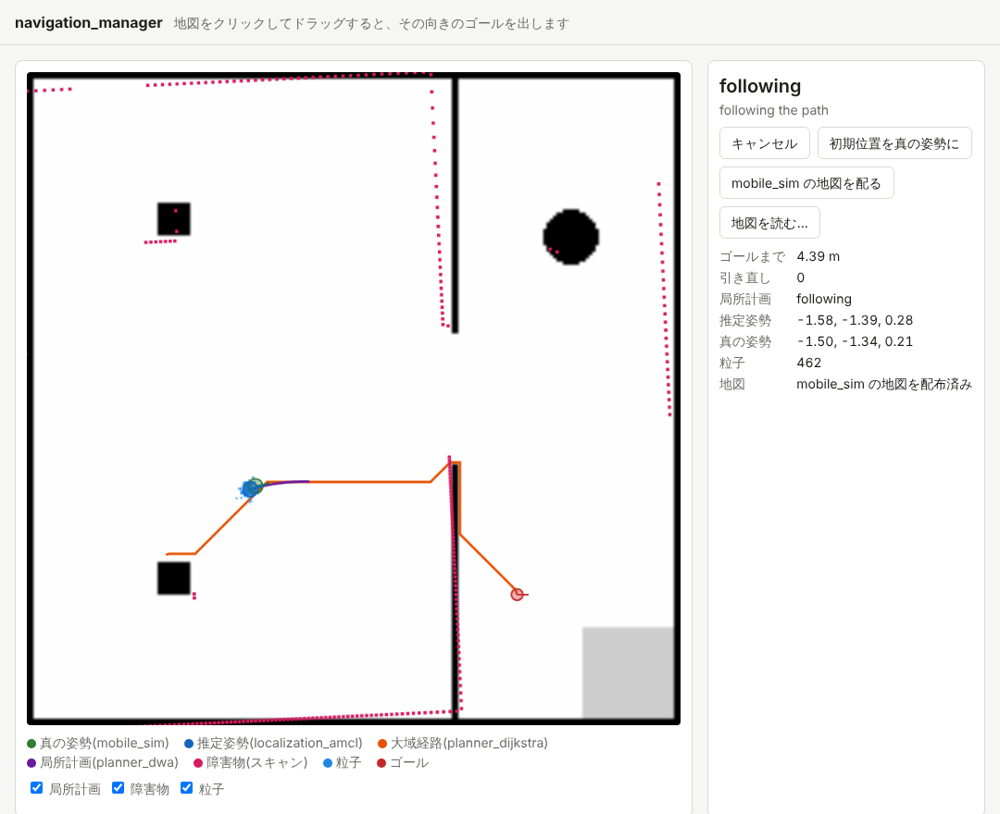

import { Aside, Tabs, TabItem } from '@astrojs/starlight/components';

First, run the stack on the simulator's own map.

## Starting the stack

In terminal 1, pass the five `.juizapp` packages to `navigation-manager stack` (replace `<version>` with the versions you downloaded). The order does not matter.

<Tabs syncKey="platform">
<TabItem label="Linux">

```sh
navigation-manager stack mobile_sim-<version>.juizapp \
    localization_amcl-<version>.juizapp planner_dijkstra-<version>.juizapp \
    planner_dwa-<version>.juizapp navigation_hub-<version>.juizapp
```

</TabItem>
<TabItem label="macOS">

```sh
navigation-manager stack mobile_sim-<version>.juizapp \
    localization_amcl-<version>.juizapp planner_dijkstra-<version>.juizapp \
    planner_dwa-<version>.juizapp navigation_hub-<version>.juizapp
```

</TabItem>
<TabItem label="Windows">

```powershell
navigation-manager stack mobile_sim-<version>.juizapp `
    localization_amcl-<version>.juizapp planner_dijkstra-<version>.juizapp `
    planner_dwa-<version>.juizapp navigation_hub-<version>.juizapp
```

</TabItem>
</Tabs>

It starts the apps one by one, and it is ready when it prints `running.` (paths are omitted below).

```text
started mobile_sim (:8000)
started localization_amcl (:8002)
started planner_dijkstra (:8003)
started planner_dwa (:8004)
started navigation_hub (:8006)
topics reach the leaves through navigation_hub
started navigation_manager (:8005)
running. open http://localhost:8005/ . Ctrl-C to stop
```

`navigation-manager stack` starts the apps in a fixed order.

| Order | App | How it is started |
| --- | --- | --- |
| 1 | mobile_sim | `juiz run` |
| 2 | localization_amcl | `juiz run`. Connects to mobile_sim, which it depends on, over IPC |
| 3, 4 | planner_dijkstra, planner_dwa | `juiz run --depend mobile_sim=none --remap old=new ...`. Starts them as leaves of the navigation_hub tree (see below) |
| 5 | navigation_hub | `juiz run`. The root starts last (if it starts first, it cannot connect to the leaves) |
| 6 | navigation_manager | Starts itself (Python) |

The `.juizapp` packages of planner_dijkstra and planner_dwa both say that they depend on mobile_sim. A plain `juiz run` would connect them to mobile_sim, giving mobile_sim two parents, and the topics would stop arriving. So two options of `juiz run` start them as leaves:

- `--depend mobile_sim=none`: do not connect to mobile_sim, which the app depends on
- `--remap old=new`: rename a topic written in the conf (for example `--remap amcl_pose=nav/amcl_pose`). The pairs come from `leaves/<app name>.yaml` in the `.juizapp` of navigation_hub

Nothing is extracted from the `.juizapp`, and no conf is rewritten. The part of planner_dwa that serves its screen (the bridge that reads AMCL and the planner over HTTP) is turned off by setting the environment variables `DWA_BRIDGE_AMCL_URL` and `DWA_BRIDGE_PLANNER_URL` to empty.

At the end it checks that topics reach the leaves through the root (`topics reach the leaves through navigation_hub`).
If they do not reach the leaves yet, which can happen on the first start, it restarts navigation_hub by itself. You then see lines like the following; as long as `topics reach the leaves …` follows, everything is fine.

```text
started navigation_hub (:8006)
topics do not reach the leaves yet; restarting navigation_hub
started navigation_hub (:8006)
topics reach the leaves through navigation_hub
```

The log of each app goes to a temporary directory, printed as `logs:` in the first lines.

## Giving a goal

Open http://localhost:8005/ in a browser. This is the screen of navigation_manager.



**Click a free spot on the map, drag towards the direction the robot should face, and release.** That becomes the goal.
The robot starts moving, and the state at the top right changes as follows.

| State | Meaning |
| --- | --- |
| `idle` | Waiting for a goal |
| `planning` | planner_dijkstra is computing the global path |
| `following` | planner_dwa is driving the robot along the path |
| `succeeded` | Reached the goal (within 0.25 m and 0.35 rad) |
| `failed` | No path was found, or the robot got stuck, and three replans did not help |
| `canceled` | Stopped with the cancel button |

The panel on the right is labeled in Japanese: キャンセル (cancel), 初期位置を真の姿勢に (set the initial pose to the true pose), mobile_sim の地図を配る (distribute the mobile_sim map), 地図を読む… (load a map…).

The drawing on the map:

| Drawing | Meaning |
| --- | --- |
| Green circle | The true position (from mobile_sim, for checking) |
| Blue circle and blue dots | The position estimated by localization_amcl, and its particles |
| Orange line | The global path computed by planner_dijkstra |
| Purple line | The trajectory planner_dwa is about to follow (the local plan) |
| Pink dots | Obstacles seen in the scan |
| Red circle | The goal |

Pressing キャンセル (cancel) while driving stops the robot there. After it stops you can give another goal.

<Aside type="note" title="Goals near obstacles">
planner_dijkstra plans with the size of the robot in mind. The center of the robot never comes closer to an obstacle than "radius 0.2 m + margin 0.05 m", and the path prefers to stay up to 0.6 m away from walls, so it goes through the middle of the doorway.
If you put a goal right next to a wall or a pillar (closer than 0.25 m), the goal is moved to the nearest place the robot can reach, and the state shows `the goal is too close to obstacles: moved to (x, y)`.
A goal on an obstacle cannot be planned and ends in `failed` (`the goal is on an obstacle`).
</Aside>

## What is happening

From the goal to the arrival, the following happens in order.

1. The screen sends the goal to navigation_manager (`POST /api/goal`).
2. navigation_manager calls the ContainerProcess `planner_set_goal` of planner_dijkstra over HTTP. planner_dijkstra computes the global path from the estimated position `amcl_pose`, which it receives on a topic, to the goal, and returns it.
3. navigation_manager passes the path to `dwa_set_path` of planner_dwa.
4. At 10 Hz, planner_dwa picks a velocity that "follows the path and avoids obstacles" from the estimated position, the odometry and the scan, and publishes it on `cmd_vel`. navigation_hub relays it to mobile_sim, and the robot moves.
5. As the robot moves, localization_amcl matches the scans against the map, corrects the estimated position, and publishes `amcl_pose`.
6. At 5 Hz, navigation_manager reads the estimated position and the state of planner_dwa, and stops planner_dwa when the goal is reached. If the robot gets stuck, it replans.

Goals and paths are "call once and get a result", so they are HTTP calls; positions and velocities are "streamed", so they are topics.

You can also give goals over HTTP, not just from the screen. Try it in terminal 2.

<Tabs syncKey="platform">
<TabItem label="Linux">

```sh
curl -X POST localhost:8005/api/goal -H 'Content-Type: application/json' -d '{"x": -2.0, "y": 0.0, "theta": 0.0}'
curl -X POST localhost:8005/api/cancel
```

</TabItem>
<TabItem label="macOS">

```sh
curl -X POST localhost:8005/api/goal -H 'Content-Type: application/json' -d '{"x": -2.0, "y": 0.0, "theta": 0.0}'
curl -X POST localhost:8005/api/cancel
```

</TabItem>
<TabItem label="Windows">

```powershell
Invoke-RestMethod -Method Post -Uri http://localhost:8005/api/goal -ContentType application/json -Body '{"x": -2.0, "y": 0.0, "theta": 0.0}'
Invoke-RestMethod -Method Post -Uri http://localhost:8005/api/cancel
```

</TabItem>
</Tabs>

`x` and `y` are in meters and `theta` in radians, all in the map frame `map`.

## Stopping

Press Ctrl+C in terminal 1, and all the apps stop in the reverse order of starting.

## Summary

- `navigation-manager stack` starts the six apps in a fixed order.
- Dragging on the map gives a goal. The state goes `planning` → `following` → `succeeded`.
- Goals and paths are called once over HTTP; positions and velocities are streamed on topics.

Next is [2. Driving on your own map](/exercises/navigation/own-map/).
