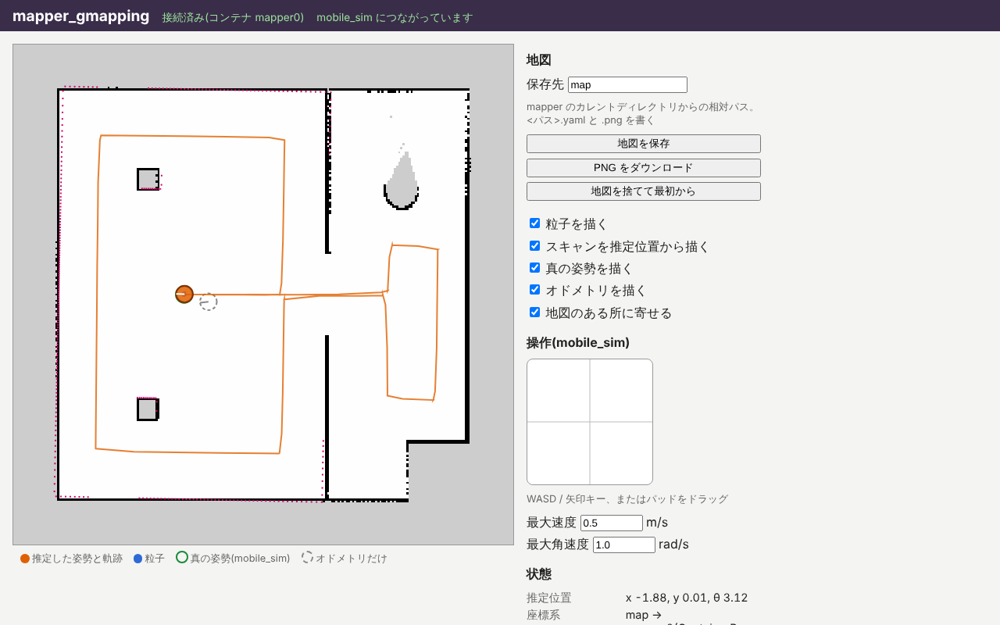

import { Aside } from '@astrojs/starlight/components';

Now that the robot moves, connect the SLAM app mapper_gmapping and build a map.

## Restart

Because you drove the robot on the previous page, the odometry has already drifted from the room's frame `world`.
The SLAM map starts from the odometry at the moment mapper_gmapping starts working, so stop and restart the apps to begin from a clean state.

1. Press Ctrl+C to stop teleop_twist in terminal 2, then mobile_sim in terminal 1.
2. Run `juiz run mobile_sim-<version>.juizapp` in terminal 1 and `juiz run teleop_twist-<version>.juizapp` in terminal 2 again.
3. Reload the mobile_sim and teleop_twist screens in the browser. The robot is back at its initial position.

From here on, do not move the robot until you have started mapper_gmapping.

## Start mapper_gmapping

Start mapper_gmapping in terminal 3.

```sh
juiz run mapper_gmapping-<version>.juizapp
```

mapper_gmapping also declares that it depends on mobile_sim, so like teleop_twist, it finds the running mobile_sim and connects.
Once connected, it subscribes to the mobile_sim topics `scan` (LiDAR scans) and `odom` (odometry).

Open http://localhost:8001/ in a browser. At first it shows a small map of just the robot's surroundings.

<Aside type="caution" title="Do not use the pad on this screen either">
The mapper_gmapping screen also has a pad, "操作(mobile_sim)" (*control mobile_sim*), but keep driving the robot from teleop_twist.
</Aside>

## Drive to grow the map

Drive the robot all around the room from the teleop_twist screen. As it moves, the map on the mapper_gmapping screen grows.



How to read the screen:

| Display | Meaning |
| --- | --- |
| White, black, gray | The map being built. White is free, black is walls and other obstacles, gray is still unknown |
| Orange circle and line | The robot position estimated by SLAM, and the path it took |
| Blue dots | Particles (the candidates "the robot may be here" that GMapping keeps at the same time) |
| Green ring | The true position (read from mobile_sim, for checking the answer) |
| Gray dotted ring | The position from odometry alone |

Tips for a good map:

- **Drive slowly**, especially when turning. Lowering the speed scale (Z / X, LB / RB) makes it easier.
- Follow the walls and cover every corner of the room. Go through the doorway in the middle wall and cover the right room too.
- At the end, **come back near where you started**. When GMapping sees a place it has seen before, it corrects the drift accumulated so far all at once (this is called closing the loop).

After one lap, the orange circle (estimate) should almost overlap the green ring (true position), while the gray dotted ring (odometry only) is off.
SLAM is correcting the odometry drift by matching against the map.

<Aside type="tip" title="To start over">
If walls get blurry or doubled, press "地図を捨てて最初から" (*discard the map and start over*) to throw the map away and build it again.
</Aside>

## Save the map

When the map is done, check the "保存先" (*save to*) field on the screen (the default is `map`) and press "地図を保存" (*save map*).
Two files appear in the directory where you started mapper_gmapping (the working directory `slam_exercise`).

| File | Contents |
| --- | --- |
| `map.png` | The map image. White is free, black is occupied, gray is unknown |
| `map.yaml` | The size of one pixel (`resolution`) and the coordinates of the lower-left corner of the image (`origin`) |

```yaml
image: map.png
resolution: 0.05
origin: [-10.025, -10.025, 0]
occupied_thresh: 0.65
free_thresh: 0.196
negate: 0
```

This is the same format as ROS map_server, and the same format mobile_sim reads its maps in.
If you add a directory to the save path (such as `maps/room`), create that directory first.
You can also save just the image from the browser with "PNG をダウンロード" (*download PNG*).

## What is going on

The container `mapper0` of mapper_gmapping has three ContainerProcesses that subscribe to topics.

| ContainerProcess | Subscribed topic | What it does |
| --- | --- | --- |
| `set_odometry0` | `odom` (`Pose2DStamped`) | Remembers the latest odometry |
| `add_scan0` | `scan` (`LaserScan`) | Updates the particles and the map with the scan and the odometry at that time |
| `set_laser_pose0` | `lidar_mount` (`PoseStamped`) | Receives where the LiDAR is mounted, seen from the robot's center |

In each cycle (20 Hz), mobile_sim advances the robot, then publishes the odometry on `odom` and the scan on `scan`.
Odometry and scans of the same time arrive together, so mapper_gmapping can pile up "from this position it looked like this" to build the map.

## Summary

- mapper_gmapping subscribes to the mobile_sim topics `scan` and `odom` and estimates the map and its own position.
- Drive slowly, and come back to the start to close the loop for a clean map.
- "地図を保存" (*save map*) saves the map in the same format as ROS map_server (YAML + PNG).

Next is [3. Checking the map and the position](/exercises/slam/check/). Keep all three apps running.
