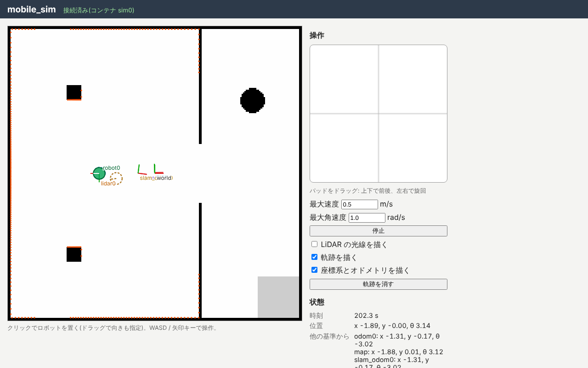
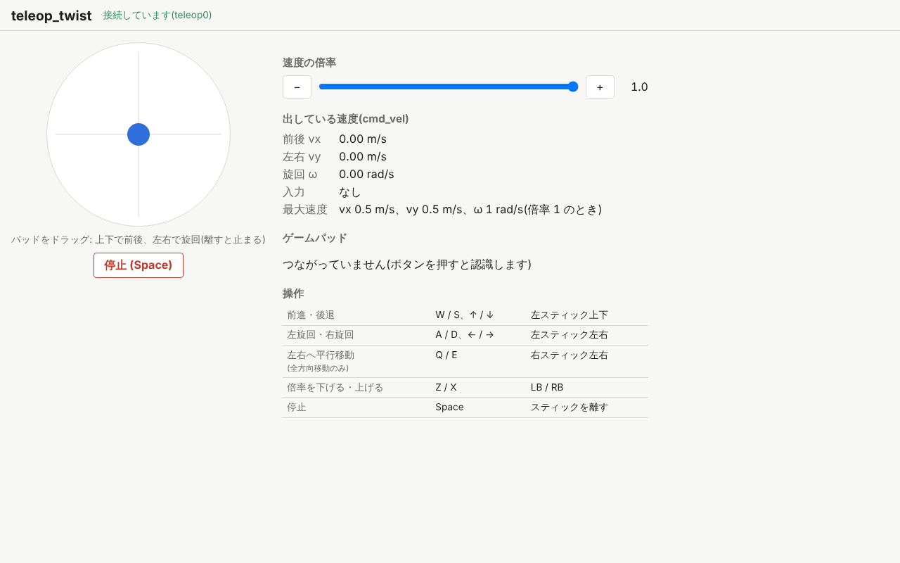

import { Aside } from '@astrojs/starlight/components';

First, start the simulator and drive the robot by hand.

## Start the simulator

Start mobile_sim in terminal 1 (replace `<version>` with the version of the file you downloaded).

```sh
juiz run mobile_sim-<version>.juizapp
```

`juiz run` checks and extracts the package, then starts juiz with the configuration file inside.
Open http://localhost:8000/ in a browser to see the simulator.



- White is the floor; black is walls and pillars. A wall in the middle splits the room in two, with a doorway between them.
- The green circle is the robot `robot0`. It carries a LiDAR `lidar0` that measures the distance to the surrounding walls (check "LiDAR の光線を描く", *draw LiDAR rays*, to see them).
- The brown dotted circle is where the **odometry** (the position computed from wheel rotation) thinks the robot is. It overlaps the true position now, but drifts away as the robot moves.

<Aside type="caution" title="Do not use the pad on this screen">
The mobile_sim screen also has key controls and a control pad, but in this exercise you drive from teleop_twist, introduced next.
Commands from both would conflict, so do not press keys on the mobile_sim screen (watching it is fine).
</Aside>

## Start teleop_twist

Start teleop_twist in terminal 2.

```sh
juiz run teleop_twist-<version>.juizapp
```

teleop_twist declares that it depends on mobile_sim, so `juiz run` looks for the running mobile_sim by the IPC name `mobile_sim`, checks its version, and connects.
If mobile_sim is not running, it stops here with an error.

Open http://localhost:8002/ in a browser.



## Drive with a keyboard or a gamepad

Click the teleop_twist screen to give it focus, then press keys.

| Motion | Keyboard | Gamepad |
| --- | --- | --- |
| Forward / backward | W / S, ↑ / ↓ | Left stick up / down, D-pad up / down |
| Turn left / right | A / D, ← / → | Left stick left / right, D-pad left / right |
| Lower / raise the speed scale | Z / X | LB / RB |
| Stop | Space | Release the stick |

- A gamepad (an Xbox or PlayStation controller, for example) is recognized after you press any button once.
- You can also drag the round pad with a mouse or by touch.
- The robot stops when you release the keys or the stick. It also stops when the teleop_twist screen goes to the background or is closed.

Switch to the mobile_sim screen and check that the robot moves. It is handy to put the teleop_twist and mobile_sim screens side by side.
After driving for a while, you can see the brown dotted circle (odometry) slowly drift away from the green circle (true position).

## What is going on

teleop_twist turns your input into a velocity `juiz_std.geometry.Twist2D` and publishes it on the topic `cmd_vel` at 20 Hz.
The robot's ContainerProcess `robot_set_velocity0` in mobile_sim subscribes to this topic and moves the robot at the received velocity.

They are separate apps, yet connected, because the juiz of teleop_twist connects the juiz of mobile_sim as a **subsystem** over IPC.
In terminal 4, list the containers that teleop_twist (port 8002) can see.

```sh
juiz -s http://localhost:8002 container list
```

```text
["http://localhost:8002/container/teleop0::teleop_twist", "ipc://mobile_sim/container/odom0::static_anchor", "ipc://mobile_sim/container/lidar0::mobile_lidar", "ipc://mobile_sim/container/sim0::mobile_sim", "ipc://mobile_sim/container/world::static_anchor", "ipc://mobile_sim/container/robot0::mobile_robot"]
```

Besides its own container `teleop0`, it sees the containers of mobile_sim, whose IDs start with `ipc://mobile_sim/...`.
As you saw in [chapter 6](/tutorial/multi-process/), the elements of juiz connect by their IDs wherever they run.

## Read the robot's position

mobile_sim keeps the robot's position as a ContainerPose of [Transformations](/guides/transformations/).
In terminal 4, look at the tree of coordinate frames (without `-s`, the command asks mobile_sim on port 8000).

```sh
juiz anchor tree world
```

An example of the output (the values are after driving the robot, and depend on how you drove):

```text
world  position (0, 0, 0)  orientation (0, 0, 0, 1)
└─ robot0  position (-1.89, -0.00, 0)  orientation (0, 0, 1.00, 0.00)
   └─ lidar0  position (-1.89, -0.00, 0.2)  orientation (0, 0, 1.00, 0.00)
```

- `world` is the origin of the room (the simulator's map). The position of `robot0` seen from it is the robot's **true position**.
- `lidar0` is mounted 0.2 m above `robot0`.

You can also read the robot's position seen from the odometry origin `odom0`.

```sh
juiz anchor tree odom0
```

After driving, the values should differ from those seen from `world`. That difference is the odometry drift.
A real robot cannot know its true position; it only has the drifting odometry. So on the next page, you build a map with SLAM and correct the position as you go.

## Summary

- `juiz run` alone starts separately distributed apps and connects them. Start the app they depend on (mobile_sim here) first.
- teleop_twist publishes a velocity `Twist2D` on the topic `cmd_vel`, and mobile_sim subscribes to it to move the robot.
- The robot's true position is a ContainerPose seen from `world`, and its odometry is one seen from `odom0`. The odometry drifts as the robot moves.

Next is [2. Building the map](/exercises/slam/mapping/). Keep mobile_sim and teleop_twist running.
