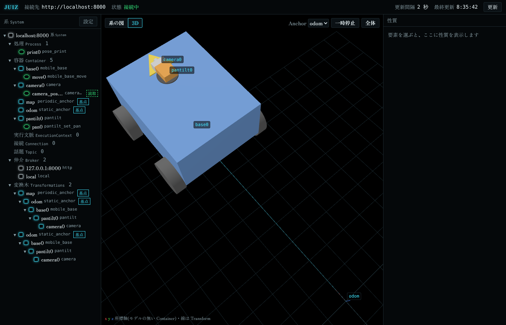
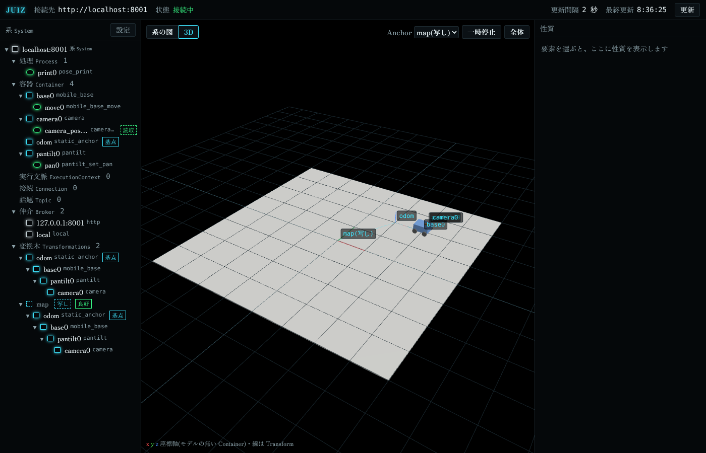

You can attach a **3D model** (ContainerModel) file to a Container. You only add `model:` to the Container in the configuration file; the plugin code does not change.
Together with [Transformations](/guides/transformations/), juiz knows which Container is where and what it looks like, and the "3D" view of the [web UI](/guides/web-ui/) shows the whole system in three dimensions.



:::note[Available from juiz 0.2.9]
Container 3D models were added in juiz 0.2.9. Earlier versions do not have them.
:::

## Concepts

- **juiz does not interpret the model.** It keeps the file as opaque bytes and only checks its format (the leading bytes), its size and its SHA-256. Opening the mesh and drawing it is up to the receiver (the web UI or your own tools).
- **One model per Container.** For a robot with many parts, make one Container per part and connect them with Transforms (parts that move at a joint should already be separate Containers).
- **A model is an attribute of the Container**, not a Process (ContainerProcess). You get it through the same kind of API as `container/profile_full`.
- It is configured in the configuration file, so it works whatever language the Container is written in (Rust, Python, C++ or Haskell).
- Anchors ([Transformations](/guides/transformations/)) are Containers too, so they can carry a floor or map model. CompositeContainers can have one as well.

## Formats

| `format` | Extension | Use | Shown in the web UI's 3D view |
|---|---|---|---|
| `glb` | `.glb` | The primary format. Binary glTF 2.0, with meshes, materials and textures in one file | Yes |
| `gltf` | `.gltf` | JSON glTF 2.0. Only files that embed their data as `data:` URIs are shown | Yes |
| `stl` | `.stl` | Easy to export from CAD (binary or ASCII). Has no colour and no unit | Yes |
| `sdf` | `.sdf` | For writing by hand. A subset of SDFormat that lines up boxes and cylinders ([below](#hand-written-sdf)) | Yes |
| `other` | Anything else | `.obj`, `.dae` and so on. You can store and fetch them | No (name and axes only) |

The format comes from the extension (case-insensitive) and is checked lightly against the leading bytes. For a file without an extension, set `format:` explicitly.

## Units and coordinates

As with Transformations, juiz uses **metres, right-handed, Z up** (x forward, y left, z up; the same as ROS REP 103).

- **glTF (.glb, .gltf) is Y up by specification, so juiz rotates it +90° about the x axis to make it Z up.** You do not need to write anything. For a glTF exported Z up, write `up_axis: z` and it is not rotated. Only "up" is aligned, not "forward" (the model keeps the orientation you saw in a tool such as Blender).
- **STL has no unit.** For an STL exported from CAD in millimetres, write `scale: 0.001`. The default `scale` is 1.0 (metres).
- SDF is metres and Z up by specification, so it fits as is.

The web UI places a model, seen from Anchor A, as:

```text
pose_A(model) = pose_A(Container) ∘ origin ∘ up-axis conversion ∘ scale
```

`pose_A(Container)` is the pose computed by Transformations, and `origin` is the mounting position written in the configuration file below.

## Writing it in the configuration file

Add `model:` to a Container. The path is **relative to the directory of the configuration file** (the same as plugin paths; absolute paths also work).

```yaml
containers:
  - type_name: periodic_anchor
    name: map
    rate: 10.0
    model:
      path: models/floor.glb            # glTF is turned from Y up to Z up automatically
  - type_name: mobile_base
    name: base0
    model:
      path: models/mobile_base.glb
  - type_name: pantilt
    name: pantilt0
    model:
      path: models/pantilt.sdf          # hand-written SDF
      color: "#606060"                  # colour for elements without <material>
  - type_name: camera
    name: camera0
    model:
      path: models/camera.stl
      scale: 0.001                      # mm -> m
      origin:                           # where the model sits in the Container's frame
        translation: {x: -0.015, y: 0.0, z: 0.0}
        rotation: {x: 0.0, y: 0.0, z: 0.0, w: 1.0}
      color: "#e0e0e0"                  # display colour for formats without colour
```

| Key | Default | Meaning |
|---|---|---|
| `path` | (required) | The model file. Relative paths start from the configuration file's directory |
| `format` | From the extension | `glb` / `gltf` / `stl` / `sdf` / `other` |
| `scale` | `1.0` | How many metres one unit of the file is (the same on all three axes). A positive number |
| `origin` | No offset | Where the model is mounted, in the Container's frame. `translation` (m) and `rotation` (quaternion x, y, z, w), written like Transformations' `transforms:`; omitted parts are 0 and no rotation |
| `up_axis` | `y` for glTF, `z` otherwise | The "up" axis inside the file |
| `color` | None | `"#RRGGBB"` or `"#RRGGBBAA"`. Display colour for formats without colour (STL, SDF elements without `<material>`). Not used for glTF |

- When the model's origin does not match the Container's origin (a camera whose origin is at its back, say), adjust it with `origin`.
- Keys not in the table produce a warning and are ignored.
- When the Container is created (at startup), juiz checks that the file exists, its size and its format, and computes its SHA-256. **If the file is missing or the format does not match, creating the Container fails.**

```text
Error:setup_objects() failed in setup in system.rs
    ...
    2: model.path = 'models/nothing.stl'
    3: ContainerModel file is not found: model file 'nothing.stl' can not be opened: No such file or directory (os error 2)
```

- The contents are not kept in memory; they are read from the file on every request. If you rewrite the file while juiz runs, the next request returns the new contents and SHA-256.
- The default size limit is 64 MiB. Change it with `option.model.max_bytes`.
- `model` can be set **only in the configuration file**. Passing `model` to the `container/create` API (including pyjuiz's `SystemProxy`) is an error. This stops remote users from pointing at arbitrary paths and reading files on the machine that runs juiz.
- Robots duplicated with namespaces may point at the same model file.

## Hand-written SDF

Even without a modelling tool, you can build a shape in text by lining up boxes and cylinders. The format is a subset of Gazebo's [SDFormat](http://sdformat.org/).

```xml
<?xml version="1.0"?>
<sdf version="1.9">
  <model name="pantilt">
    <link name="body">
      <!-- The base disc. It has no <material>, so it is painted with the conf's model.color -->
      <visual name="base">
        <pose>0 0 0.0025 0 0 0</pose>          <!-- x y z roll pitch yaw (m, rad) -->
        <geometry><cylinder><radius>0.045</radius><length>0.005</length></cylinder></geometry>
      </visual>
      <!-- The head -->
      <visual name="head">
        <pose>0 0 0.025 0 0 0</pose>
        <geometry><box><size>0.07 0.06 0.03</size></box></geometry>
        <material><diffuse>0.95 0.45 0.10 1</diffuse></material>
      </visual>
    </link>
  </model>
</sdf>
```

- Put **exactly one** `<model>` directly under `<sdf>`. A `<world>` or two or more `<model>`s is an error.
- Only the `<pose>` of `<model>`, `<link>` and `<visual>`, and the `<geometry>` and `<material>` of `<visual>`, are read. `<collision>`, `<inertial>`, `<sensor>`, `<plugin>` and the like are skipped.
- `<pose>` is `x y z roll pitch yaw` (m, rad). With the attribute `degrees="true"` the angles are in degrees.
- The shapes are `<box><size>`, `<cylinder><radius>`/`<length>` (along Z), `<sphere><radius>`, `<capsule><radius>`/`<length>`, `<ellipsoid><radii>` and `<plane><normal>`/`<size>`.
- The colour is the RGBA (0–1) of `<material>`'s `<diffuse>` (or `<ambient>` if there is no `<diffuse>`). If neither is there, the conf's `color` is used.
- Several `<link>`s are each placed **fixed** at their `<pose>` (the whole is drawn as one rigid body). Put moving parts in separate Containers and connect them with Transforms. `<joint>` only gives a warning and is not read.
- You may write `<mesh>`, but this version does not show it (axes are drawn instead).

## Checking a file: juiz model check

Checks a model file without starting a System. Besides the same checks as at startup, it warns about SDF mistakes (wrong number of values, unknown shapes, `<joint>`, `<mesh>`), external file references in glTF, and bounding boxes that are too large or too small.

```sh
juiz model check models/pantilt.sdf
# models/pantilt.sdf: sdf (application/xml), 1406 bytes, sha256 c04dbfd1...
#   up_axis: z, scale: 1.0
#   size: 0.09 x 0.09 x 0.04 m (x, y, z after scale and up_axis)
# OK
juiz model check models/camera.stl --scale 0.001
#   size: 0.045 x 0.06 x 0.03 m (x, y, z after scale and up_axis)
```

Give the configuration file's values with `--format`, `--up-axis` and `--scale`, and `size:` becomes the size (in metres) the model is actually placed at. It helps you notice a millimetre STL without `scale`.
On an error it prints `error: …` and exits with code 1; with only warnings it prints `warning: …` and ends with `OK (n warnings)`.

## Getting the model

### CLI

```sh
juiz -f transformations.conf -d

juiz container list --long
# NAMESPACE  NAME      TYPE             ID
# /          map       periodic_anchor  http://127.0.0.1:8000/container/map::periodic_anchor
#     anchor: periodic (10 Hz)
#     model: glb 4.3 KiB (floor.glb)
# ...

juiz container model camera0 --info     # model info
juiz container model base0 -o .         # write the contents (into a directory, under its file name)
# wrote: ./mobile_base.glb (24760 bytes, glb)
```

Without `--info` or `-o` it prints the model info. The identifier can be a name or an ID. Change the target with `-s` (default `http://localhost:8000`).

The model info (type `juiz_std.model.ContainerModelInfo`) looks like this. It is `null` for a Container without a model.

```json
{
  "color": "#e0e0e0",
  "file_name": "camera.stl",
  "format": "stl",
  "media_type": "model/stl",
  "origin": {
    "rotation": {"w": 1.0, "x": 0.0, "y": 0.0, "z": 0.0},
    "translation": {"x": -0.015, "y": 0.0, "z": 0.0}
  },
  "scale": 0.001,
  "sha256": "2883af162d95f9815e98c91dccf239aabf3181677a7d532f75d2b95e62b4a1b1",
  "size": 7084,
  "up_axis": "z"
}
```

`format` and `up_axis` hold the values actually used, even when the configuration file omits them. `file_name` is the file name only; the directory is not shown.

### HTTP API

| Path (GET) | Returns |
|---|---|
| `/api/container/profile_full?identifier=` | The usual profile, plus `model` (the model info or `null`) |
| `/api/container/model_info?identifier=` | The model info, or `null` without a model |
| `/api/container/model?identifier=` | The raw bytes of the file |

`container/model` returns the format's type in `Content-Type` (`model/gltf-binary`, `model/gltf+json`, `model/stl`, `application/xml` or `application/octet-stream`) and the SHA-256 in `ETag`. Ask again with the same ETag in `If-None-Match` and you get `304 Not Modified` without the file being read.

```sh
curl -sI "http://localhost:8000/api/container/model?identifier=map"
# HTTP/1.1 200 OK
# content-type: model/gltf-binary
# content-length: 4392
# etag: "819e3c9ca72684c10412bf096efc03d5bafe4bc99d815fe1f44d1350d438bc82"
# cache-control: no-cache
# content-disposition: inline; filename="floor.glb"
```

Over brokers other than HTTP (QUIC, Zenoh, IPC and so on), `container/model` returns JSON: `{"info": <model info>, "data": "<base64>"}`. Base64 makes it 4/3 the size and slower to build, so get large models over HTTP, or check `sha256` in `model_info` first and skip the download when you already have the same file.

The identifier can be a name or an ID. Containers in subsystems (other Systems) can also be fetched through the parent System's API. When a name refers to a replica from [Transforms across Systems](/guides/transformations/#transforms-across-systems) (such as `map` in the robot's System), the request is forwarded to the System the replica comes from.

### pyjuiz

```python
import hashlib
from juiz.proxy import SystemProxy, HttpProxy

system = SystemProxy(HttpProxy('localhost', 8000))
info = system.model_info('camera0')     # dict, or None without a model
data = system.model('camera0')          # bytes
assert hashlib.sha256(data).hexdigest() == info['sha256']

for c in system.containers():           # also from a ContainerProxy
    if c.model_info() is not None:
        open(c.model_info()['file_name'], 'wb').write(c.model())
```

`HttpProxy` returns the raw HTTP bytes, and `IpcProxy` returns the bytes decoded from base64. `model()` on a Container without a model raises an exception (`NotFoundError` over HTTP).

## The 3D view in the web UI

In the [web UI](/guides/web-ui/) (`http://localhost:8000/ui/`), press "3D" at the top of the centre pane to switch to the 3D view ("系の図" switches back; the browser remembers your choice).

- Choose an **Anchor** at the top right, and the Containers in that Anchor's tree are placed at their poses seen from the Anchor. Poses are refreshed at 5 Hz, so the view follows when the base drives or the pan-tilt turns. "一時停止" pauses it and "全体" fits everything in the view.
- Containers with a model show the model; Containers without one (and `other` or unreadable models) show small axes (x red, y green, z blue). Transforms are lines between parent and child.
- Press a name tag or a model to show that Container in the property pane on the right. Its "3D モデル" section lists the file name, format, size, scale, up axis, mounting position, colour and the start of the SHA-256.
- Formats and SDF elements that are not shown, load failures, and models whose bounding box exceeds 100 m (a likely missing `scale`) are flagged at the top right.
- Each model is loaded once per SHA-256. However many Containers share a shape, it is fetched once.
- three.js is loaded only when you open the 3D view, so the UI stays light if you only use the system diagram.

With [Transforms across Systems](/guides/transformations/#transforms-across-systems), choosing the Anchor `map(写し)` (the replica) in the robot System's web UI also shows the floor model held by the map System.



## In a .juizapp

Put the model files in the package directory and [`juiz pack`](/guides/app-package/) includes them as they are. While packing, it checks that each `model.path` in the entry configuration file **points inside the package** (no `..` out of it, no absolute path) and that the file is packed, and runs the same checks as at startup. `juiz run` reads the configuration file from where the package was unpacked, so relative paths resolve as they are.

## Errors

| Error | When |
|---|---|
| `ContainerModelInvalidError` | Wrong type or value of a `model` key, over the size limit, the format check fails, or `model` given to the `container/create` API |
| `ContainerModelFileNotFoundError` | The `path` file is missing or cannot be opened (at startup or when fetched) |
| `ContainerHasNoModelError` | `container/model` on a Container without a model |

Over HTTP, `ContainerModelFileNotFoundError` and `ContainerHasNoModelError` are 404, and `ContainerModelInvalidError` is 400 (on creation) or 500 (when fetched). If the file disappears while juiz runs, that request fails but the Container stays, and once the file is back, fetching works again.

## Limitations

- Several models per Container (one for display, one for collision, and so on).
- Showing models made of several files (a .gltf that references external files, SDF `<mesh>`).
- Replacing a model at run time, or setting a model through the API.
- A default model per type (Factory).
- Importing URDF or SDF with joints (turning links into Containers and joints into Transforms).

## Samples

In every language's sample repository, the Transformations samples (`transformations.conf`, and `transformations_map.conf` / `transformations_robot.conf` for the cross-System version) have models. The model files are the same in all four languages.

| Container | File | Format | What it shows |
|---|---|---|---|
| `map` (floor) | `models/floor.glb` | glTF | No `up_axis` (juiz turns it Z up) |
| `base0` (base) | `models/mobile_base.glb` | glTF | A yellow triangle marks the front (+x) |
| `pantilt0` (pan-tilt) | `models/pantilt.sdf` | Hand-written SDF | Cylinders and boxes placed with `<pose>`; the base without `<material>` is painted with `color` |
| `camera0` (camera) | `models/camera.stl` | STL | Made in mm, so `scale: 0.001`. Its origin is at the back, so `origin` shifts it 15 mm back |

| Language | Repository |
|---|---|
| Rust | [juiz_examples_rust](https://github.com/OpenJUIZ/juiz_examples_rust) |
| Python | [juiz_examples_python](https://github.com/OpenJUIZ/juiz_examples_python) |
| C++ | [juiz_examples_cpp](https://github.com/OpenJUIZ/juiz_examples_cpp) |
| Haskell | [juiz_examples_haskell](https://github.com/OpenJUIZ/juiz_examples_haskell) |

The .glb and .stl files were built from boxes and cylinders by `scripts/make_models.py` in each repository (it needs only the Python standard library).

## Specification

[docs/spec/container-model.md](https://github.com/OpenJUIZ/juiz/blob/main/docs/spec/container-model.md) (in Japanese)
