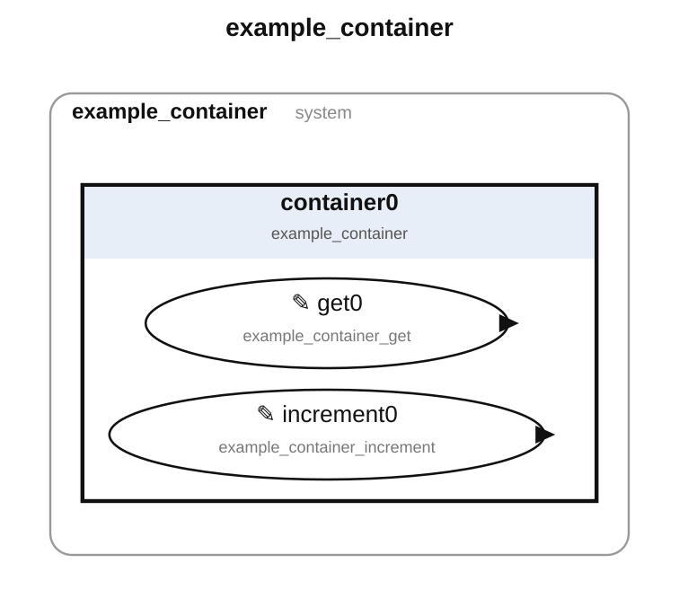
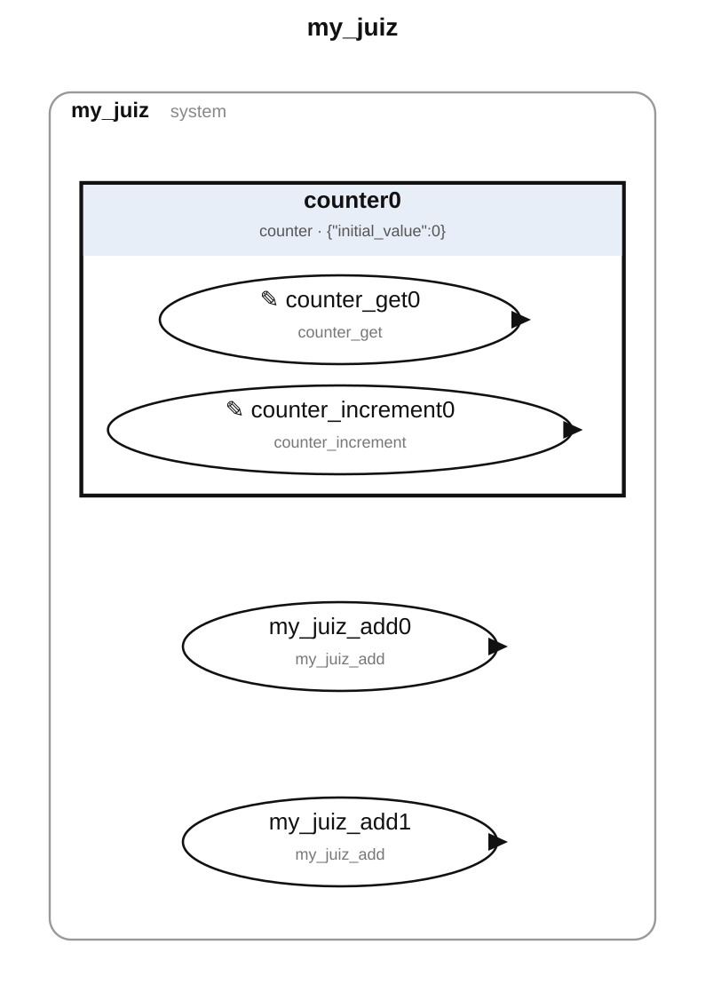
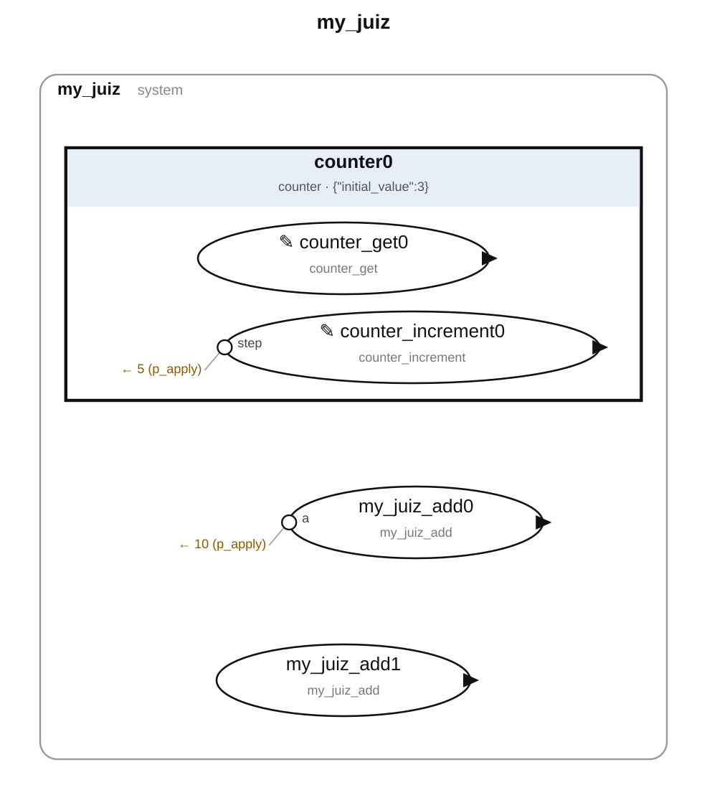
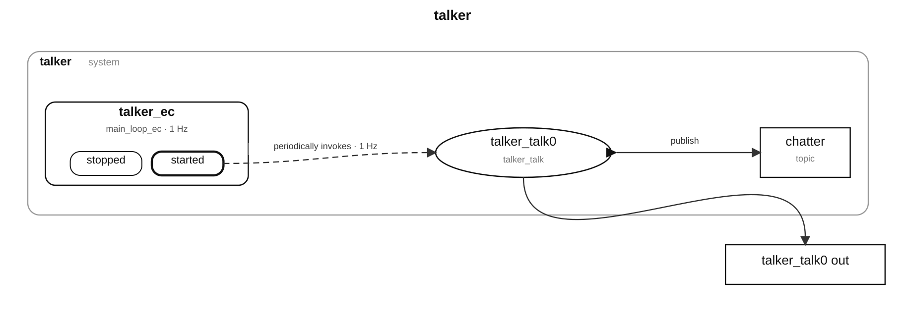
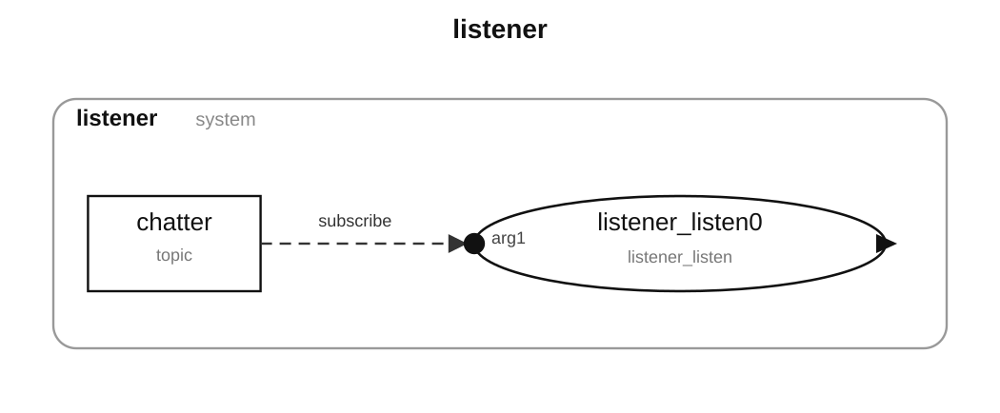
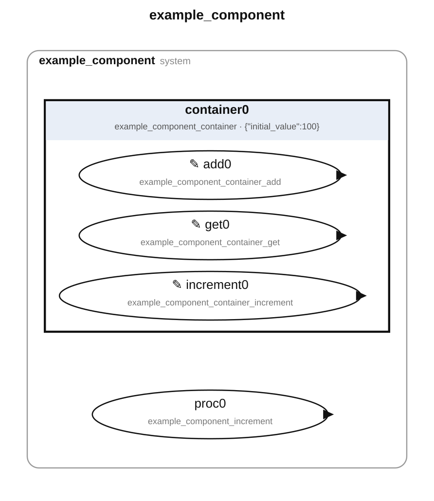
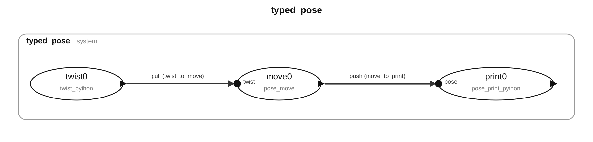

import { Tabs, TabItem } from '@astrojs/starlight/components';

[juiz_opm](https://github.com/OpenJUIZ/juiz_opm) is a command that writes a juiz system out as an **OPM** (Object-Process Methodology, ISO 19450) model.
From a config file (conf) or a running System it makes a model you can read as English sentences (juiz-OPL), checks it against the rules, and draws it.

Diagrams use one notation, the **abbreviated diagram**. A Process is an ellipse, a Container a box, an EC a box with states, a System a frame, and arguments are small circles on the edge of the ellipse.
The diagrams in the chapters of the [tutorial](/tutorial/) on this site were drawn with this command from each chapter's config file.


:::note[A separate command from juiz]
juiz_opm is not part of the `juiz` command, and juiz does not need it to run.
:::

## Install

[Releases](https://github.com/OpenJUIZ/juiz_opm/releases) has prebuilt archives for each OS. Unpack one and put `juiz_opm` (`juiz_opm.exe` on Windows) in a directory on your PATH.

<Tabs syncKey="os">
<TabItem label="Linux">

```sh
curl -LO https://github.com/OpenJUIZ/juiz_opm/releases/download/v0.1.0/juiz_opm-v0.1.0-x86_64-unknown-linux-gnu.tar.gz
tar xzf juiz_opm-v0.1.0-x86_64-unknown-linux-gnu.tar.gz
cp juiz_opm-v0.1.0-x86_64-unknown-linux-gnu/juiz_opm ~/.local/bin/
```

</TabItem>
<TabItem label="macOS">

Use the `aarch64-apple-darwin` archive on Apple silicon and `x86_64-apple-darwin` on Intel Macs.

```sh
curl -LO https://github.com/OpenJUIZ/juiz_opm/releases/download/v0.1.0/juiz_opm-v0.1.0-aarch64-apple-darwin.tar.gz
tar xzf juiz_opm-v0.1.0-aarch64-apple-darwin.tar.gz
cp juiz_opm-v0.1.0-aarch64-apple-darwin/juiz_opm /usr/local/bin/
```

</TabItem>
<TabItem label="Windows">

Download and unpack [juiz_opm-v0.1.0-x86_64-pc-windows-msvc.zip](https://github.com/OpenJUIZ/juiz_opm/releases/download/v0.1.0/juiz_opm-v0.1.0-x86_64-pc-windows-msvc.zip), and put `juiz_opm.exe` in a folder on your PATH.

</TabItem>
</Tabs>

With a Rust toolchain you can also install from source.

```sh
cargo install --git https://github.com/OpenJUIZ/juiz_opm juiz_opm
```

Drawing needs two more tools. Making, checking and converting models back to conf do not.

| Tool | Used for | Install, for example |
| --- | --- | --- |
| `dot` from [Graphviz](https://graphviz.org/) | laying out diagrams (SVG, PNG, DOT) | `sudo apt install graphviz`, `brew install graphviz` |
| `rsvg-convert` from librsvg | writing PNG | `sudo apt install librsvg2-bin`, `brew install librsvg` |

Check that it is installed.

```sh
juiz_opm --version
juiz_opm --help
```

## Draw a config file

Take `talker_listener.conf` of the samples repository, used from [chapter 6](/tutorial/component/) on, as the example. Run these in the root of the samples repository.

```sh
juiz_opm from-conf talker_listener.conf -o talker_listener.opl   # make the model
juiz_opm draw talker_listener.opl > talker_listener.svg          # abbreviated diagram (SVG)
juiz_opm draw -T png -o out/ talker_listener.opl                 # abbreviated diagram (PNG, into out/)
```

`from-conf` turns the conf into **juiz-OPL**: English sentences, one fact per sentence.

```text title="talker_listener.opl (part)"
"talker0" is a process [role: process, name: talker0, type: talker].
"talker0" yields "talker0 out".
"talker0" invokes "listener0".

"listener0" is a process [role: process, name: listener0, type: listener].
"listener0" requires "talker0 out" [arg: arg1, arg_index: 0, connection: push, connection_name: con0].
```

Items such as `option` and `plugins` describe how to start juiz, not the shape of the system, so they are not carried into the model. You get a warning for them, which you can ignore.
With `--xml`, the model is written as the exchange XML instead of juiz-OPL.

### What the diagram shows and what it does not

Anything the conf does not say is not in the diagram either.

- **Unconnected arguments** are not drawn, because the conf never names them. Only arguments given a value with `p_apply` and arguments that a connection goes to are drawn.
- **Whether a ContainerProcess only reads** is not in the conf, so it is drawn as writing (✎).

A model made from a running System also has the names, order and data types of the arguments that juiz knows (next section).

## Draw a running System

From a juiz running with the HTTP broker (`-d`), you can take the shape of the System at that moment.

```sh
juiz -f talker_listener.conf -d &                                   # run the System
juiz_opm fetch http://127.0.0.1:8000 -o talker_listener.json         # take a snapshot
juiz_opm from-system talker_listener.json -o talker_listener.opl     # model from the snapshot
juiz_opm from-conf --system talker_listener.json talker_listener.conf -o talker_listener.opl  # combine with the conf
```

## Check

```sh
juiz_opm check talker_listener.conf talker_listener.opl
```

This checks the OPM rules (C1 to C12) and the juiz rules (J1 to J13). The exit status is 0 when there is no problem (also when there are only warnings), 1 when there are errors, and 2 for a usage error or a failure to read or write.

## Reading the abbreviated diagram

| Symbol | Meaning |
| --- | --- |
| Grey rounded frame, name and `system` at top left | System (the `name` in the config file) |
| Ellipse with the name inside and the type name in grey below | Process |
| Small circle with an argument name on the left edge of the ellipse | Argument. Black when a connection comes in, white otherwise |
| Brown `← value (p_apply)` | Value given to the argument with `p_apply` |
| Black triangle at the right end of the ellipse | Return value |
| Thick line (label `push (connection name)`) | Push connection. When the source runs, its output goes to the destination, which runs too |
| Thin line (label `pull (connection name)`) | Pull connection. When the destination runs, it runs the source and takes the value |
| Thick box with name, type name and creation values in the top band | Container |
| Ellipse inside the box with ✎ or 👁 before the name | ContainerProcess. ✎ changes the Container, 👁 only reads it |
| Rounded box with `stopped` and `started` inside | EC. The state with the thick border is the state right after start (`auto_start`) |
| Dashed line from `started` (label `periodically invokes · rate`) | While started, the EC runs the bound Process periodically |
| Thick blue line with a hollow triangle in the middle | Transform (the pose between Containers; the triangle points from parent to child) |

The model stays full OPM; the abbreviated diagram draws it by fixed rules that merge groups of elements into one symbol. The details are in juiz_opm's [abbreviated diagram spec](https://github.com/OpenJUIZ/juiz_opm/blob/main/spec/diagram.md) (in Japanese).

## The systems in the tutorial

These are drawn from the config files (the Rust ones) used in each chapter of the tutorial, as they are. Chapters 2 and 3 give the same diagrams in every language; for chapters 4 and 5, only the type names (the grey text) differ in other languages.

### Chapter 2: app/app.conf with the Container added

The ContainerProcesses `counter_increment0` and `counter_get0` are bound to one Container, `counter0`. Outside it is the Process `my_juiz_add0` from chapter 1. → [2. Keeping state](/tutorial/container/)



### Chapter 3: app/app.conf with more instances

Two Processes of the same type, `my_juiz_add0` and `my_juiz_add1`, and the Container `counter0`. → [3. Starting everything from a configuration file](/tutorial/config-file/)



The same system after `initial_value` and `p_apply` are added later in the chapter.



### Chapter 4: app/app.conf of talker and listener (Topic)

In the talker's juiz, the EC `talker_ec` runs `talker_talk0` every second and publishes its output to the Topic `chatter`. In the listener's juiz, `listener_listen0` subscribes to `chatter` with its argument `arg1`. The `mastersystem` that joins the two juiz instances does not appear in the diagrams. → [4. Connecting Processes in separate processes](/tutorial/multi-process/)





### Chapter 5: talker_listener.conf

The EC `ec0` runs `talker_talk0` every second, and the output of `talker_talk0` goes to the argument `arg1` of `listener_listen0` over the push connection `con0`. → [5. Connecting several libraries in one juiz](/tutorial/connect/)


### Chapter 6: example_component.conf

The Process `proc0` and the Container `container0` with initial value 100, made from a Component. → [6. Packaging as a Component](/tutorial/component/)



### Chapter 8: typed_pose.conf

The output of `twist0` goes to the argument `twist` of `move0` over a pull connection, and the output of `move0` to the argument `pose` of `print0` over a push connection. → [8. Data types](/tutorial/datatype/)



## Other uses

```sh
juiz_opm opx talker_listener.opl -o talker_listener.opz   # a file you can open in OPCAT or OPCloud
juiz_opm to-conf talker_listener.opl -o out.conf           # back from the model to a conf
juiz_opm round-trip talker_listener.conf                   # check conf -> model -> conf gives the same conf
```

`juiz_opm --help` lists all commands; juiz_opm's [usage guide](https://github.com/OpenJUIZ/juiz_opm/blob/main/docs/usage.md) (in Japanese) has the details.
