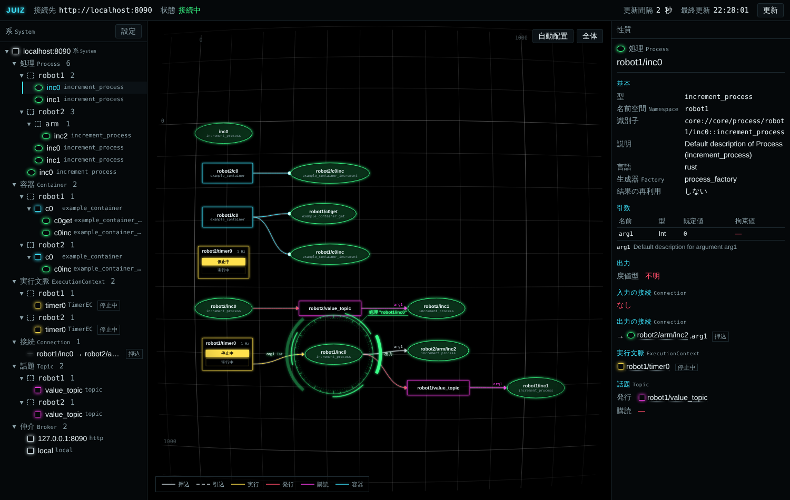

Namespaces let you place Processes, Containers, Execution Contexts and Topics that share an instance name side by side in one System.
There are two main uses.

- **Duplicating a setup**: to run two robots on one PC, load the same configuration file into `robot1` and `robot2` (much like namespaces in ROS).
- **Organizing**: split functional groups into namespaces and see them as groups in the CLI and the web UI.

:::caution[Requires juiz 0.0.21 or later]
Namespaces are available from juiz 0.0.21. If you do not use them, IDs, Topic names and configuration files stay exactly as before.
:::

## The shape of an ID

A namespace goes in front of the instance name in the ID, separated by `/`.

```text
core://core/process/inc0::increment                      # root (no namespace)
core://core/process/robot1/inc0::increment               # inc0 in robot1
http://127.0.0.1:8000/process/robot1/arm/inc0::increment # inc0 in robot1/arm
```

- A namespace is a `/`-separated hierarchy (`robot1/arm`). An empty namespace is the root, and the ID is exactly the same string as before.
- The part after the last `/` is the instance name; the part before it is the namespace.
- A ContainerProcess is placed in the same namespace as its Container.
- Instance names and namespace elements cannot contain `/`, `:` or `|`. Using them is an error at startup.
- Registering two objects with the same ID is an error.

## `namespace` in the configuration file

Write `namespace` on each element. The top-level `namespace` is the default namespace for the whole System (the root if omitted).

```yaml
namespace: robot1          # default namespace
processes:
  - type_name: increment_process
    name: inc0             # => robot1/inc0
  - type_name: increment_process
    name: inc1
    namespace: arm         # relative => robot1/arm/inc1
  - type_name: increment_process
    name: inc0
    namespace: /tools      # a leading / makes it absolute => tools/inc0
```

| Value | Meaning |
|---|---|
| omitted | the default namespace |
| `arm` (relative) | under the default namespace (`robot1/arm`) |
| `/tools` (absolute) | from the root (`tools`) |
| `/` | the root |

References by name in `source` / `destination` of `connections` and in `bind` of `ecs` are resolved in the namespace of that Connection or Execution Context.
To refer to something in another namespace, write `namespace` inside the reference as well.

```yaml
ecs:
  - name: ec0
    type_name: main_loop_ec
    rate: 1.0
    bind:
      - name: talker0
        namespace: robot1
        type_name: talker
      - name: talker0
        namespace: robot2
        type_name: talker
```

References that give the ID directly as a string (the `identifier` key) are used as they are.

## Topics

Topic names are resolved by the same rules.

- `chatter` is under the namespace of the Process (`robot1/chatter`).
- `/chatter` is at the root.

`chatter` in `robot1` and `chatter` in `robot2` are different Topics, so placing the same setup in two namespaces does not mix them up.
To exchange data across namespaces, use an absolute name such as `/chatter`.
If the default namespace is the root, Topic names are the same as before.

```yaml
processes:
  - type_name: talker
    name: talker0
    namespace: robot1
    publishes: [chatter]      # => robot1/chatter
  - type_name: listener
    name: listener0
    namespace: robot1
    subscribes:
      arg1: chatter           # => robot1/chatter
```

Publishing and subscribing across subsystems also uses the resolved name (`robot1/chatter`).

## CLI

### Starting the same configuration file in another namespace

`--namespace` replaces the default namespace of the configuration file at startup (it replaces rather than appends; `/` means the root).

```sh
juiz -f increment_process.conf --namespace robot1 -d
```

In another terminal, start the same configuration file as `robot2`. The second one becomes a subsystem of the first (on port 8001), and the two are handled as one System.

```sh
juiz -f increment_process.conf --namespace robot2 -d
```

### Listing and calling

`--namespace` on `list` narrows the result to that namespace and everything under it. `--long` prints a table with namespace, name and type columns.
It works with `list` of `process`, `container`, `container-process` and `ec`.

```sh
juiz process list --namespace robot2
# => ["http://127.0.0.1:8001/process/robot2/increment0::increment_process"]

juiz process list --long
# NAMESPACE  NAME        TYPE               ID
# /robot1    increment0  increment_process  http://127.0.0.1:8000/process/robot1/increment0::increment_process
# /robot2    increment0  increment_process  http://127.0.0.1:8001/process/robot2/increment0::increment_process
```

To call, pass the ID with its namespace.

```sh
juiz process call "http://127.0.0.1:8000/process/robot1/increment0::increment_process" '{"arg1": 1}' -p
# => CapsulePtr((value:Value(2), option: []))
```

In the HTTP API, adding `?namespace=robot1` to a list request filters it the same way.

## Python (pyjuiz)

```python
from juiz.proxy import SystemProxy, HttpProxy, ProcessProxy

system = SystemProxy(HttpProxy('localhost', 8000))
system.processes(namespace='robot1')   # Processes in robot1 and below

p = ProcessProxy('inc0', 'localhost', 8000, namespace='robot1')
# or ProcessProxy('robot1/inc0', 'localhost', 8000)
p.namespace()   # => 'robot1'
p.full_name()   # => 'robot1/inc0'
```

Without a namespace, an object at the root wins. If there is none at the root and the same name exists in several namespaces, `AmbiguousNameError` is raised.

## Web UI

In the [web UI](/guides/web-ui/), namespaces appear as folders under each category of the tree (Processes, Containers, ECs, Topics). The properties panel shows the namespace ("ルート" (root) for the root), and the system diagram shows names with their namespace.



## Not the same as the IPC broker's `namespace`

The IPC broker settings also have a key called `namespace`, but it is the name of the socket file (`/tmp/<namespace>`) and has nothing to do with the ID namespaces described here.

## Example

`namespace.conf` in [juiz_examples_rust](https://github.com/OpenJUIZ/juiz_examples_rust) places `talker0` and `listener0` in `robot1` and `robot2` and connects them with the Topic `chatter`.
