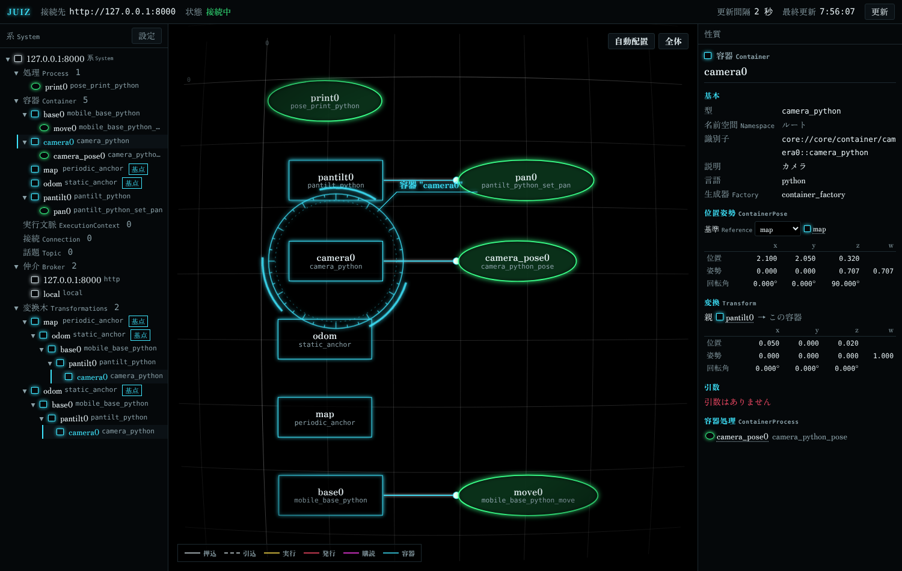

import { Tabs, TabItem } from '@astrojs/starlight/components';

Transformations lets juiz compute **the pose of each robot part and the spatial relations between parts** while the parts (mobile base, arm joints, pan-tilt unit, camera, sensors) stay ordinary Containers.
Write the links between parts (**Transforms**) and the origins (**Anchors**) in the configuration file, and ContainerProcesses in any language can read and write "the camera seen from the map" or "the pan-tilt orientation seen from the base".

```text
map (Anchor) → odom (Anchor) → base0 (mobile base) → pantilt0 (pan-tilt) → camera0 (camera)
```

:::note[Available from juiz 0.2.0]
Transformations was added in juiz 0.2.0. Earlier versions do not have it.
:::

## Terms

| Term | Label in the web UI | Meaning |
|---|---|---|
| **ContainerPose** | 位置姿勢 | The position of a Container itself: a position (x, y, z) [m] and a quaternion (x, y, z, w) orientation. It is **always read and written together with a reference Container** ("seen from which Container"). Every Container has one |
| **Transform** | 変換 | A **directed** link between two Containers. It holds the pose of the destination (child) seen from the source (parent) as a translation and a rotation |
| **Anchor** | 基点 | A special built-in Container that acts as an origin of coordinates. It has no user state. A System can have any number of them |
| PeriodicExecutionAnchor | 基点 (周期更新) | An Anchor that walks its tree every `rate` [Hz] and recomputes the ContainerPose of the Containers in it. Type name `periodic_anchor` |
| StaticAnchor | 基点 (静的) | An Anchor that recomputes only when it is created, when the shape or values of its tree change, and when asked. Type name `static_anchor` |
| **Transformations Tree** | 変換木 | The tree of Containers reached from an Anchor by following Transforms from parent to child |
| Pose notification | | Calling a registered Process when the ContainerPose of a Container is written |

Difference from ROS tf: tf frames have names separate from the parts, but in juiz **the Container itself is the coordinate frame**. The Container's name is the frame's name; there are no separate frame names.

## Concepts

### Direction and quaternions

As in ROS, Transform(P → C) maps coordinates of the child C into coordinates of the parent P. The translation t is the position of C's origin seen from P and the rotation q is C's orientation seen from P, so **the value of Transform(P → C) is the same numbers as "the ContainerPose of C with P as the reference"**.

- Quaternions are ordered **(x, y, z, w)** (w last). This is the same in configuration files, JSON, C structs and function arguments, and matches ROS and `juiz_std.geometry.Quaternion`.
- No rotation is (0, 0, 0, 1). A rotation of θ around the z axis is (0, 0, sin(θ/2), cos(θ/2)).
- Values are normalized when stored. A zero-length quaternion or a value containing NaN is an error (`InvalidPoseValueError`).

### How poses are computed

Inside the tree of Anchor A, Transforms are composed from the parent down. Even if the reference R is not an Anchor, the relative pose can be computed as long as some Anchor contains both R and C.

```text
pose_A(A) = identity                               (an Anchor is the origin seen from itself)
pose_A(C) = pose_A(parent) ∘ Transform(parent → C)
pose_R(C) = pose_A(R)⁻¹ ∘ pose_A(C)                (when R and C are in the tree of the same Anchor A)
```

Read `pose_R(C)` as "the ContainerPose of C with R as the reference". Values use the `juiz_std.geometry` types ([Data types](/guides/datatype/)).

| Value | Type |
|---|---|
| ContainerPose | `juiz_std.geometry.Pose` `{"position": {x, y, z}, "orientation": {x, y, z, w}}` |
| ContainerPose with time and reference (returned by reads and writes) | `juiz_std.geometry.PoseStamped`. `header.frame_id` is the name of the reference Container, `header.stamp` the time it was computed or written |
| Value of a Transform | `juiz_std.geometry.Transform` `{"translation": {x, y, z}, "rotation": {x, y, z, w}}` |

`Transform` and `TransformStamped` have the same names and shapes as ROS 2 `geometry_msgs`.

## Writing it in the configuration file

This is `transformations.conf` from the sample repositories of all four languages (the Rust version; the others differ only in `plugins:` and type names, see [Samples](#samples)).

```yaml
name: transformations
option:
  http_broker:
    start: true
    port: 8000
plugins:
  components:
    mobile_robot:
      language: rust
      path: "./target/debug"
processes:
  - type_name: pose_print
    name: print0
containers:
  - type_name: periodic_anchor   # built-in Anchor, no plugin needed
    name: map
    rate: 10.0
  - type_name: static_anchor
    name: odom
  - type_name: mobile_base
    name: base0
    processes:
      - type_name: mobile_base_move
        name: move0
  - type_name: pantilt
    name: pantilt0
    processes:
      - type_name: pantilt_set_pan
        name: pan0
  - type_name: camera
    name: camera0
    processes:
      - type_name: camera_pose
        name: camera_pose0
# parent → child Transforms. Omitted translation / rotation mean 0 and no rotation
transforms:
  # map → odom offset, corrected by localization
  - source: map
    destination: odom
    translation: {x: 1.0, y: 2.0, z: 0.0}
  # rewritten by move0 with set_pose
  - source: odom
    destination: base0
  # mounting position of the pan-tilt unit. pan0 rewrites its orientation with set_pose
  - source: base0
    destination: pantilt0
    translation: {x: 0.1, y: 0.0, z: 0.3}
  # the camera is fixed to the pan-tilt unit (Transform only)
  - source: pantilt0
    destination: camera0
    translation: {x: 0.05, y: 0.0, z: 0.02}
# Pose notification: when the pose of base0 is written, call print0 with the pose seen from odom as argument pose
pose_listeners:
  - container: base0
    process: print0
    arg: pose
    reference: odom
```

This builds the following tree. `odom` is the root of its own tree and also a node in the middle of the `map` tree (the same shape as map / odom in ROS).

```text
map (PeriodicExecutionAnchor, 10 Hz)  … walks the tree at 10 Hz and recomputes poses
└─ odom (StaticAnchor)                … recomputes only when something is written. Offset (1, 2, 0) from map
   └─ base0 (mobile base)             … move0 writes the odometry with set_pose
      └─ pantilt0 (pan-tilt)          … mounted at (0.1, 0, 0.3) on the base. pan0 writes the pan angle
         └─ camera0 (camera)          … mounted at (0.05, 0, 0.02) on the pan-tilt unit. Transform only
```

### Anchors

Write Anchors in `containers:` like ordinary Containers. IDs, [namespaces](/guides/namespace/), listing and deleting work the same as for Containers.

| Key | Meaning |
|---|---|
| `type_name` | `periodic_anchor` or `static_anchor` |
| `name` | Name of the Anchor, used as a reference name |
| `rate` | Update rate [Hz] of a `periodic_anchor`. Defaults to 10.0 |

In this release an Anchor cannot have ContainerProcesses (writing `processes:` is an error).

### `transforms:`

| Key | Required | Meaning |
|---|---|---|
| `source` | yes | Name or ID of the source (parent) Container |
| `destination` | yes | Name or ID of the destination (child) Container |
| `translation` | no | Position of the child's origin seen from the parent `{x, y, z}` [m]. Defaults to 0 |
| `rotation` | no | Orientation of the child seen from the parent `{x, y, z, w}`. Defaults to no rotation |
| `writers` | no | Names or IDs of Containers that may write this Transform with `set_transform` from their ContainerProcesses, besides the endpoints (since juiz 0.2.4, see [Reading another Container and writing a Transform](#reading-another-container-and-writing-a-transform)) |

The ID of a Transform is `transform://<source ID>|<destination ID>`. Names are resolved with the same [namespace](/guides/namespace/) rules as the rest of the configuration (`robot1/base0` and so on).

### Tree rules

**What every Anchor reaches must form a tree.** The following Transforms are errors (`TransformTreeError`): in a configuration file they are load errors, and through the API the whole change is rejected.

- A Container reached from the same Anchor by two paths (two parents).
- A loop back to the Anchor.
- Two Transforms with the same source and destination (`TransformAlreadyExistsError`; use update to change the value).

A Container may be in the trees of **different** Anchors (`map → base0` and `world → base0` are fine as long as `map` and `world` do not reach each other). A Transform that no Anchor reaches is not an error either.

## Reading and writing from a ContainerProcess

Inside a ContainerProcess you read and write the ContainerPose of **your own Container**, naming the reference. The mobile base in the sample integrates its odometry and writes its pose seen from `odom`.

<Tabs syncKey="lang">
<TabItem label="Rust">

Read with `pose(reference)` and write with `set_pose(reference, pose)` on `ContainerImpl`. Both return `juiz_sdk::geometry::PoseStamped`.

```rust
use juiz_sdk::geometry::{Pose, Quaternion, Vector3};
use juiz_sdk::prelude::*;

#[juiz_component_container_process(container_type = "mobile_base" arguments = {
    default = { vx = 0.0 omega = 0.0 dt = 1.0 reference = "odom" }
})]
fn mobile_base_move(
    c: &mut ContainerImpl<MobileBase>,
    vx: f64,
    omega: f64,
    dt: f64,
    reference: String,
) -> JuizResult<Capsule> {
    c.x += vx * c.theta.cos() * dt;
    c.y += vx * c.theta.sin() * dt;
    c.theta += omega * dt;
    let pose = Pose::new(Vector3::new(c.x, c.y, 0.0), Quaternion::from_rpy(0.0, 0.0, c.theta));
    // rewrites the odom → base0 Transform and sends a Pose notification
    Ok(c.set_pose(&reference, pose)?.into())
}

#[juiz_component_container_process(container_type = "camera" arguments = {
    default = { reference = "map" }
})]
fn camera_pose(c: &mut ContainerImpl<Camera>, reference: String) -> JuizResult<Capsule> {
    Ok(c.pose(&reference)?.into())
}
```

The geometry types (`Vector3`, `Quaternion`, `Pose`, `Transform`, `PoseStamped`) live in `juiz_sdk::geometry` and provide composition (`*`), `inverse`, `Quaternion::from_rpy` / `to_rpy` and more. They convert to and from `Value` and `Capsule` with `From` / `TryFrom`.
The code is the same whether the plugin is loaded through the default C ABI or with `abi: rust`.

</TabItem>
<TabItem label="Python">

Read with `juiz.pose(obj, reference)` and write with `juiz.set_pose(obj, reference, pose)`. `obj` is the first argument of the ContainerProcess (the Container object). Both return `juiz_std.geometry.PoseStamped`.

```python
import math

from juiz import juiz_container_process, pose, set_pose
from juiz_std.geometry import Point3D, Pose, PoseStamped, Quaternion


def yaw_quaternion(yaw: float) -> Quaternion:
    """Quaternion (x, y, z, w) rotating yaw [rad] around the z axis"""
    return Quaternion(x=0.0, y=0.0, z=math.sin(yaw / 2), w=math.cos(yaw / 2))


@juiz_container_process(container_type="mobile_base_python")
def mobile_base_python_move(base, vx: float = 0.0, omega: float = 0.0, dt: float = 1.0,
                            reference: str = "odom") -> PoseStamped:
    base.x += vx * math.cos(base.theta) * dt
    base.y += vx * math.sin(base.theta) * dt
    base.theta += omega * dt
    p = Pose(position=Point3D(x=base.x, y=base.y, z=0.0), orientation=yaw_quaternion(base.theta))
    # rewrites the odom → base0 Transform and sends a Pose notification
    return set_pose(base, reference, p)


@juiz_container_process(container_type="camera_python")
def camera_python_pose(camera, reference: str = "map") -> PoseStamped:
    return pose(camera, reference)
```

juiz attaches an attribute `__juiz_pose__` to the Container object and reads and writes through it. The Container constructor must therefore return **an instance of an ordinary class** (classes with `__slots__` and dicts cannot take the attribute and give `TransformationsNotAttachedError`).
`set_pose` accepts `Pose`, `PoseStamped` or their dicts.

</TabItem>
<TabItem label="C++">

Read with `juiz::pose(container, reference)` and write with `juiz::set_pose(container, reference, pose)` from `juiz/pose.h` (included by `juiz/juiz.h`). `container` is the Container pointer the ContainerProcess received. They return `juiz_pose_stamped`; use `juiz::pose_to_value` to turn it into a dictionary.

```cpp
#include <cmath>
#include "juiz/juiz.h"

// juiz_pose at position (x, y, z), rotated yaw [rad] around the z axis
static juiz_pose yaw_pose(double x, double y, double z, double yaw) {
    return juiz::make_pose(x, y, z, 0.0, 0.0, std::sin(yaw / 2), std::cos(yaw / 2));
}

std::optional<juiz::Value> mobile_base_cpp_move(MobileBase* base, const double vx, const double omega, const double dt,
                                                const std::string& reference) {
    base->x += vx * std::cos(base->theta) * dt;
    base->y += vx * std::sin(base->theta) * dt;
    base->theta += omega * dt;
    // rewrites the odom → base0 Transform and sends a Pose notification
    auto p = juiz::set_pose(base, reference, yaw_pose(base->x, base->y, 0.0, base->theta));
    return juiz::pose_to_value(p, reference);
}
COMPONENT_CONTAINER_PROCESS_FACTORY(MobileBase, mobile_base_cpp_move_manif, mobile_base_cpp_move);

std::optional<juiz::Value> camera_cpp_pose(Camera* camera, const std::string& reference) {
    return juiz::pose_to_value(juiz::pose(camera, reference), reference);
}
COMPONENT_CONTAINER_PROCESS_FACTORY(Camera, camera_cpp_pose_manif, camera_cpp_pose);
```

On failure they throw a subclass of `juiz::TransformationsError` (such as `juiz::NoCommonAnchorError`). If it is not caught, it is returned as the error of that call.
From C, pass the `capsule_map*` the entry point received to `juiz_container_pose_get` / `juiz_container_pose_set` in `juiz_sdk.h`.

</TabItem>
<TabItem label="Haskell">

Read with `containerPose reference` and write with `setContainerPose reference pose`. Both act on **the Container of the ContainerProcess currently being called**, so you do not pass the Container value.

```haskell
-- | ContainerPose at position (x, y, z), rotated yaw [rad] around the z axis
yawPose :: (Double, Double, Double) -> Double -> ContainerPose
yawPose position yaw = ContainerPose position (0, 0, sin (yaw / 2), cos (yaw / 2))

move :: MobileBase -> Double -> Double -> Double -> Text -> IO Value
move (MobileBase ref) vx omega dt reference = do
  (x, y, theta) <- readIORef ref
  let x' = x + vx * cos theta * dt
      y' = y + vx * sin theta * dt
      theta' = theta + omega * dt
  writeIORef ref (x', y', theta')
  -- rewrites the odom → base0 Transform and sends a Pose notification
  poseStampedToValue reference <$> setContainerPose reference (yawPose (x', y', 0) theta')

cameraPose :: Camera -> Text -> IO Value
cameraPose Camera reference = poseStampedToValue reference <$> containerPose reference
```

On failure they throw `JuizError` (codes -901 to -905).

</TabItem>
</Tabs>

In C++, Haskell and C ABI Rust, the accessors work **only during the call**. Reading or writing from another thread started inside the ContainerProcess, or after the call has returned, gives `TransformationsNotAttachedError`.

### Rules for reading

`pose(C, R)` decides the value in this order:

1. If R is an Anchor and C is in its tree, return the value that Anchor has computed (fast).
2. Otherwise find an Anchor that contains both R and C and return `pose_A(R)⁻¹ ∘ pose_A(C)`. If there are several, use the one where the sum of the depths of R and C in the tree is smallest.
3. If there is no common Anchor, `NoCommonAnchorError`.

### Rules for writing

`set_pose(C, R, p)` means "put C at pose p seen from R". **It does not set C's own value; it rewrites the parent → C Transform in the tree.** It is like moving a joint: the parts beyond it move too.

- The pan-tilt unit in the sample keeps its mounting position and changes only its orientation (it reads its current position with `pose("base0")`, changes the orientation and calls `set_pose("base0", ...)`). The camera is a child of the pan-tilt unit, so it turns with it without doing anything.
- Writing to a Container that is in no tree is an error (`NoCommonAnchorError`). Transforms are never created automatically; create one first in the configuration file or through the API.
- Writing to the root Anchor of the tree, to the reference itself, or to a Container whose descendant is the reference is an error (`PoseNotWritableError`). So is writing from inside a [readonly ContainerProcess](#readonly-containerprocesses).
- The return value is `pose(C, R)` after the write.

## Reading another Container and writing a Transform

:::note[Available since juiz 0.2.4]
`lookup` and `set_transform` were added in juiz 0.2.4. They are not available in earlier versions.
:::

`pose` / `set_pose` only work on your own Container. To handle poses or Transforms **other than your own** from inside a ContainerProcess, use these two:

- **`lookup(T, R)`**: reads the ContainerPose of another Container T, seen from the reference R (like tf's lookupTransform). Example: a SLAM Container reads where the LiDAR `lidar0` is as seen from the robot `robot0`.
- **`set_transform(S, D, t)`**: sets the value of the Transform S → D, named explicitly, to t. Examples: the SLAM Container `slam0` writes the `map → odom` correction (`odom` is an Anchor, so it cannot have ContainerProcesses), or a single simulator `sim0` writes `odom → robotN` for several robots.

<Tabs syncKey="lang">
<TabItem label="Rust">

```rust
use juiz_sdk::geometry::{Quaternion, Transform, Vector3};

// &self method of ContainerImpl. Returns PoseStamped
let lidar = c.lookup("lidar0", "robot0")?;
// &mut self method of ContainerImpl. Returns TransformStamped
let t = c.set_transform("map", "odom", Transform::new(Vector3::new(0.1, 0.0, 0.0), Quaternion::identity()))?;
```

</TabItem>
<TabItem label="Python">

```python
from juiz import lookup, set_transform
from juiz_std.geometry import Quaternion, Transform, Vector3

lidar = lookup(slam, "lidar0", "robot0")   # PoseStamped
t = set_transform(slam, "map", "odom",
                  Transform(translation=Vector3(x=0.1, y=0.0, z=0.0), rotation=Quaternion(x=0.0, y=0.0, z=0.0, w=1.0)))
```

The value of `set_transform` can be a `Transform`, a `TransformStamped`, or a dict of either. It returns a `TransformStamped`.

</TabItem>
<TabItem label="C++">

```cpp
juiz_pose_stamped lidar = juiz::lookup(slam, "lidar0", "robot0");
juiz_transform_stamped t = juiz::set_transform(slam, "map", "odom", juiz::make_transform(0.1, 0.0, 0.0));
// For a plane, use juiz::make_transform_2d(x, y, yaw). To make a dict, use juiz::transform_to_value(t, "map", "odom")
```

`lookup` can be called with a `const T*` (readonly) too. From C, use `juiz_container_pose_lookup` / `juiz_container_transform_set`.

</TabItem>
<TabItem label="Haskell">

```haskell
(lidar, stamp) <- lookupContainerPose "lidar0" "robot0"
t <- setTransform "map" "odom" (ContainerTransform (0.1, 0, 0) (0, 0, 0, 1))
pure (transformStampedToValue "map" "odom" t)
```

</TabItem>
</Tabs>

Rules for `lookup`:

- It is computed the same way as `pose(T, R)`; if nothing is found, it fails with `NoCommonAnchorError`. Your own Container takes no part in the computation, so it does not need to be in any tree.
- Names T and R are resolved in your own namespace (IDs also work). It only reads, so it can be called from a [readonly ContainerProcess](#readonly-containerprocesses).

Rules for `set_transform`:

- You can only write a Transform **whose endpoint (S or D) is your own Container**, or one **whose `writers` include your Container**. Anything else fails with `TransformNotWritableError`.
- Set `writers` in an entry of `transforms:` in the configuration file, with `juiz transform create --writer <Container>` (repeatable) in the CLI, or with `create_transform(..., writers=[...])` in pyjuiz. `writers` only restricts writes from ContainerProcesses; `transform update` from the API and the CLI is open to everyone as before.
- Transforms are not created automatically. If it does not exist, it fails with `TransformNotFoundError`. The result is the same as `transform/update` in the API, including Pose notifications.
- It cannot be called from a readonly ContainerProcess (`TransformNotWritableError`; in Rust and C++ the types prevent it).

```yaml
transforms:
  - source: map
    destination: odom
    writers: [slam0]          # slam0 is not an endpoint but can write with set_transform
  - source: odom
    destination: robot0
    writers: [sim0]
```

## Readonly ContainerProcesses

A ContainerProcess normally takes a **write lock** on its Container, so the ContainerProcesses of one Container run one at a time. A ContainerProcess that does not change its Container, such as one that only reads a pose, can be made **readonly**. A readonly ContainerProcess takes a **read lock** on the Container, so readonly ContainerProcesses of the same Container run in parallel.

:::note[Available from juiz 0.2.2]
Readonly ContainerProcesses were added in juiz 0.2.2. Earlier versions do not have them.
:::

- A readonly ContainerProcess can still read ContainerPoses with `pose`. Writing with `set_pose` fails with `PoseNotWritableError`.
- Readonly and non-readonly ContainerProcesses do not run in parallel. A non-readonly one waits for running readonly ones to finish (and the other way round).
- Only writes **from inside that readonly call to its own Container** are blocked. While a readonly ContainerProcess runs, writes from the API, the CLI, other ContainerProcesses and Pose notifications work as before.
- Whether a ContainerProcess is readonly is decided by how the function is written (its manifest), and cannot be changed per instance in the configuration file. The Process profile shows `readonly: true` (it is omitted when not readonly).
- In a Composite ContainerProcess, each child takes its own lock: readonly children are called with a read lock and the others with a write lock.

<Tabs syncKey="lang">
<TabItem label="Rust">

Make the first argument `&ContainerImpl<T>` (without `mut`) and the macro makes the ContainerProcess readonly. Because it is `&self`, `set_pose` cannot be called, and changes to your own state are **stopped by the type system**. The Container type `T` must be `Sync`.

```rust
#[juiz_component_container_process(container_type = "camera" arguments = {
    default = { reference = "map" }
})]
fn camera_pose(c: &ContainerImpl<Camera>, reference: String) -> JuizResult<Capsule> {
    Ok(c.pose(&reference)?.into())
}
```

Writing `readonly = true` in the attribute does the same (a first argument left as `&mut` is then a compile error). The code is the same whether the plugin is loaded with the default C ABI or with `abi: rust`.

</TabItem>
<TabItem label="Python">

Add `readonly=True` to the decorator.

```python
@juiz_container_process(container_type="camera_python", readonly=True)
def camera_python_pose(camera, reference: str = "map") -> PoseStamped:
    return pose(camera, reference)
```

Calling `juiz.set_pose` inside raises `PoseNotWritableError`. However, Python **cannot stop** changes to the attributes of the Container object. In a readonly function, it is up to you not to change the Container's state. Since calls run in parallel, changing it causes data races.

</TabItem>
<TabItem label="C++">

Add `.readonly()` to the manifest, and take the Container as `const T*`.

```cpp
static auto camera_cpp_pose_manif = ProcessManifest("camera_cpp_pose")
    .readonly()
    .add_string_arg("reference", "reference container", "map");
std::optional<juiz::Value> camera_cpp_pose(const Camera* camera, const std::string& reference) {
    return juiz::pose_to_value(juiz::pose(camera, reference), reference);
}
COMPONENT_CONTAINER_PROCESS_FACTORY(Camera, camera_cpp_pose_manif, camera_cpp_pose);
```

With `const T*`, changes to the Container are **stopped by the type system**. Passing a const Container to `juiz::set_pose` is a compile error (`static_assert`). `T*` still works, but then it is up to you not to change the Container.

</TabItem>
<TabItem label="Haskell">

Add `& readonly True` to the manifest.

```haskell
cameraPoseManifest :: ProcessManifest
cameraPoseManifest = containerProcessManifest "camera_hs_pose" "camera_hs"
  & readonly True
  & addStringArg "reference" "reference container" "map"

cameraPose :: Camera -> Text -> IO Value
cameraPose Camera reference = poseStampedToValue reference <$> containerPose reference
```

Calling `setContainerPose` inside throws `JuizError` (`juizPoseNotWritableError`). However, changes to Container state held in an `IORef` or similar **cannot be stopped**. In a readonly function, it is up to you not to change the Container's state.

</TabItem>
</Tabs>

## Anchor updates

Each Container holds "a ContainerPose per Anchor", and Anchors walk their trees to recompute them. These values are stored apart from the user state, so a long-running ContainerProcess does not hold up Anchor updates.

| | PeriodicExecutionAnchor (`periodic_anchor`) | StaticAnchor (`static_anchor`) |
|---|---|---|
| Recomputes | every `rate` [Hz] | when created, when a Transform in the tree is created, deleted or changed (including by `set_pose`), and when asked |
| Reading right after a write | up to one period old | up to date as soon as `set_pose` returns |
| Good for | trees like a map where many parts move all the time | trees with few writes, or when you need the value right after writing |

To get fresh values from a Periodic tree right now, ask it to recompute with `juiz anchor update map` (API `anchor/update`).

## Pose notifications

With `pose_listeners:` in the configuration file (or through the API) you can register "when the ContainerPose of Container X is written, call Process Y". Y receives the pose of X as `juiz_std.geometry.PoseStamped`.

| Key | Required | Meaning |
|---|---|---|
| `container` | yes | Container to watch |
| `process` | yes | Process to call. May be a ContainerProcess or a Process in another process across a broker |
| `arg` | when Y has two or more arguments | Name of the argument that receives the pose |
| `reference` | no | Reference of the value passed. Defaults to the reference used by the write |
| `on_update` | no | If `true`, also call when an Anchor update changes the value (default `false`). `reference` is then required |

- Only **explicit writes** trigger a notification: `set_pose` (from a ContainerProcess, the API or the CLI) and creating, changing or deleting a Transform (the destination Container is notified). Periodic Anchor updates do not (except with `on_update: true`).
- If Y's argument type is neither `juiz_std.geometry.PoseStamped` nor untyped, registering is an error.
- If a Process called by a notification calls `set_pose` again, that write sends no notification and a warning is logged once (so notifications cannot loop forever).
- Y is called on the writing thread. Errors from Y are logged as warnings and dropped (the write still succeeds).
- If Y is a ContainerProcess of **the same Container** as the ContainerProcess doing the write, it blocks waiting for the Container's lock. Do not register such a pair.

The sample uses `reference: odom` because with `map` the Periodic value could be up to one period old.

## Trying it out

Build the parts in a sample repository (see each repository's README), then start juiz.

```sh
juiz -f transformations.conf -d
```

In another terminal, drive the base 1 m forward and turn the pan-tilt unit by 90 degrees.

<Tabs syncKey="lang">
<TabItem label="Rust">

```sh
juiz container-process call "http://127.0.0.1:8000/container_process/move0::mobile_base_move:base0" '{"vx": 1.0, "dt": 1.0}' -p
juiz container-process call "http://127.0.0.1:8000/container_process/pan0::pantilt_set_pan:pantilt0" '{"pan": 1.5707963267948966}' -p
```

</TabItem>
<TabItem label="Python">

```sh
juiz container-process call "http://127.0.0.1:8000/container_process/move0::mobile_base_python_move:base0" '{"vx": 1.0, "dt": 1.0}' -p
juiz container-process call "http://127.0.0.1:8000/container_process/pan0::pantilt_python_set_pan:pantilt0" '{"pan": 1.5707963267948966}' -p
```

</TabItem>
<TabItem label="C++">

```sh
juiz container-process call "http://127.0.0.1:8000/container_process/move0::mobile_base_cpp_move:base0" '{"vx": 1.0, "dt": 1.0}' -p
juiz container-process call "http://127.0.0.1:8000/container_process/pan0::pantilt_cpp_set_pan:pantilt0" '{"pan": 1.5707963267948966}' -p
```

</TabItem>
<TabItem label="Haskell">

```sh
juiz container-process call "http://127.0.0.1:8000/container_process/move0::mobile_base_hs_move:base0" '{"vx": 1.0, "dt": 1.0}' -p
juiz container-process call "http://127.0.0.1:8000/container_process/pan0::pantilt_hs_set_pan:pantilt0" '{"pan": 1.5707963267948966}' -p
```

</TabItem>
</Tabs>

The first call makes the Pose notification print in the terminal running juiz (the leading type name differs per language).

```text
pose_print: x=1.00 y=0.00 yaw=0.0deg (from odom)
```

Read the camera's pose. The pan-tilt unit turned 90 degrees to the left, so the camera, 0.05 m in front of it, is now to the left of the base (y = 0.05). Seen from `map`, the `map` → `odom` offset (1, 2, 0) is added.

```sh
juiz container pose camera0 --reference odom
# => position: x=1.1, y=0.05, z=0.32 (PoseStamped as JSON)
juiz container pose camera0 --reference map
# => position: x=2.1, y=2.05, z=0.32 (excerpt of the JSON)
juiz anchor tree map
# map  position (0, 0, 0)  orientation (0, 0, 0, 1)
# └─ odom  position (1, 2, 0)  orientation (0, 0, 0, 1)
#    └─ base0  position (2, 2, 0)  orientation (0, 0, 0, 1)
#       └─ pantilt0  position (2.1, 2, 0.3)  orientation (0, 0, 0.7071067811865475, 0.7071067811865476)
#          └─ camera0  position (2.1, 2.05, 0.32)  orientation (0, 0, 0.7071067811865475, 0.7071067811865476)
```

`map` is Periodic, so reading right after a write may return a value up to 0.1 s old.

## CLI

Choose the server with `-s` (default `http://127.0.0.1:8000`). Containers and Anchors can be given by name or ID.

```text
juiz container pose <container> --reference <reference>                    # read (-r also works). Prints PoseStamped as JSON
juiz container pose <container> --reference <reference> --set '<Pose JSON>' # write
juiz container list --long                        # Anchor rows get "anchor: periodic (10 Hz)" / "anchor: static"

juiz transform list [--long]                      # --long prints "source -> destination  translation (…)  rotation (…)"
juiz transform info <id | source destination>
juiz transform create <source> <destination> [--translation x,y,z] [--rotation x,y,z,w]
juiz transform update <id | source destination> [--translation x,y,z] [--rotation x,y,z,w]
juiz transform delete <id | source destination>

juiz anchor list
juiz anchor update <anchor>                       # recompute now
juiz anchor tree <anchor> [--json]                # the tree, with each Container's position and orientation seen from the Anchor
```

Transform IDs are long, so a Transform can also be given by its source and destination names. An example of `--set`:

```sh
juiz container pose base0 --reference odom --set '{"position": {"x": 0.5, "y": 0, "z": 0}, "orientation": {"x": 0, "y": 0, "z": 0, "w": 1}}'
```

There is no CLI for Pose notifications (register them in the configuration file, through the API or with pyjuiz). To create an Anchor at run time, use the API `container/create` (type name `periodic_anchor` / `static_anchor`) or `create_anchor` in pyjuiz.

## HTTP API and pyjuiz

The System API has the following classes, callable through any broker (HTTP, QUIC or IPC). Their arguments and return values also appear in OpenAPI (`/docs`) as `juiz_std.geometry` types.

| Class / function | Method | Meaning |
|---|---|---|
| `container/pose` | READ (GET) | Read the ContainerPose of `identifier` seen from `reference` |
| `container/set_pose` | UPDATE (PATCH) | Write `identifier`. Body: `reference`, `pose` |
| `transform/list`, `transform/profile_full` | READ | List Transforms and show one |
| `transform/create`, `transform/update`, `transform/destroy` | CREATE, UPDATE, DELETE | Create, change and delete a Transform |
| `anchor/list`, `anchor/update` | READ, UPDATE | List Anchors, recompute |
| `transformations/tree` | READ | The tree of `anchor` (pose of each node and the Transform from its parent) |
| `pose_listener/list`, `profile_full`, `create`, `destroy` | | Pose notification registrations |

```sh
curl "http://127.0.0.1:8000/api/container/pose?identifier=camera0&reference=map"
```

Names in the API are resolved from the root namespace. Even if the System was started with `--namespace robot1`, give names with their namespace, such as `robot1/camera0`.

The Python client (pyjuiz) offers them on `SystemProxy` and `ContainerProxy`. Values are dicts or `juiz_std.geometry` objects, and `translation` / `rotation` may also be tuples.

```python
from juiz.proxy import SystemProxy, HttpProxy

system = SystemProxy(HttpProxy('localhost', 8000))
system.pose('camera0', 'map')                       # PoseStamped as a dict
system.create_anchor('world', kind='periodic', rate=30.0)
system.create_transform('world', 'map', translation=(0.0, 0.0, 0.0))
system.tree('map')
system.pose_listeners()                             # IDs of registered Pose notifications
system.create_pose_listener('camera0', 'print0', arg='pose', reference='map', on_update=True)
```

## Web UI

In the [web UI](/guides/web-ui/), Anchor Containers carry a "基点" (Anchor) badge, and the tree group "変換木" (Transformations) lists the tree of each Anchor, nested. Select a Container to see in the property pane:

- **位置姿勢 (ContainerPose)**: pick a reference to show the position (x, y, z), the quaternion (x, y, z, w) and the rotation angles (roll, pitch, yaw [degrees]).
- **変換 (Transform)**: the values of the Transform coming from the parent and of those going to the children.
- For an Anchor, its kind (periodic / static), rate, and the position of each node in its tree.



There is no 3D view yet.

## Transforms across Systems

A Transform can start from **a Container in a System of another process (or another machine)**, such as a map System and a robot System. The robot System can then read "the camera's pose seen from the map".

:::note[Available from juiz 0.2.1]
Transforms across Systems were added in juiz 0.2.1.
:::

```text
Map System (port 8000)
map (PeriodicExecutionAnchor, 10 Hz)
 ┊  the robot System owns the map → odom Transform and fetches the pose of map (a replica)
Robot System (port 8001)
└─ odom (StaticAnchor) → base0 (mobile base) → pantilt0 (pan-tilt) → camera0 (camera)
```

### How it works

- **The System of the destination (child) owns the Transform.** Each Container has exactly one parent, so a Transform belongs to the child. `set_pose` rewrites the parent → child Transform, so when the child's System owns it, writes still finish inside the child's System.
- The child's System fetches the pose of the parent Container (its ContainerPose for each Anchor) from the parent's System every `1 / rate` seconds and keeps it as a **replica**. In the example, the robot System gets a replica of `map`, and reads with `map` as the reference are answered by the same computation as before. When nothing has changed, only a version number goes over the wire; otherwise one Pose (about 200 bytes) per Anchor.
- The robot's parts do not enter the tree of the parent's System. The parent Container only gets a mark that "a System is fetching from it" (`remote_children`).
- A replica can be fetched again by a further System (map → robot → robot arm, and so on).
- The stamp of a replica is the parent System's clock as is. juiz does not synchronize clocks between Systems.

### Writing it in the configuration file

In the child System's `transforms:`, write the source as **the parent System's Container with a broker-qualified ID** (a name cannot be used, because names are looked up in your own System). Besides HTTP, `qmp://…` and `ipc://…` brokers work as well.

```yaml
# Excerpt of the robot System's conf (port 8001)
transforms:
  # The source is map in the map System. Fetched every rate (Hz); the replica is removed if nothing arrives for timeout (seconds)
  - source: http://127.0.0.1:8000/container/map::periodic_anchor
    destination: odom
    translation: {x: 1.0, y: 2.0, z: 0.0}
    rate: 10.0
    timeout: 3.0
  - source: odom
    destination: base0
```

| Key | Default | Meaning |
|---|---|---|
| `rate` | 10.0 | How often to fetch the pose from the parent's System [Hz] |
| `timeout` | 3.0 | Remove the replica after this many seconds without a successful fetch. A single call never waits longer than this either |

- If several Transforms share a source, the largest `rate` and the smallest `timeout` are used. On a Transform that does not cross Systems, these keys are ignored with a warning.
- The parent System's conf only needs `map`.
- You may also write it in the parent System's conf. With the child connected through `subsystems:`, write the child's Container as the destination with a broker-qualified ID, and the Transform is created by the child System's `transform/create` (nothing stays in the parent System). Such entries are created after the `subsystems:` / `mastersystem:` connections are made.

```yaml
# Written in the map System's conf (forwarded to the child System)
subsystems:
  - ...                    # connect to the robot System
transforms:
  - source: map
    destination: http://127.0.0.1:8001/container/odom::static_anchor
```

### Reading

In the child System, the name `map` resolves to the replica (if your own System has a Container with the same name, that one wins, and you give the replica by ID). `header.frame_id` in the answer is the replica's ID.

```sh
juiz -s http://127.0.0.1:8001 container pose camera0 --reference map
# => position: x=2.1, y=2.05, z=0.32, header.frame_id: http://127.0.0.1:8000/container/map::periodic_anchor (excerpt of the JSON)
juiz -s http://127.0.0.1:8001 transform list --long
# http://127.0.0.1:8000/container/map::periodic_anchor -> core://core/container/odom::static_anchor  translation (1, 2, 0)  rotation (0, 0, 0, 1)  (remote: ok)
# ...
juiz -s http://127.0.0.1:8001 anchor tree map
# map  position (0, 0, 0)  orientation (0, 0, 0, 1)
# └─ odom  position (1, 2, 0)  orientation (0, 0, 0, 1)
#    └─ ...
```

`pose` / `set_pose` inside a ContainerProcess (Rust, Python, C++, Haskell) keep the same form. Give `map` as the reference and the replica is used.

From the parent System, give the child System's Container **with a broker-qualified ID** and the read is forwarded to the child System. The reference can be a Container of the parent System that the child holds as a replica. The type name in the ID (`camera_python`) is from the Python sample and differs per language.

```sh
juiz container pose "http://127.0.0.1:8001/container/camera0::camera_python" --reference map
# => position: x=2.1, y=2.05, z=0.32, header.frame_id: map (excerpt of the JSON)
juiz container list --long
# /          map   periodic_anchor  http://127.0.0.1:8000/container/map::periodic_anchor
#     anchor: periodic (10 Hz)
#     remote child: <UUID of the robot System> -> core://core/container/odom::static_anchor
```

- Writes (`juiz container pose … --set`, the API `container/set_pose`) are forwarded to the child System in the same way (the reference is a Container of the parent System).
- Only Containers that the target System holds as replicas can be the reference. Other Containers of the parent System cannot.
- If two robot Systems hold replicas of the same map, read each robot's pose from the map in each System and combine them yourself to get the relative pose between the robots (there is no API that combines them).

### When the connection is lost

| State (`remote:`) | Web UI | When | Reads |
|---|---|---|---|
| `ok` | 良好 (OK) | Fetching works | The latest value |
| `stale` | 途絶中 (Stale) | Fetches fail, but less than `timeout` seconds since the last success | The last value fetched (its stamp tells how old it is) |
| `lost` | 切断 (Lost) | Nothing fetched for `timeout` seconds, or the parent System was removed by `remove_subsystem` | The replica is removed; reads with `map` as the reference give `NoCommonAnchorError` (the reason says the other System is unreachable) |

- Even when `lost`, the Transform is kept and fetching continues. When the parent System comes back, the replica returns on the next fetch. Either System may start first.
- Reads and writes with your own Containers such as `odom` as the reference keep working while the parent System is down.
- The log shows one WARN at the first failure and one INFO when the connection comes back (only DEBUG while failing).
- Fetching a replica is not an explicit write, so only Pose notifications with `on_update: true` are called.

### Additions to the CLI, API and pyjuiz

```text
juiz transform create <source> <destination> [--rate <Hz>] [--timeout <seconds>]   # source is a broker-qualified ID
juiz transform list --long                         # (remote: ok | stale | lost) on Transforms across Systems
juiz container pose-state <container>              # the Container's PoseState (pose per Anchor) as JSON
juiz container pose <ID of a Container in another System> --reference <reference>
juiz container list --long                         # Systems fetching from a Container, as remote child: lines
```

| Class / function | Addition |
|---|---|
| `container/pose_state` | New API. Returns the Container's PoseState with a version number (this is what child Systems call) |
| `transform/create` | Arguments `rate` and `timeout`. Forwarded when the destination is in another System |
| `transform/profile_full` | `remote: {system, rate, timeout, state, last_success}` |
| `container/pose`, `container/set_pose` | Forwarded when `identifier` is in another System |
| `container/profile_full` | `remote_children: [{system, destinations, last_access}]` |
| `anchor/list`, `transformations/tree` | Include and accept replica Anchors. `anchor/update` on a replica fetches once right away |

In pyjuiz, `create_transform` takes `rate` and `timeout`, and `pose_state()` reads the PoseState. Pass **a `ContainerProxy` of another System** to `pose`, `set_pose` or `create_transform`, and it is sent as a broker-qualified ID for that System.

```python
from juiz.proxy import SystemProxy, ContainerProxy, HttpProxy

map_system = SystemProxy(HttpProxy('localhost', 8000))
robot_system = SystemProxy(HttpProxy('localhost', 8001))
map0 = ContainerProxy('map', 'localhost', 8000)
camera0 = ContainerProxy('camera0', 'localhost', 8001)

robot_system.pose('camera0', 'map')    # in the robot System, with the map replica as the reference
map_system.pose(camera0, 'map')        # from the map System, read camera0 of the robot System (forwarded)
camera0.pose(map0)                     # the reference may be a Proxy of another System
map0.pose_state()                      # {identifier, system, version, changed, entries: [...]}
```

To create one at run time, pass a Proxy of another System as the source: `robot_system.create_transform(map0, 'odom', translation=(1, 2, 0), rate=10.0, timeout=3.0)`.

### In the web UI

In the child System's web UI, the replica trees follow your own trees in "変換木" (Transformations), and replica Anchors and replica sources are shown with a dashed line and a "写し" (Replica) badge. The row of a replica source and Containers whose parent is in another System show the fetch state (良好 OK, 途絶中 Stale, 切断 Lost). The "親" (Parent) entry of the property pane shows the replica's name and broker, the other System, the time of the last successful fetch, the rate and the timeout.

In the parent System, Containers that are being fetched get a "別系の子" (Remote child) badge, and the property pane lists the child Systems and destinations. If a subsystem fetches a Container of the parent, the poses of that subsystem's Containers are also shown with the parent's references.

## Errors

| Error | When |
|---|---|
| `NoCommonAnchorError` | No Anchor contains both the reference and the target (reads and writes). Also raised when writing to a Container that is in no tree |
| `PoseNotWritableError` | Writing to the root Anchor of the tree, to the reference itself, or to a Container whose descendant is the reference. Writing from inside a [readonly ContainerProcess](#readonly-containerprocesses) (from juiz 0.2.2) |
| `InvalidPoseValueError` | Zero-length quaternion, NaN or infinity |
| `TransformTreeError` | A Transform that breaks the tree rules |
| `TransformAlreadyExistsError` | A Transform with the same source and destination |
| `TransformNotFoundError` | The given Transform does not exist |
| `TransformNotWritableError` | `set_transform` on a Transform whose endpoints are not your Container and whose `writers` do not include it, or from a readonly ContainerProcess (since juiz 0.2.4) |
| `PoseListenerError` | Invalid Pose notification registration (argument, type, duplicate) |
| `CrossSystemTransformError` | A Transform across Systems cannot be created or forwarded (the other System is unreachable, both ends are in other Systems, or a replica is used as an endpoint). From juiz 0.2.1 |
| `TransformationsNotAttachedError` | A Container not registered in a System, an object without the accessor, or a read/write outside the call |

In Python they are all subclasses of `juiz.TransformationsError` (a subclass of `RuntimeError`); in C++, subclasses of `juiz::TransformationsError`.

## Limitations

- **Building the whole tree of a child System in the parent System**: with [Transforms across Systems](#transforms-across-systems), the shape of each tree stays inside its System, and the parent System only gets a mark.
- Pushing every change from the parent to the child (the child only fetches, so values can lag by about 1 / rate seconds).
- Queries for poses at past times (like the time-stamped buffer of tf2).
- A 3D view in the web UI.

## Samples

Every sample repository has `transformations.conf` and one Component holding the mobile base, pan-tilt unit, camera and the Pose notification receiver. The tree and the numbers are the same in all four languages.

| Language | Repository | Component | Type names |
|---|---|---|---|
| Rust | [juiz_examples_rust](https://github.com/OpenJUIZ/juiz_examples_rust) | `component/mobile_robot` | `mobile_base`, `pantilt`, `camera`, `pose_print` |
| Python | [juiz_examples_python](https://github.com/OpenJUIZ/juiz_examples_python) | `component/mobile_robot_python.py` | `mobile_base_python`, `pantilt_python`, `camera_python`, `pose_print_python` |
| C++ | [juiz_examples_cpp](https://github.com/OpenJUIZ/juiz_examples_cpp) | `component/mobile_robot_cpp` | `mobile_base_cpp`, `pantilt_cpp`, `camera_cpp`, `pose_print_cpp` |
| Haskell | [juiz_examples_haskell](https://github.com/OpenJUIZ/juiz_examples_haskell) | `component/MobileRobot.hs` | `mobile_base_hs`, `pantilt_hs`, `camera_hs`, `pose_print_hs` |

ContainerProcess type names are the Container type name plus `_move`, `_set_pan` or `_pose` (such as `mobile_base_python_move`).

The [across-Systems](#transforms-across-systems) version, which splits the same tree into a map System and a robot System, is `transformations_map.conf` (port 8000) and `transformations_robot.conf` (port 8001) (from juiz 0.2.1). Start the map System, then the robot System, and use port 8001 in the `call` URLs above for the robot System's ContainerProcesses.
