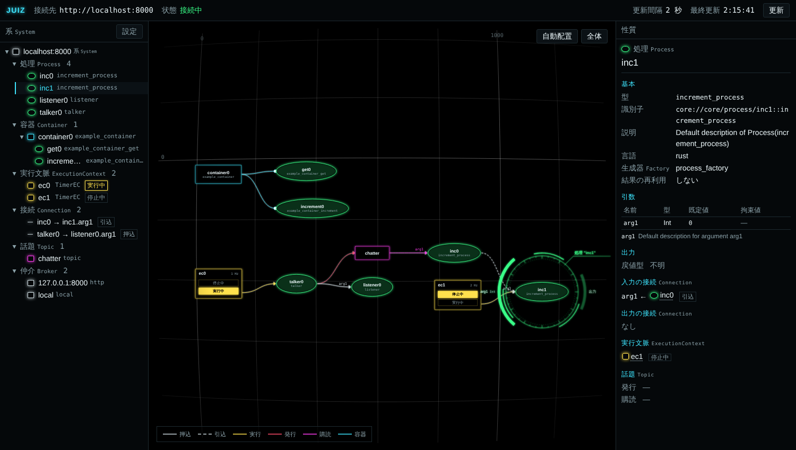
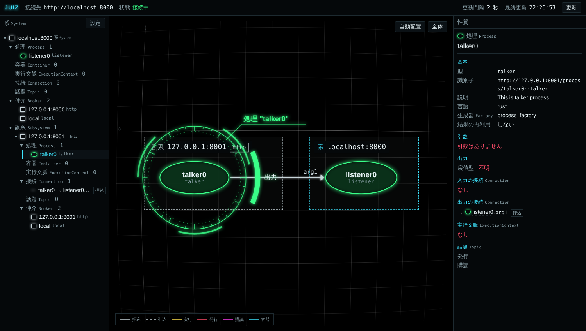

juiz ships with a web UI that shows what is inside a running System in your browser.
Start juiz with the HTTP broker enabled and open `/ui/`; nothing else needs to be installed.
For now the UI is view-only: you cannot create connections or use `p_apply` from it yet.



:::caution[Requires juiz 0.0.19 or later]
The web UI is built into the `juiz` command from juiz 0.0.19. Both `cargo install juiz_app` and the `juiz-cli` pip package contain the prebuilt UI, so Node.js is not needed.
:::

## Open it

Start juiz with the HTTP broker enabled. With `-d`, the HTTP broker starts on port 8000.

```sh
juiz -f increment_process.conf -d
# => juiz 管理画面: http://localhost:8000/ui/
```

Open the URL printed at startup in your browser. The UI and the API are served by the same juiz, so no CORS setup is needed.
For juiz running on another machine, open `http://<that machine's address>:8000/ui/`.

The screen has four parts.

| Part | Contents |
|---|---|
| Top bar | Server, status (接続中 = connected / 未接続 = disconnected), refresh interval, time of the last update, and the 更新 (refresh) button |
| Left tree | The System and the elements in it |
| Center diagram | A system diagram of the elements and their connections |
| Right property pane | Details of the selected element |

The UI labels are in Japanese, with the English names used in the API and on this site shown in small type next to them.

| UI label | Name on this site |
|---|---|
| 系 | System |
| 副系 | Subsystem (juiz in another process) |
| 処理 | Process |
| 容器 | Container |
| 容器処理 | ContainerProcess |
| 実行文脈 | ExecutionContext (EC) |
| 接続 | Connection |
| 話題 | Topic |
| 仲介 | Broker |
| 生成器 | Factory |

## The tree and the property pane

The left tree is ordered as System → Processes, Containers (with their ContainerProcesses below them), ECs, Connections, Topics, Brokers → each element. Click ▸ / ▾ on a group or element to fold it.
Click an element to show its details in the property pane on the right.

| Kind | Shown in the property pane |
|---|---|
| Process / ContainerProcess | Type, identifier, description, language, Factory, owning Container, arguments (name, type, default), input and output connections, ECs that run it, published and subscribed Topics |
| Container | Type, identifier, description, language, Factory, arguments, ContainerProcesses |
| EC | Type, identifier, state (stopped / running), rate, auto start, target Processes |
| Connection | Push or Pull, source, destination and argument, identifier |
| Topic | Publishing Processes, subscribing Processes and arguments |
| Broker | Type, identifier |
| System | Broker it is reached through, UUID, Brokers, element counts |

Click an element name inside the property pane to jump to that element.
The "拘束値" (bound value, given by `p_apply`) column and the return type are not available yet and show "—" and "不明" (unknown).

When juiz cannot be reached, the status in the top bar changes to 未接続 (disconnected) and the reason appears above the tree. The last fetched contents stay on screen, dimmed.

## Reading the system diagram

The center diagram draws each kind of element with its own shape and color.

| Element | Drawn as |
|---|---|
| Process | Green ellipse |
| Container | Cyan rectangle. ContainerProcesses (green ellipses) sit outside the Container and are joined to it by a cyan line with a white dot on the Process end |
| EC | Yellow rectangle. Of its "stopped" and "running" boxes, the current state lights up; when running, a yellow arrow points to each target Process |
| Topic | Magenta rectangle. Process → Topic is a red arrow (publish), Topic → Process is a magenta arrow (subscribe) |
| Connection | Process → Process arrow. Push is solid, Pull is dashed. The argument name is shown at the arrow head |

The legend at the bottom left of the diagram also lists the line styles.

- The layout is chosen automatically so that data flows from left to right. It is recomputed only when the set of elements or lines changes.
- You can drag elements around. Their positions are saved in your browser, per server.
- "自動配置" (auto layout) at the top right clears the saved positions and goes back to the automatic layout. "全体" (fit) zooms to show everything.
- Clicking an element or a connection line selects it, and the tree and property pane follow (selecting in the tree also selects it in the diagram). A selected Process gets a targeting ring with an arc for each argument on its left and an output arc on its right; the connected ones light up.

## Showing juiz in other processes

When a second juiz is registered as a subsystem of the first, as in [Chapter 6: Connecting separate processes](/tutorial/multi-process/), the first juiz's web UI shows the second one as well.
For example, start listener on port 8000 and talker on port 8001, connect talker → listener, and open `http://localhost:8000/ui/`:



- In the tree, subsystems are nested under 副系 (Subsystem) of the System, with the Broker they are reached through (`http`, `qmp`, ...) next to the name. A subsystem whose contents cannot be fetched is marked 取得不可 (unavailable).
- In the diagram, each System gets a dashed frame, but only when there are subsystems. Connections between Systems are arrows that cross the frames. Click a frame's title to select that System.
- A connection is listed under the System of the Process that sends the value. A connection seen from both Systems is shown only once.

Subsystems registered through the QUIC broker ([Chapter 7](/tutorial/quic-broker/)) are shown the same way.

## Settings

Open the 設定 (settings) button above the left tree. Values are saved in your browser.

| Item | Meaning |
|---|---|
| 接続先 (server) | Empty means the juiz that served the UI. If you point it at another juiz, that juiz needs CORS settings (see "Opening it from somewhere else" below) |
| 更新間隔 (refresh interval, seconds) | Interval of automatic refresh. Default 2 seconds, minimum 0.5. Zero or less turns automatic refresh off; the UI then refreshes only when you press 更新 in the top bar |

## Settings on the juiz side

### Turning the UI off

To stop serving the web UI, set `webui: false` under `option.http_broker` in the config file.

```yaml
option:
  http_broker:
    start: true
    port: 8000
    webui: false
```

### Opening it from somewhere else (CORS)

If you open the UI from a different origin (another host or port) than the juiz you want to inspect, allow CORS on that juiz. List the allowed origins in `option.http_broker.cors_allow_origins` (nothing is allowed by default).

```yaml
option:
  http_broker:
    start: true
    port: 8000
    cors_allow_origins:
      - "http://localhost:8001"
```

`"*"` allows any origin, so use it only for local experiments.

### Serving a UI you built yourself

The UI source lives in [`webui/`](https://github.com/OpenJUIZ/juiz/tree/main/webui) in the juiz repository. If you set `/ui` in `option.http_broker.static_filepaths` to a built UI, juiz serves it instead of the embedded one. The path is relative to the directory juiz was started in.

```yaml
option:
  http_broker:
    start: true
    port: 8000
    static_filepaths:
      /ui: "./webui/dist"
```

See [webui/README.md](https://github.com/OpenJUIZ/juiz/blob/main/webui/README.md) for how to develop the UI.
