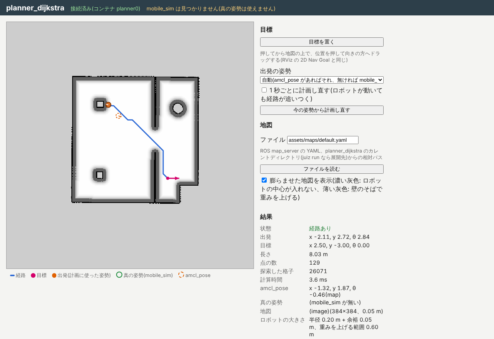
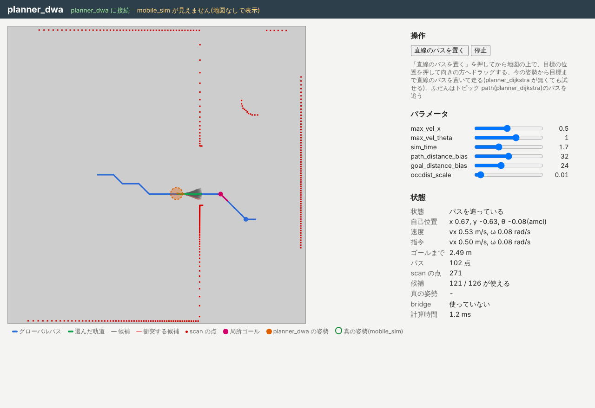

import { Aside } from '@astrojs/starlight/components';

最後に、動いている一式の中を `juiz` コマンドと各アプリの画面でのぞいてみます。
ターミナル 2 を使います。一式は前のページのまま動かしておいてください。

## 木の形を見る

根の navigation_hub(8006 番)から見えるコンテナを並べてみましょう。

```sh
juiz -s http://localhost:8006 container list
```

```text
["ipc://localization_amcl/container/map::static_anchor", "ipc://localization_amcl/container/amcl_odom0::static_anchor", "ipc://localization_amcl/container/amcl0::amcl", "ipc://localization_amcl/container/robot0::mobile_robot", "ipc://localization_amcl/container/lidar0::mobile_lidar", "ipc://localization_amcl/container/world::static_anchor", "ipc://localization_amcl/container/sim0::mobile_sim", "ipc://localization_amcl/container/odom0::static_anchor", "ipc://planner_dijkstra/container/planner0::dijkstra_planner", "ipc://planner_dwa/container/dwa0::dwa_planner"]
```

- `ipc://localization_amcl/...` の中に、localization_amcl 自身の `amcl0`・`map`・`amcl_odom0` と、その下につないだ mobile_sim の `sim0`・`robot0` などが並んでいます。navigation_hub から見ると、mobile_sim は「副系の副系」です。
- `ipc://planner_dijkstra/...` と `ipc://planner_dwa/...` は、navigation_hub の直接の副系です。

[概要](/ja/exercises/navigation/) の図のとおり、navigation_hub を根にした 1 本の木になっていることがわかります。

## トピックの中継を見る

navigation_hub 自身の Process も見てみます。

```sh
juiz -s http://localhost:8006 process list
```

```text
["http://localhost:8006/process/relay_odom::nav_relay", "http://localhost:8006/process/relay_scan::nav_relay", "http://localhost:8006/process/relay_lidar_mount::nav_relay", "http://localhost:8006/process/relay_cmd_vel::nav_relay", "http://localhost:8006/process/relay_amcl_pose::nav_relay", "ipc://localization_amcl/process/version0::localization_amcl_version"]
```

`relay_...` の 5 つが、トピックを受けて別の名前で出し直す Process です。

| Process | 受けるトピック | 出すトピック | 流れ |
| --- | --- | --- | --- |
| `relay_odom` | `odom` | `nav/odom` | mobile_sim → planner_dwa |
| `relay_scan` | `scan` | `nav/scan` | mobile_sim → planner_dwa |
| `relay_lidar_mount` | `lidar_mount` | `nav/lidar_mount` | mobile_sim → planner_dwa |
| `relay_amcl_pose` | `amcl_pose` | `nav/amcl_pose` | localization_amcl → planner_dijkstra・planner_dwa |
| `relay_cmd_vel` | `cmd_vel_dwa` | `cmd_vel` | planner_dwa → mobile_sim |

`navigation-manager stack` は planner_dijkstra と planner_dwa を葉として起動するとき、`juiz run` の `--remap` で、購読するトピックを `nav/...` に、planner_dwa が出すトピックを `cmd_vel_dwa` に付け替えています(例: `--remap odom=nav/odom --remap cmd_vel=cmd_vel_dwa`)。付け替える組は navigation_hub の `.juizapp` の `leaves/planner_dijkstra.yaml`・`leaves/planner_dwa.yaml` に書いてあります。
根の中継を通ることで、別々の枝にあるアプリどうしがトピックでつながります。

## 大域経路をのぞく

planner_dijkstra の画面([http://localhost:8003/](http://localhost:8003/))を開き、navigation_manager の画面からゴールを出してみましょう。



planner_dijkstra は、地図の障害物をロボットの大きさだけ膨らませた地図(コストマップ)の上で、ダイクストラ法で経路を求めます。画面の「膨らませた地図を表示」に印が付いている(既定)と、その地図が描かれます。

| 表示 | 意味 |
| --- | --- |
| 黒 | 障害物 |
| 濃い灰色の帯 | ロボットの中心が入れない所(障害物から `robot_radius` + `safety_margin` 以内) |
| 薄い灰色のぼかし | 通れるが、障害物に近いほど重みを上げる所(障害物から `inflation_radius` 以内) |
| 青い線 | 求めた経路 |

濃い灰色の帯があるので、経路は柱や扉の角をかすめません。さらに薄い灰色の所を避けようとするので、扉の真ん中寄りを通ります。planner_dwa が追いやすい経路になります。

この形で動かしているときは、planner_dijkstra も mobile_sim を副系に持たないので、画面の上に「mobile_sim は見つかりません」と出ます。地図と経路は描かれます。

膨らませ方は、コンテナの引数(`.juizapp` の `app.conf`)で決まっていて、ContainerProcess `planner_set_inflation` で変えられます。

| 引数 | 既定 | 意味 |
| --- | --- | --- |
| `robot_radius` | 0.2 m | ロボットの半径。planner_dwa の `robot_radius` と揃える |
| `safety_margin` | 0.05 m | 半径に足す余裕 |
| `inflation_radius` | 0.6 m | 障害物からこの距離までは重みを上げる |
| `inflation_weight` | 2.0 | 重みの上げ方(0 なら、入れない帯を空けるだけ) |

```sh
juiz -s http://localhost:8003 container-process call -p "http://localhost:8003/container_process/set_inflation0::planner_set_inflation:planner0" '{"robot_radius": 0.3, "safety_margin": null, "inflation_radius": null, "inflation_weight": null}'
```

`null` にした値は今のまま変わりません。戻り値として、変えた後の設定が返ってきます。膨らませた地図も描き直されるので、画面で濃い灰色の帯が太くなったことを確かめてください。

## 局所計画をのぞく

planner_dwa の画面([http://localhost:8004/](http://localhost:8004/))を開き、navigation_manager の画面からゴールを出してみましょう。



DWA は、ロボットが今の速度から出せる範囲で速度の組(前進の速さと旋回の速さ)をたくさん試し、それぞれで少し先(`sim_time` 秒)までの軌道を描いてみます。
その中から、ぶつからず、大域経路に近く、ゴールに近づくものを選びます。

| 表示 | 意味 |
| --- | --- |
| 灰色の線 | 試した候補の軌道 |
| 赤い線 | 障害物にぶつかるので捨てた候補 |
| 緑の線 | 選んだ軌道(その速度を `cmd_vel` に出す) |
| ピンクの丸 | 局所ゴール(大域経路の上の、少し先の点) |

この形で動かしているときは、planner_dwa は mobile_sim を副系に持たないので、画面の上に「mobile_sim が見えません(地図なしで表示)」と出て、地図は描かれません。経路と scan の点は描かれます。

右のスライダーでパラメータを変えられます。名前と意味は ROS の dwa_local_planner と同じです。

| パラメータ | 意味 | 変えてみると |
| --- | --- | --- |
| `max_vel_x` | 前進の最大速度 [m/s] | 下げるとゆっくり、慎重に走る |
| `max_vel_theta` | 旋回の最大速度 [rad/s] | 下げると曲がるのに時間がかかる |
| `sim_time` | 候補の軌道を何秒先まで描くか | 短いと目先だけ、長いと遠くの障害物まで考える |
| `path_distance_bias` | 大域経路に近い軌道をどれだけ好むか | 上げると経路にぴったり沿う |
| `goal_distance_bias` | 局所ゴールに近づく軌道をどれだけ好むか | 上げると経路から外れても先を急ぐ |
| `occdist_scale` | 障害物から離れた軌道をどれだけ好むか | 上げると壁から離れて走る |

パラメータは、ContainerProcess `dwa_set_params` を呼んでも変えられます。

```sh
juiz -s http://localhost:8004 container-process call -p "http://localhost:8004/container_process/set_params0::dwa_set_params:dwa0" '{"params": {"max_vel_x": 0.3}}'
```

戻り値として、変えた後の全部のパラメータが返ってきます。画面のスライダーも、同じ `dwa_set_params` を呼んでいます。
Windows の PowerShell では JSON の中の `"` の渡し方が版によって違うので、画面のスライダーを使ってください。

<Aside type="note" title="パラメータは起動し直すと戻る">
ここで変えた値は、一式を止めると元に戻ります。
</Aside>

## わざと失敗させてみる

navigation_manager の画面で、次のことを試してみましょう。

- **障害物の上にゴールを置く**: 柱や壁の上でドラッグすると、planner_dijkstra が経路を求められず、引き直しを 3 回したあと `failed`(`the goal is on an obstacle`)になります。
- **障害物のすぐそばにゴールを置く**: 柱や円い障害物のすぐそば(0.25 m より近く)にゴールを置くと、planner_dijkstra がゴールを一番近い通れる所に寄せ、状態の欄に `the goal is too close to obstacles: moved to (x, y)` と出ます。ロボットは寄せた先まで走って `succeeded` になります。
- **ロボットの大きさを忘れさせる**: 次のように 4 つとも 0 にすると、planner_dijkstra はロボットの大きさを考えず、地図をそのまま使って経路を求めます。

  ```sh
  juiz -s http://localhost:8003 container-process call -p "http://localhost:8003/container_process/set_inflation0::planner_set_inflation:planner0" '{"robot_radius": 0, "safety_margin": 0, "inflation_radius": 0, "inflation_weight": 0}'
  ```

  この状態で、左の部屋から右下の小部屋(たとえば x 2.5、y -3.0)へゴールを出すと、経路が扉の角をかすめ、近づいたところで planner_dwa がぶつかると判断して止まり、`stuck` → 引き直し → `failed`(`local planner is stuck`)になることがあります。
  確かめたら、`{"robot_radius": 0.2, "safety_margin": 0.05, "inflation_radius": 0.6, "inflation_weight": 2.0}` で元に戻してください。
- **途中でキャンセルする**: 走っている途中で「キャンセル」を押すと、planner_dwa が止まり、状態は `canceled` になります。

## 自己位置推定をのぞく

localization_amcl の画面([http://localhost:8002/](http://localhost:8002/))では、粒子と推定した姿勢、誤差の楕円を見られます。
ロボットが走っている間、粒子がロボットの周りにまとまっていることを確かめてください。

試しに、「大域的な推定(粒子を地図全体に撒く)」を押してみましょう。粒子が地図全体に散らばり、推定した位置は「どこにいるかわからない」状態になります。
このまま走らせると、まとまり直すこともあれば、似た形の別の場所にまとまってしまうこともあります。
戻すときは、navigation_manager の画面の「初期位置を真の姿勢に」を押します。mobile_sim の真の位置を localization_amcl に初期位置として教え直します(シミュレータだからできる近道です)。

## まとめ

- navigation_hub を根にした木で、5 つのアプリが 1 つにつながっています。根の `relay_...` がトピックを中継しています。
- DWA は候補の軌道を試して速度を選びます。パラメータは画面や `dwa_set_params` で変えられます。
- planner_dijkstra は障害物をロボットの大きさだけ膨らませた地図の上で経路を求めるので、経路は壁や扉の角から離れます。膨らませ方は `planner_set_inflation` で変えられます。

これで自律移動の演習はおしまいです。[演習の一覧](/ja/exercises/) に戻るか、各アプリのリポジトリで中の作りを読んでみてください。
