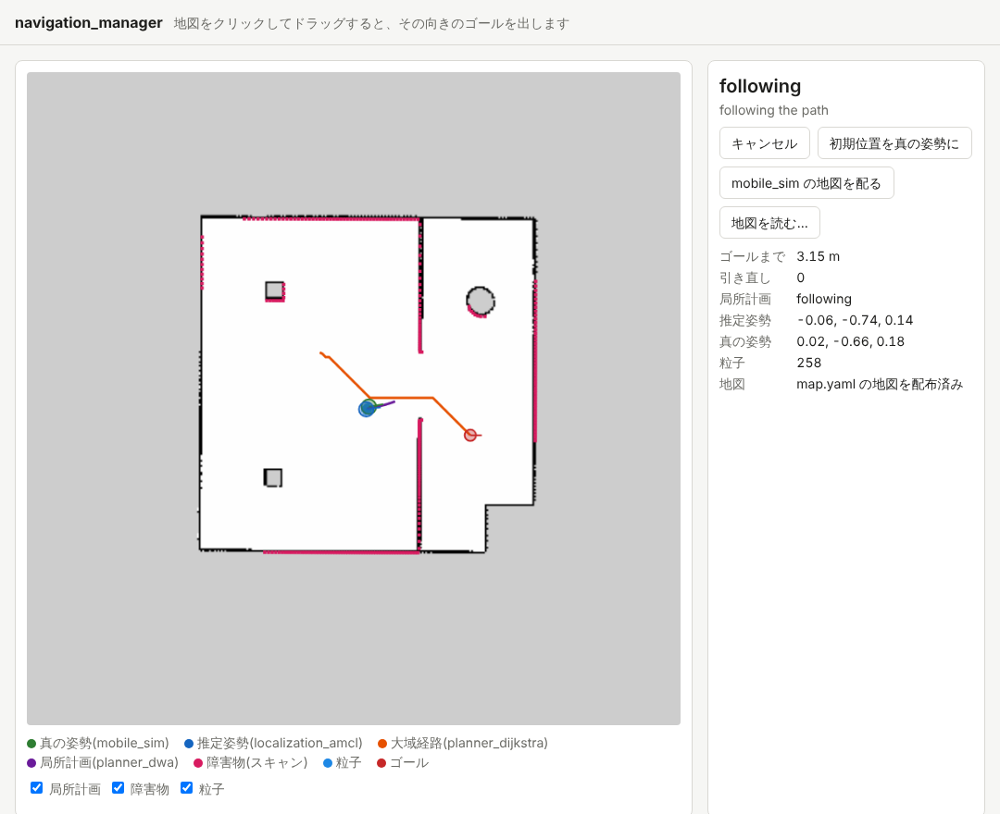
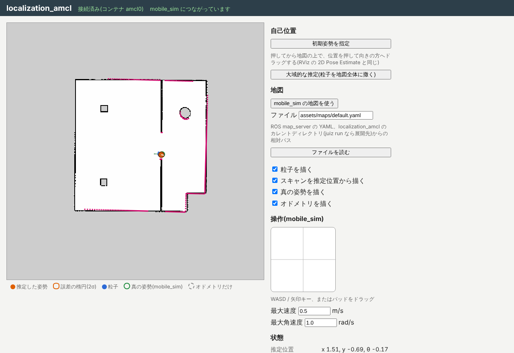

import { Aside, Tabs, TabItem } from '@astrojs/starlight/components';

前のページでは、シミュレータが持っている地図(答えの地図)を使いました。
現実のロボットは答えの地図を持っていないので、SLAM で作った地図を使って走ります。ここでは [SLAM の演習](/ja/exercises/slam/mapping/) で保存した地図を使います。

## 地図を配って起動し直す

ターミナル 1 で Ctrl+C を押して一式を止め、`--map` に地図の YAML を付けて起動し直します。
`map.yaml` と、その中の `image` に書かれた `map.png` が、作業用のディレクトリにある前提です。

<Tabs syncKey="platform">
<TabItem label="Linux">

```sh
navigation-manager stack mobile_sim-<版>.juizapp \
    localization_amcl-<版>.juizapp planner_dijkstra-<版>.juizapp \
    planner_dwa-<版>.juizapp navigation_hub-<版>.juizapp \
    --map map.yaml
```

</TabItem>
<TabItem label="macOS">

```sh
navigation-manager stack mobile_sim-<版>.juizapp \
    localization_amcl-<版>.juizapp planner_dijkstra-<版>.juizapp \
    planner_dwa-<版>.juizapp navigation_hub-<版>.juizapp \
    --map map.yaml
```

</TabItem>
<TabItem label="Windows">

```powershell
navigation-manager stack mobile_sim-<版>.juizapp `
    localization_amcl-<版>.juizapp planner_dijkstra-<版>.juizapp `
    planner_dwa-<版>.juizapp navigation_hub-<版>.juizapp `
    --map map.yaml
```

</TabItem>
</Tabs>

navigation_manager は起動したときに、この地図を planner_dijkstra(経路を求める地図)と localization_amcl(位置を照らし合わせる地図)の両方に配ります。
http://localhost:8005/ を開き直すと、画面にも SLAM で作った地図が描かれ、右の「地図」の欄が `map.yaml の地図を配布済み` になります。



SLAM の地図は 20 m 四方で作るので、部屋の周りは灰色(不明)の余白になります。planner_dijkstra は不明な所を通らないので、経路は部屋の中だけを通ります。

<Aside type="tip" title="起動し直さずに地図を替える">
画面の「地図を読む…」を押し、`map.yaml` と `map.png` を**一緒に**選んでも、その地図を配れます。
「mobile_sim の地図を配る」を押すと、シミュレータの地図に戻ります。
どちらも、走っている途中なら一度止めてから配ります。
</Aside>

## 走らせてみる

前のページと同じように、地図の上でドラッグしてゴールを出します。例えば次のゴールを順に試してみましょう(座標は地図の上でのおおよその位置です)。

| ゴール | だいたいの場所 |
| --- | --- |
| x 3.0, y -1.5 | 扉を抜けた右の部屋 |
| x 2.0, y -3.0 | 右の部屋の下のほう |
| x -1.5, y 2.5 | 左の部屋の上、柱の右 |
| x -2.0, y 0.0 | 出発した場所 |

シミュレータの地図のときと同じように、ゴールに着くはずです。緑の丸(真の位置)と青い丸(推定した位置)がほぼ重なったまま走ることを確かめてください。

## 地図の上の位置はどう決まるか

SLAM の地図の座標系 `map` は、mapper_gmapping が動き始めたときのオドメトリを出発点にしていました。
SLAM の演習で、mobile_sim を起動し直してから地図を作った場合は、`map` は部屋の座標系 `world` とほぼ同じです。
localization_amcl は、起動したときのロボットの位置を mobile_sim の最初の位置 (x -2.0, y 0.0) と仮定して推定を始めるので、そのまま正しく推定できます。

ロボットの位置は、localization_amcl が書く座標系の木から読めます。ターミナル 2 で見てみましょう(下は数を小数 2 けたに丸めた例です)。

```sh
juiz anchor tree map
```

```text
map  position (0, 0, 0)  orientation (0, 0, 0, 1)
└─ amcl_odom0  position (-0.04, -0.04, 0)  orientation (0, 0, 0.01, 1.00)
   └─ odom0  position (-0.04, -0.04, 0)  orientation (0, 0, 0.01, 1.00)
      └─ robot0  position (2.93, -1.43, 0)  orientation (0, 0, -0.14, 0.99)
         └─ lidar0  position (2.93, -1.43, 0.20)  orientation (0, 0, -0.14, 0.99)
```

[SLAM の演習の最後](/ja/exercises/slam/check/) で見た `map → slam_odom0 → odom0` と同じ形です。
今度は localization_amcl の Anchor `map` と `amcl_odom0` が、mobile_sim の `odom0` の上に乗っています。`map → amcl_odom0` には、AMCL が求めた「オドメトリのずれ」が入っていて、スキャンのたびに書き直されます。
`juiz anchor tree world` で真の位置と比べると、差は数 cm です。

<Aside type="caution" title="ロボットの位置がずれているとき">
SLAM の地図を作る前に mobile_sim を起動し直さなかったなどで、`map` と `world` がずれていると、localization_amcl の最初の仮定が外れます。
粒子がまとまらなかったり、青い丸が緑の丸から離れたりしたら、localization_amcl の画面([http://localhost:8002/](http://localhost:8002/))で「初期姿勢を指定」を押し、地図の上でロボットのいる所を押して、向いている方へドラッグして教えてください。


</Aside>

## まとめ

- `--map map.yaml` で、SLAM で作った地図を planner_dijkstra と localization_amcl に配れます。画面の「地図を読む…」でも替えられます。
- localization_amcl は、スキャンを地図と照らし合わせて `map → amcl_odom0` を書き直し、オドメトリのずれを直します。
- SLAM の地図とシミュレータの部屋の座標がほぼ同じなら、そのまま自律移動できます。ずれていたら、初期姿勢を教え直します。

次は [3. 中を見る](/ja/exercises/navigation/inside/) です。一式は動かしたままにしておいてください。
