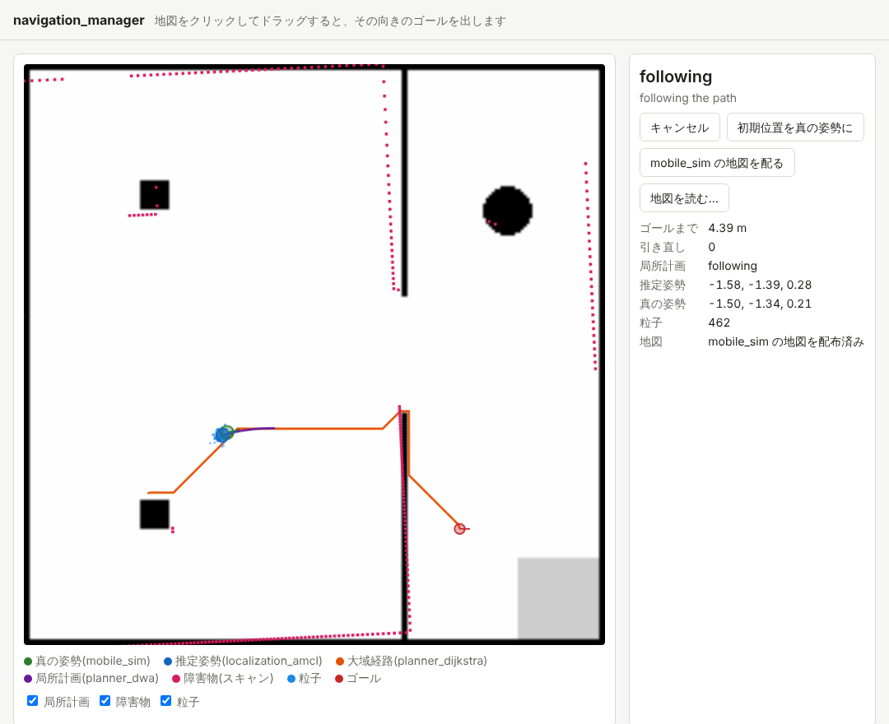

import { Aside, Tabs, TabItem } from '@astrojs/starlight/components';

まずはシミュレータの地図のまま、一式を動かしてみます。

## 一式を起動する

ターミナル 1 で、取ってきた 5 つの `.juizapp` を `navigation-manager stack` に渡します(`<版>` は取ってきたファイルの版に読み替えてください)。並べる順は問いません。

<Tabs syncKey="platform">
<TabItem label="Linux">

```sh
navigation-manager stack mobile_sim-<版>.juizapp \
    localization_amcl-<版>.juizapp planner_dijkstra-<版>.juizapp \
    planner_dwa-<版>.juizapp navigation_hub-<版>.juizapp
```

</TabItem>
<TabItem label="macOS">

```sh
navigation-manager stack mobile_sim-<版>.juizapp \
    localization_amcl-<版>.juizapp planner_dijkstra-<版>.juizapp \
    planner_dwa-<版>.juizapp navigation_hub-<版>.juizapp
```

</TabItem>
<TabItem label="Windows">

```powershell
navigation-manager stack mobile_sim-<版>.juizapp `
    localization_amcl-<版>.juizapp planner_dijkstra-<版>.juizapp `
    planner_dwa-<版>.juizapp navigation_hub-<版>.juizapp
```

</TabItem>
</Tabs>

次のように 1 つずつ起動していき、最後に `running.` と出たら準備完了です(パスは省いています)。

```text
started mobile_sim (:8000)
started localization_amcl (:8002)
started planner_dijkstra (:8003)
started planner_dwa (:8004)
started navigation_hub (:8006)
topics reach the leaves through navigation_hub
started navigation_manager (:8005)
running. open http://localhost:8005/ . Ctrl-C to stop
```

`navigation-manager stack` は、決まった順番でアプリを起動します。

| 順 | アプリ | 起動のしかた |
| --- | --- | --- |
| 1 | mobile_sim | `juiz run` |
| 2 | localization_amcl | `juiz run`。依存する mobile_sim に IPC でつなぐ |
| 3・4 | planner_dijkstra・planner_dwa | `juiz run --depend mobile_sim=none --remap 旧=新 ...`。navigation_hub の木の葉として起動する(下の説明) |
| 5 | navigation_hub | `juiz run`。根は最後に起動する(先に起動すると葉につながらない) |
| 6 | navigation_manager | 自分自身(Python)を起動する |

planner_dijkstra と planner_dwa の `.juizapp` は、どちらも mobile_sim に依存すると書いてあります。そのまま `juiz run` すると mobile_sim につながり、mobile_sim の上に親が 2 つできてトピックが届かなくなります。そこで 2 つの `juiz run` のオプションで、葉として起動しています。

- `--depend mobile_sim=none`: 依存する mobile_sim につながない
- `--remap 旧=新`: conf に書いてあるトピック名を付け替える(例: `--remap amcl_pose=nav/amcl_pose`)。付け替える組は navigation_hub の `.juizapp` に入っている `leaves/<アプリ名>.yaml` から作る

`.juizapp` を展開したり conf を書き換えたりはしません。planner_dwa の画面用の仕組み(AMCL と planner を HTTP で読みに行く bridge)は、環境変数 `DWA_BRIDGE_AMCL_URL`・`DWA_BRIDGE_PLANNER_URL` を空にして止めています。

最後に、トピックが根を通って葉まで届いていることを確かめています(`topics reach the leaves through navigation_hub`)。
各アプリのログは一時ディレクトリに出ます。場所は起動したときの最初の数行に `logs:` として出ます。

## ゴールを出す

ブラウザで http://localhost:8005/ を開きます。navigation_manager の画面です。



**地図の上の空いている所をクリックし、そのままロボットに向かせたい方向へドラッグして離す**と、そこがゴールになります。
ロボットが動き出し、右上の状態が次のように変わっていきます。

| 状態 | 意味 |
| --- | --- |
| `idle` | ゴールを待っている |
| `planning` | planner_dijkstra に大域経路を求めさせている |
| `following` | planner_dwa が経路に沿って走らせている |
| `succeeded` | ゴールに着いた(位置 0.25 m・向き 0.35 rad 以内) |
| `failed` | 経路が求まらない、または立ち往生して、引き直しても 3 回だめだった |
| `canceled` | 「キャンセル」で止めた |

地図の上の表示は次のとおりです。

| 表示 | 意味 |
| --- | --- |
| 緑の丸 | 真の位置(mobile_sim。答え合わせ用) |
| 青い丸と青い点 | localization_amcl が推定した位置と、その粒子 |
| オレンジの線 | planner_dijkstra が求めた大域経路 |
| 紫の線 | planner_dwa がこれから進もうとしている軌道(局所計画) |
| ピンクの点 | スキャンで見えている障害物 |
| 赤い丸 | ゴール |

走っている途中で「キャンセル」を押すと、その場で止まります。止まったあとは、また別のゴールを出せます。

<Aside type="note" title="障害物のそばのゴール">
planner_dijkstra はロボットの大きさを考えて経路を求めます。ロボットの中心は障害物から「半径 0.2 m + 余裕 0.05 m」より近くには入らず、壁から 0.6 m までは離れた所を好むので、経路は扉の真ん中寄りを通ります。
壁や柱のすぐそば(0.25 m より近く)にゴールを置くと、一番近い通れる所にゴールを寄せて走り、状態の欄に `the goal is too close to obstacles: moved to (x, y)` と出ます。
障害物の上にゴールを置くと、経路が求まらずに `failed`(`the goal is on an obstacle`)になります。
</Aside>

## 何が起きているか

ゴールを出してから着くまで、次のことが順に起きています。

1. 画面がゴールを navigation_manager に送ります(`POST /api/goal`)。
2. navigation_manager が planner_dijkstra の ContainerProcess `planner_set_goal` を HTTP で呼びます。planner_dijkstra は、トピックで受けている推定位置 `amcl_pose` から、ゴールまでの大域経路を求めて返します。
3. navigation_manager がその経路を planner_dwa の `dwa_set_path` に渡します。
4. planner_dwa は 10 Hz で、推定位置・オドメトリ・スキャンから「経路に沿って進み、障害物をよける」速度を選び、`cmd_vel` に出します。navigation_hub が中継して mobile_sim に届き、ロボットが動きます。
5. ロボットが動くと、localization_amcl がスキャンを地図と照らし合わせて推定位置を直し、`amcl_pose` を出します。
6. navigation_manager は 5 Hz で推定位置と planner_dwa の状態を読み、ゴールに着いたら planner_dwa を止めます。立ち往生したら経路を引き直します。

ゴールや経路の受け渡しは「1 回だけ呼んで結果がほしい」ので HTTP の呼び出し、位置や速度は「流し続ける」のでトピック、と使い分けています。

ゴールは画面からだけでなく、HTTP でも出せます。ターミナル 2 で試してみましょう。

<Tabs syncKey="platform">
<TabItem label="Linux">

```sh
curl -X POST localhost:8005/api/goal -H 'Content-Type: application/json' -d '{"x": -2.0, "y": 0.0, "theta": 0.0}'
curl -X POST localhost:8005/api/cancel
```

</TabItem>
<TabItem label="macOS">

```sh
curl -X POST localhost:8005/api/goal -H 'Content-Type: application/json' -d '{"x": -2.0, "y": 0.0, "theta": 0.0}'
curl -X POST localhost:8005/api/cancel
```

</TabItem>
<TabItem label="Windows">

```powershell
Invoke-RestMethod -Method Post -Uri http://localhost:8005/api/goal -ContentType application/json -Body '{"x": -2.0, "y": 0.0, "theta": 0.0}'
Invoke-RestMethod -Method Post -Uri http://localhost:8005/api/cancel
```

</TabItem>
</Tabs>

`x`・`y` はメートル、`theta` はラジアンで、どれも地図の座標系 `map` の値です。

## 止め方

ターミナル 1 で Ctrl+C を押すと、起動したのと逆の順にすべてのアプリを止めます。

## まとめ

- `navigation-manager stack` で、6 つのアプリを決まった順に起動できます。
- 画面の地図の上でドラッグするとゴールを出せます。状態は `planning` → `following` → `succeeded` と進みます。
- ゴールや経路は HTTP で 1 回呼び、位置や速度はトピックで流し続けます。

次は [2. 自分の地図で走る](/ja/exercises/navigation/own-map/) です。
