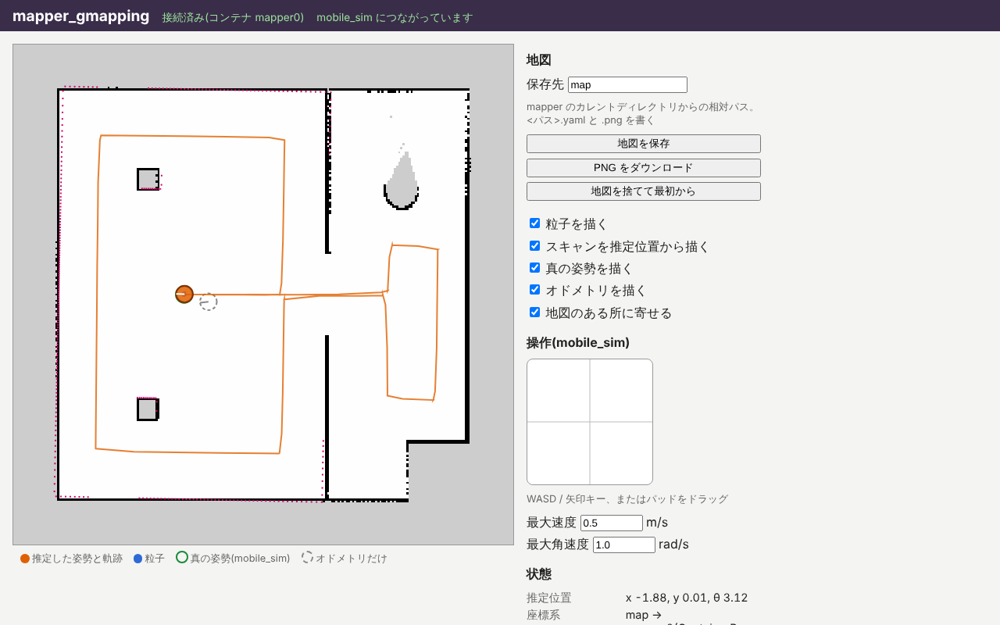

import { Aside } from '@astrojs/starlight/components';

ロボットが動くようになったので、SLAM のアプリ mapper_gmapping をつないで地図を作ります。

## 起動し直す

前のページでロボットを走らせた分、オドメトリはもう部屋の座標系 `world` からずれています。
SLAM の地図は、mapper_gmapping が動き始めたときのオドメトリを出発点にするので、まっさらな状態から始めるために、一度止めて起動し直します。

1. ターミナル 2 の teleop_twist、ターミナル 1 の mobile_sim の順に、Ctrl+C で止めます。
2. ターミナル 1 で `juiz run mobile_sim-<版>.juizapp`、ターミナル 2 で `juiz run teleop_twist-<版>.juizapp` を、もう一度実行します。
3. ブラウザの mobile_sim と teleop_twist の画面を再読み込みします。ロボットは最初の位置に戻っています。

ここからは、mapper_gmapping を起動するまでロボットを動かさないでください。

## mapper_gmapping を起動する

ターミナル 3 で mapper_gmapping を起動します。

```sh
juiz run mapper_gmapping-<版>.juizapp
```

mapper_gmapping も mobile_sim に依存すると宣言しているので、teleop_twist と同じように、動いている mobile_sim を探してつなぎます。
つながると、mobile_sim のトピック `scan`(LiDAR のスキャン)と `odom`(オドメトリ)を購読し始めます。

ブラウザで http://localhost:8001/ を開きます。最初は、ロボットの周りだけが描かれた小さな地図が出ます。

<Aside type="caution" title="この画面の操作パッドも使いません">
mapper_gmapping の画面にも「操作(mobile_sim)」のパッドがありますが、ロボットは引き続き teleop_twist から動かします。
</Aside>

## 走らせて地図を育てる

teleop_twist の画面からロボットを動かし、部屋じゅうを走らせます。走るにつれて、mapper_gmapping の画面の地図が育っていきます。



画面の見方は次のとおりです。

| 表示 | 意味 |
| --- | --- |
| 白・黒・灰色 | 作った地図。白が空いている所、黒が壁など、灰色はまだわからない所 |
| オレンジの丸と線 | SLAM が推定したロボットの位置と、通った軌跡 |
| 青い点 | 粒子(GMapping が同時に持っている「ロボットはここかもしれない」という候補) |
| 緑の輪 | 真の位置(mobile_sim から読んだもの。答え合わせ用) |
| 灰色の点線の輪 | オドメトリだけで求めた位置 |

うまく地図を作るコツです。

- **ゆっくり走らせます。** 特に旋回はゆっくりにします。速度の倍率(Z / X、LB / RB)を下げておくと楽です。
- 壁に沿って、部屋の隅々まで回ります。真ん中の壁の出入口を通って、右の部屋も回ります。
- 最後は**出発した場所の近くに戻ってきます**。一度見た場所をもう一度見ると、GMapping はそれまでのずれをまとめて直します(ループを閉じる、と言います)。

部屋を一周すると、オレンジの丸(推定)は緑の輪(真の位置)とほぼ重なっているのに、灰色の点線の輪(オドメトリだけ)は離れているはずです。
オドメトリのずれを、SLAM が地図と照らし合わせて直しているのです。

<Aside type="tip" title="やり直したいとき">
壁がにじんだり二重になったりしたら、「地図を捨てて最初から」を押すと、それまでの地図を捨てて作り直せます。
</Aside>

## 地図を保存する

地図ができたら、画面の「保存先」を確かめて(既定は `map`)、「地図を保存」を押します。
mapper_gmapping を起動したディレクトリ(作業用のディレクトリ `slam_exercise`)に、次の 2 つのファイルができます。

| ファイル | 中身 |
| --- | --- |
| `map.png` | 地図の画像。白が空き、黒が占有、灰色が不明 |
| `map.yaml` | 画像の 1 画素の大きさ(`resolution`)と、画像の左下の座標(`origin`) |

```yaml
image: map.png
resolution: 0.05
origin: [-10.025, -10.025, 0]
occupied_thresh: 0.65
free_thresh: 0.196
negate: 0
```

これは ROS の map_server と同じ形式で、mobile_sim が読む地図とも同じ形式です。
保存先にディレクトリを付けるとき(`maps/room` など)は、そのディレクトリを先に作っておいてください。
「PNG をダウンロード」を押すと、画像だけをブラウザで保存することもできます。

## 何が起きているか

mapper_gmapping のコンテナ `mapper0` には、トピックを購読する ContainerProcess が 3 つあります。

| ContainerProcess | 購読するトピック | すること |
| --- | --- | --- |
| `set_odometry0` | `odom`(`Pose2DStamped`) | 最新のオドメトリを覚える |
| `add_scan0` | `scan`(`LaserScan`) | スキャンとその時のオドメトリで、粒子と地図を更新する |
| `set_laser_pose0` | `lidar_mount`(`PoseStamped`) | ロボットの中心から見た LiDAR の取付位置を受け取る |

mobile_sim は 1 周期(20 Hz)の中で、ロボットを進め、オドメトリを `odom` に、スキャンを `scan` に出します。
同じ時刻のオドメトリとスキャンがそろって届くので、mapper_gmapping は「この位置からこう見えた」を積み重ねて地図を作れます。

## まとめ

- mapper_gmapping は mobile_sim のトピック `scan` と `odom` を購読して、地図と自己位置を推定します。
- ゆっくり走らせ、出発点に戻ってループを閉じると、きれいな地図ができます。
- 「地図を保存」で、ROS の map_server と同じ形式(YAML + PNG)で保存できます。

次は [3. 地図と位置を確かめる](/ja/exercises/slam/check/) です。3 つのアプリは動かしたままにしておいてください。
