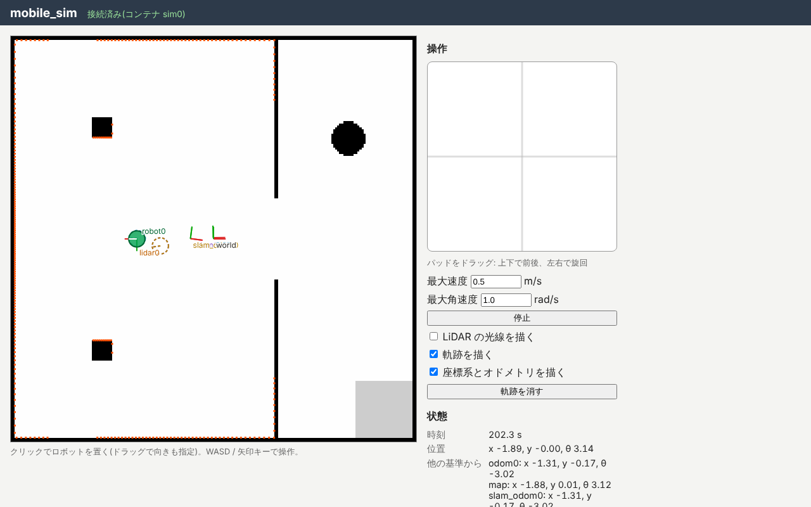
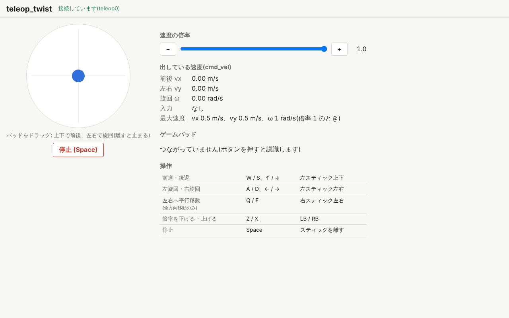

import { Aside } from '@astrojs/starlight/components';

まずはシミュレータを起動して、ロボットを手で動かしてみます。

## シミュレータを起動する

ターミナル 1 で mobile_sim を起動します(`<版>` は取ってきたファイルの版に読み替えてください)。

```sh
juiz run mobile_sim-<版>.juizapp
```

`juiz run` はパッケージを確かめて展開し、中の設定ファイルで juiz を起動します。
ブラウザで http://localhost:8000/ を開くと、シミュレータの画面が出ます。



- 白い所が床、黒い所が壁や柱です。部屋は真ん中の壁で 2 つに分かれていて、出入口でつながっています。
- 緑の丸がロボット `robot0` です。ロボットには LiDAR `lidar0` が載っていて、周りの壁までの距離を測っています(「LiDAR の光線を描く」で見られます)。
- 茶色の点線の丸は、**オドメトリ**(車輪の回転から求めた位置)が思っているロボットの位置です。今は真の位置と重なっていますが、走るとずれていきます。

<Aside type="caution" title="この画面の操作パッドは使いません">
mobile_sim の画面にもキー操作と操作パッドがありますが、この演習では次の teleop_twist から動かします。
両方から同時に指令を出すとぶつかるので、mobile_sim の画面ではキーを押さないようにしてください(画面を見るのはかまいません)。
</Aside>

## teleop_twist を起動する

ターミナル 2 で teleop_twist を起動します。

```sh
juiz run teleop_twist-<版>.juizapp
```

teleop_twist は mobile_sim に依存すると宣言しているので、`juiz run` は動いている mobile_sim を IPC の名前 `mobile_sim` で探し、版を確かめてからつなぎます。
mobile_sim が動いていないと、ここでエラーになって起動しません。

ブラウザで http://localhost:8002/ を開きます。



## キーボードかゲームパッドで動かす

teleop_twist の画面をクリックしてフォーカスを当ててから、キーを押します。

| 動き | キーボード | ゲームパッド |
| --- | --- | --- |
| 前進・後退 | W / S、↑ / ↓ | 左スティック上下、十字キー上下 |
| 左旋回・右旋回 | A / D、← / → | 左スティック左右、十字キー左右 |
| 速度の倍率を下げる・上げる | Z / X | LB / RB |
| 止める | Space | スティックを離す |

- ゲームパッド(Xbox や PlayStation のコントローラなど)は、つないだ後にボタンを 1 回押すと認識されます。
- 丸いパッドをマウスやタッチでドラッグしても動かせます。
- キーやスティックを離すと止まります。teleop_twist の画面が裏に回ったときや、閉じたときも止まります。

mobile_sim の画面に切り替えて、ロボットが動くのを確かめてください。teleop_twist の画面と mobile_sim の画面を横に並べておくと便利です。
しばらく走らせると、茶色の点線の丸(オドメトリ)が、緑の丸(真の位置)から少しずつずれていくのがわかります。

## 何が起きているか

teleop_twist は、入力から速度 `juiz_std.geometry.Twist2D` を作り、トピック `cmd_vel` に 20 Hz で出しています。
mobile_sim のロボットの ContainerProcess `robot_set_velocity0` がこのトピックを購読していて、受け取った速度でロボットを動かします。

別々のアプリなのにつながっているのは、teleop_twist の juiz が mobile_sim の juiz を**副系**(subsystem)として IPC でつないでいるからです。
ターミナル 4 で、teleop_twist(8002 番)から見えるコンテナを並べてみましょう。

```sh
juiz -s http://localhost:8002 container list
```

```text
["http://localhost:8002/container/teleop0::teleop_twist", "ipc://mobile_sim/container/odom0::static_anchor", "ipc://mobile_sim/container/lidar0::mobile_lidar", "ipc://mobile_sim/container/sim0::mobile_sim", "ipc://mobile_sim/container/world::static_anchor", "ipc://mobile_sim/container/robot0::mobile_robot"]
```

自分のコンテナ `teleop0` のほかに、`ipc://mobile_sim/...` で始まる mobile_sim のコンテナが見えています。
[第 6 章](/ja/tutorial/multi-process/) で見たように、juiz の要素は場所を問わず ID でつながります。

## ロボットの位置を読む

mobile_sim は、ロボットの位置を [座標系(Transformations)](/ja/guides/transformations/) の ContainerPose として持っています。
ターミナル 4 で、座標系の木を見てみましょう(`-s` を付けないと、8000 番の mobile_sim に聞きます)。

```sh
juiz anchor tree world
```

出力の例です(値はロボットを動かした後のもので、走らせ方によって変わります。数は小数 2 けたに丸めています。実際の出力には全部の桁が出ます)。

```text
world  position (0, 0, 0)  orientation (0, 0, 0, 1)
└─ robot0  position (-1.89, -0.00, 0)  orientation (0, 0, 1.00, 0.00)
   └─ lidar0  position (-1.89, -0.00, 0.2)  orientation (0, 0, 1.00, 0.00)
```

- `world` は部屋(シミュレータの地図)の座標系の原点です。そこから見た `robot0` の位置が、ロボットの**真の位置**です。
- `lidar0` は `robot0` の上 0.2 m に取り付けられています。

オドメトリの原点 `odom0` から見たロボットの位置も読めます。

```sh
juiz anchor tree odom0
```

走ったあとだと、`world` から見た位置とは値が違うはずです。これがオドメトリのずれです。
現実のロボットは真の位置を知ることができず、ずれていくオドメトリしか持っていません。そこで次のページでは、SLAM で地図を作りながら位置を直していきます。

## まとめ

- `juiz run` だけで、別々に配布されたアプリを起動してつなげられます。依存するアプリ(ここでは mobile_sim)を先に起動します。
- teleop_twist は速度 `Twist2D` をトピック `cmd_vel` に出し、mobile_sim がそれを購読してロボットを動かします。
- ロボットの真の位置は `world` から、オドメトリは `odom0` から見た ContainerPose として読めます。オドメトリは走るほどずれていきます。

次は [2. 地図を作る](/ja/exercises/slam/mapping/) です。mobile_sim と teleop_twist は動かしたままにしておいてください。
