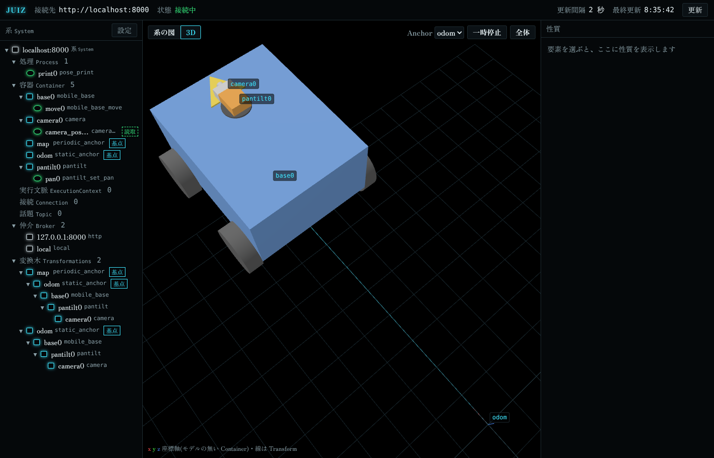
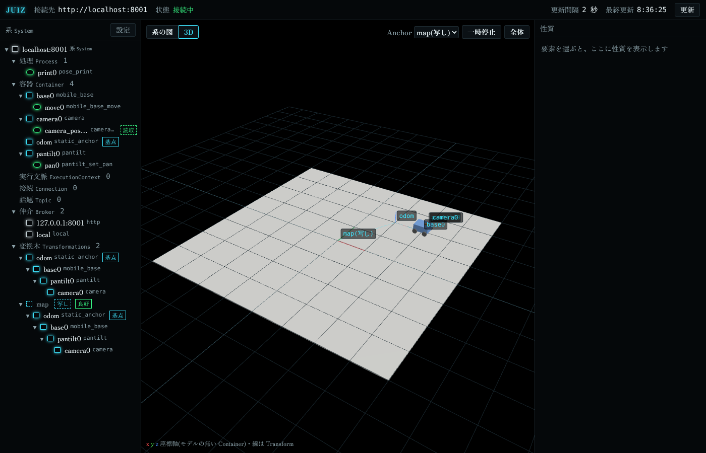

Container に **3D モデル**(ContainerModel)のファイルを付けられます。設定ファイルの Container に `model:` を書くだけで、プラグインのコードは変えません。プラグインの側で、その型の Container の[既定のモデル](#型ごとの既定のモデル)を決めておくこともできます(juiz 0.2.11 から)。
[Transformations](/ja/guides/transformations/) と組み合わせると、「どの Container が、どこに、どんな形で」あるかがそろい、[管理画面](/ja/guides/web-ui/)の「3D」で系全体を立体で見られます。



:::note[juiz 0.2.9 から使えます]
Container の 3D モデルは juiz 0.2.9 で入った機能です。それより前の版では使えません。
:::

## 考え方

- **juiz はモデルの中身を解釈しません**。ファイルを不透明なバイト列として持ち、確かめるのは形式(先頭のバイト)・大きさ・SHA-256 だけです。メッシュを開いて描くのは受け取った側(管理画面や、利用者のツール)です。
- **1 つの Container に 1 つ**です。部品が多いロボットは部品ごとに Container を分け、Transform でつなぎます(関節で動く部分は、もともと別の Container のはずです)。
- **モデルは Container の属性**で、Process(ContainerProcess)ではありません。`container/profile` と同じ種類の API で取り出します。
- 設定ファイルに書く機能なので、Container の中身の言語(Rust・Python・C++・Haskell・Zig)に関係なく使えます。
- Anchor([Transformations](/ja/guides/transformations/))も Container なので、床や地図のモデルを持てます。CompositeContainer も持てます。

## 形式

| `format` | 拡張子 | 用途 | 管理画面の 3D 表示 |
|---|---|---|---|
| `glb` | `.glb` | 第一の形式。glTF 2.0 のバイナリ。メッシュ・材質・テクスチャが 1 ファイルに入る | する |
| `gltf` | `.gltf` | glTF 2.0 の JSON。データを `data:` で埋め込んだものだけ表示する | する |
| `stl` | `.stl` | CAD から出しやすい(バイナリ・アスキー)。色と単位を持たない | する |
| `sdf` | `.sdf` | 手書き用。SDFormat の部分集合で、箱や円柱を並べる([下](#手書きの-sdf)) | する |
| `other` | 上のどれでもない | `.obj`・`.dae` など。置いて取り出すことはできる | しない(名前と座標軸だけ) |

形式は拡張子で決め(大文字小文字は区別しません)、先頭のバイトで軽く確かめます。拡張子の無いファイルなどは `format:` で明示できます。

## 単位と座標

juiz の座標は Transformations と同じく **メートル・右手系・Z 上**(x 前・y 左・z 上、ROS の REP 103 と同じ)です。

- **glTF(.glb・.gltf)は仕様が Y 上なので、juiz が x 軸まわりに +90° 回して Z 上にそろえます**。利用者は何も書かなくてかまいません。Z 上で書き出した glTF なら `up_axis: z` と書けば回しません。そろえるのは「上」だけで、「前」はそろえません(Blender などで見た向きのまま置かれます)。
- **STL は単位を持ちません**。CAD から mm で書き出したものは `scale: 0.001` と書きます。既定の `scale` は 1.0(メートル)です。
- SDF は仕様がメートル・Z 上なので、そのまま合います。

管理画面は、Anchor A から見たモデルを次の順に置きます。

```text
pose_A(モデル) = pose_A(Container) ∘ origin ∘ 上の軸の変換 ∘ scale
```

`pose_A(Container)` は Transformations で求めた位置姿勢、`origin` は下の設定ファイルで書く取り付け位置です。

## 設定ファイルに書く

Container に `model:` を足します。パスは**設定ファイルのディレクトリからの相対**です(プラグインのパスと同じ。絶対パスも書けます)。

```yaml
containers:
  - type_name: periodic_anchor
    name: map
    rate: 10.0
    model:
      path: models/floor.glb            # glTF は自動で Y 上 → Z 上
  - type_name: mobile_base
    name: base0
    model:
      path: models/mobile_base.glb
  - type_name: pantilt
    name: pantilt0
    model:
      path: models/pantilt.sdf          # 手書きの SDF
      color: "#606060"                  # <material> の無い要素の色
  - type_name: camera
    name: camera0
    model:
      path: models/camera.stl
      scale: 0.001                      # mm → m
      origin:                           # Container の座標から見たモデルの位置
        translation: {x: -0.015, y: 0.0, z: 0.0}
        rotation: {x: 0.0, y: 0.0, z: 0.0, w: 1.0}
      color: "#e0e0e0"                  # 色を持たない形式の表示色
```

| キー | 既定 | 意味 |
|---|---|---|
| `path` | (必須) | モデルのファイル。相対パスは設定ファイルのディレクトリから |
| `format` | 拡張子から | `glb` / `gltf` / `stl` / `sdf` / `other` |
| `scale` | `1.0` | ファイルの 1 単位を何メートルにするか(3 軸とも同じ)。正の数 |
| `origin` | 動かさない | Container の座標から見たモデルの取り付け位置。`translation`(m)と `rotation`(四元数 x, y, z, w)。Transformations の `transforms:` と同じ書き方で、省いたものは 0 と回転なし |
| `up_axis` | glTF は `y`、ほかは `z` | ファイルの中の「上」の軸 |
| `color` | なし | `"#RRGGBB"` か `"#RRGGBBAA"`。色を持たない形式(STL、SDF の `<material>` の無い要素)の表示色。glTF では使わない |

- モデルの原点が Container の原点とずれているとき(カメラの原点が背面にある、など)は `origin` で合わせます。
- 表に無いキーは警告を出して使いません。
- ファイルは Container を作るとき(起動時)に、あるか・大きさ・形式を確かめ、SHA-256 を計算します。**ファイルが無い・形式が合わないときは Container の作成がエラーになります**。

```text
Error:setup_objects() failed in setup in system.rs
    ...
    2: model.path = 'models/nothing.stl'
    3: ContainerModel file is not found: model file 'nothing.stl' can not be opened: No such file or directory (os error 2)
```

- 中身はメモリに持たず、取り出しのたびにファイルから読みます。実行中にファイルを書き換えると、次の取り出しから新しい中身と SHA-256 になります。
- 大きさの上限は既定で 64 MiB です。`option.model.max_bytes` で変えられます。
- `model` は**設定ファイルでだけ**書けます。API の `container/create`(pyjuiz の `SystemProxy` を含む)で `model` を渡すとエラーになります。遠くの利用者が任意のパスを指して、juiz を動かす機械のファイルを読み出せないようにするためです。
- ネームスペースで複製したロボットが、同じモデルのファイルを指してかまいません。

## 型ごとの既定のモデル

:::note[juiz 0.2.10 から使えます]
型(Factory)ごとの既定のモデルは juiz 0.2.10 で入った機能です。それより前の版では使えません。
:::

Container の型を作るプラグインの manifest に `model` を書くと、それが**その型の既定のモデル**になります。設定ファイルの Container に `model:` を書かなくても、その型の Container にはモデルが付きます。カメラや雲台のように形の決まった部品を配るときに、プラグインとモデルのファイルを一緒に渡せます。

値の形は、設定ファイルの `model:` と同じです([上の表](#設定ファイルに書く))。`path` だけなら文字列でも書けます(Python・C++)。

```rust
// Rust: #[juiz_container] か #[juiz_component_container] に model = {...}
#[juiz_container(
    model = {
        path = "models/pantilt.glb",
        scale = 0.001,
        origin = { translation = { z = -0.02 } }   // 負の数も書けます
    }
)]
fn pantilt(initial_value: i64) -> JuizResult<Box<PanTilt>> { ... }
```

```python
# Python: @juiz_container か @juiz_component_container に model=
@juiz_container(model={"path": "models/pantilt.glb", "scale": 0.001})
def pantilt(initial_value: int = 0):
    ...

@juiz_container(model="models/camera.glb")   # path だけなら文字列
def camera(initial_value: int = 0):
    ...
```

```cpp
// C++ (cppjuiz): ContainerManifest::model()。path だけなら .model("models/pantilt.glb")
auto manifest() {
    return ContainerManifest("pantilt")
        .model({
            {"path", "models/pantilt.glb"},
            {"scale", 0.001},
            {"origin", {{"translation", {{"z", -0.02}}}}}
        });
}
```

```haskell
-- Haskell (hsjuiz): model に conf の model: と同じ形の Value。path だけなら modelPath "models/pantilt.glb"
manifest :: ContainerManifest
manifest = containerManifest "pantilt_hs"
  & model (object
      [ "path" .= JString "models/pantilt.glb"
      , "scale" .= JFloat 0.001
      , "origin" .= object ["translation" .= object ["z" .= JFloat (-0.02)]]
      ])
```

Component の Container(Rust の `#[juiz_component_container]`、Python の `@juiz_component_container`、C++ の `ComponentManifest::add_container`、Haskell の `componentContainer`)にも同じように書けます。
Zig(zigjuiz)の Container には、まだ型ごとの既定のモデルを書けません。設定ファイルの `model:` で付けてください。

- **相対パスはプラグインのファイル**(`libpantilt.so`・`pantilt.dll`・`pantilt.py` など)**のあるディレクトリから**です。設定ファイルからではありません。モデルのファイルはプラグインの横に置いて一緒に配ってください。
- **インスタンスの `model:` が優先**します。設定ファイルの Container に `model:` があれば、そちらを**丸ごと**使います(キーごとには混ぜず、既定の `scale` なども引き継ぎません)。`model: null` と書けば、既定を使わずモデル無しで作ります。

```yaml
containers:
  - type_name: pantilt
    name: pantilt0                  # model: を書かない → 型の既定のモデル
  - type_name: pantilt
    name: pantilt1
    model:                          # インスタンスの model: が丸ごと優先
      path: models/pantilt_red.sdf
  - type_name: pantilt
    name: pantilt2
    model: null                     # モデル無し
```

- ファイルは**プラグインを読み込むとき**に確かめます。無い・形式が合わないときは、その型(Factory)の登録がエラーになります。大きさの上限(`option.model.max_bytes`)は Container を作るたびに当て直します。
- API の `container/create`(pyjuiz の `SystemProxy` を含む)で作った Container にも型の既定が付きます。API で `model` を渡せないのは今までどおりです。
- [.juizapp](/ja/guides/app-package/) では、プラグインの横に置いたモデルのファイルはパッケージのディレクトリにあれば pack に入ります。pack はプラグインを読み込まないので、型の既定のモデルは pack では確かめません。足りなければ `juiz run` でプラグインを読み込むときにエラーになります。

## 手書きの SDF

モデルを作る道具が無くても、テキストで箱や円柱を並べて形を作れます。形式は Gazebo の [SDFormat](http://sdformat.org/) の部分集合です。

```xml
<?xml version="1.0"?>
<sdf version="1.9">
  <model name="pantilt">
    <link name="body">
      <!-- 台座の円盤。<material> が無いので conf の model.color で塗られる -->
      <visual name="base">
        <pose>0 0 0.0025 0 0 0</pose>          <!-- x y z roll pitch yaw (m, rad) -->
        <geometry><cylinder><radius>0.045</radius><length>0.005</length></cylinder></geometry>
      </visual>
      <!-- 頭 -->
      <visual name="head">
        <pose>0 0 0.025 0 0 0</pose>
        <geometry><box><size>0.07 0.06 0.03</size></box></geometry>
        <material><diffuse>0.95 0.45 0.10 1</diffuse></material>
      </visual>
    </link>
  </model>
</sdf>
```

- `<sdf>` の直下に `<model>` を **1 つ**置きます。`<world>` や、2 つ以上の `<model>` はエラーです。
- 読むのは `<model>`・`<link>`・`<visual>` の `<pose>`、`<visual>` の `<geometry>` と `<material>` だけです。`<collision>`・`<inertial>`・`<sensor>`・`<plugin>` などは読み飛ばします。
- `<pose>` は `x y z roll pitch yaw`(m、rad)。属性 `degrees="true"` を付ければ角度は度です。
- 使える形は `<box><size>`、`<cylinder><radius>`・`<length>`(Z 軸向き)、`<sphere><radius>`、`<capsule><radius>`・`<length>`、`<ellipsoid><radii>`、`<plane><normal>`・`<size>` です。
- 色は `<material>` の `<diffuse>`(無ければ `<ambient>`)の RGBA(0〜1)。どちらも無ければ conf の `color` を使います。
- `<link>` が複数あれば、それぞれの `<pose>` に**固定で**置きます(全体を 1 つの剛体として描きます)。動く部分は Container を分けて Transform でつないでください。`<joint>` は警告だけ出して読みません。
- `<mesh>` は書けますが、今の版では表示しません(座標軸だけ出ます)。

## ファイルを確かめる: juiz model check

System を起動せずに、モデルのファイルを確かめます。起動時の検査と同じことに加えて、SDF の書き間違い(数の個数、知らない形、`<joint>`・`<mesh>`)、glTF の外部ファイルの参照、大きすぎる・小さすぎる外接箱を警告します。

```sh
juiz model check models/pantilt.sdf
# models/pantilt.sdf: sdf (application/xml), 1406 bytes, sha256 c04dbfd1...
#   up_axis: z, scale: 1.0
#   size: 0.09 x 0.09 x 0.04 m (x, y, z after scale and up_axis)
# OK
juiz model check models/camera.stl --scale 0.001
#   size: 0.045 x 0.06 x 0.03 m (x, y, z after scale and up_axis)
```

`--format`・`--up-axis`・`--scale` で設定ファイルの値を与えると、`size:` が実際に置かれる大きさ(メートル)になります。mm の STL に `scale` を書き忘れていないかの見当に使えます。
エラーがあれば `error: …` を出して終了コード 1、警告だけなら `warning: …` を出して最後に `OK (n warnings)` です。

## 取り出す

### CLI

```sh
juiz -f transformations.conf -d

juiz container list --long
# NAMESPACE  NAME      TYPE             ID
# /          map       periodic_anchor  http://127.0.0.1:8000/container/map::periodic_anchor
#     anchor: periodic (10 Hz)
#     model: glb 4.3 KiB (floor.glb)
# ...

juiz container model camera0 --info     # モデル情報
juiz container model base0 -o .         # 中身を書き出す(ディレクトリならファイル名はそのまま)
# wrote: ./mobile_base.glb (24760 bytes, glb)
```

`--info` か `-o` を付けなければモデル情報を表示します。識別子は名前でも ID でもかまいません。接続先は `-s` で変えられます(既定 `http://localhost:8000`)。

モデル情報(型は `juiz_std.model.ContainerModelInfo`)は次の形です。モデルの無い Container では `null` です。

```json
{
  "color": "#e0e0e0",
  "file_name": "camera.stl",
  "format": "stl",
  "media_type": "model/stl",
  "origin": {
    "rotation": {"w": 1.0, "x": 0.0, "y": 0.0, "z": 0.0},
    "translation": {"x": -0.015, "y": 0.0, "z": 0.0}
  },
  "scale": 0.001,
  "sha256": "2883af162d95f9815e98c91dccf239aabf3181677a7d532f75d2b95e62b4a1b1",
  "size": 7084,
  "up_axis": "z"
}
```

`format`・`up_axis` には、設定ファイルで省いたときも実際に使う値が入ります。`file_name` はファイル名だけで、ディレクトリは出しません。

### HTTP API

| パス(GET) | 返すもの |
|---|---|
| `/api/container/profile?identifier=` | 今までの profile に `model`(モデル情報か `null`) |
| `/api/container/model_info?identifier=` | モデル情報。モデルが無ければ `null` |
| `/api/container/model?identifier=` | 中身のバイト列そのまま |

`container/model` は、`Content-Type` に形式の種類(`model/gltf-binary`・`model/gltf+json`・`model/stl`・`application/xml`・`application/octet-stream`)、`ETag` に SHA-256 を付けて返します。`If-None-Match` に同じ ETag を付けて問い合わせると、中身を読まずに `304 Not Modified` を返します。

```sh
curl -sI "http://localhost:8000/api/container/model?identifier=map"
# HTTP/1.1 200 OK
# content-type: model/gltf-binary
# content-length: 4392
# etag: "819e3c9ca72684c10412bf096efc03d5bafe4bc99d815fe1f44d1350d438bc82"
# cache-control: no-cache
# content-disposition: inline; filename="floor.glb"
```

HTTP 以外のブローカー(QUIC・Zenoh・IPC など)では、`container/model` は `{"info": <モデル情報>, "data": "<base64>"}` の JSON で返ります。base64 で 4/3 倍になり組み立ても重いので、大きなモデルは HTTP で取るか、先に `model_info` の `sha256` を見て、持っているものと同じなら取り直さないようにしてください。

識別子は名前でも ID でもかまいません。サブシステム(別の System)の Container も、親の System の API から取り出せます。[System をまたぐ Transform](/ja/guides/transformations/#system-をまたぐ-transform) の写し(ロボットの System の `map` など)を名前で指したときは、写しの元の System に問い合わせて返します。

### pyjuiz

```python
import hashlib
from juiz.proxy import SystemProxy, HttpProxy

system = SystemProxy(HttpProxy('localhost', 8000))
info = system.model_info('camera0')     # dict。モデルが無ければ None
data = system.model('camera0')          # bytes
assert hashlib.sha256(data).hexdigest() == info['sha256']

for c in system.containers():           # ContainerProxy からも
    if c.model_info() is not None:
        open(c.model_info()['file_name'], 'wb').write(c.model())
```

`HttpProxy` は HTTP の生のバイト列を、`IpcProxy` は base64 をほどいた bytes を返します。モデルの無い Container の `model()` は例外です(HTTP では `NotFoundError`)。

## 管理画面の 3D 表示

[管理画面](/ja/guides/web-ui/)(`http://localhost:8000/ui/`)の中央の上にある「3D」を押すと、3D 表示に切り替わります(「系の図」で元に戻ります。選んだ方はブラウザが覚えます)。

- 右上で **Anchor** を選ぶと、その Anchor の木の Container を、Anchor から見た位置姿勢に置きます。位置は 5 Hz で取り直すので、台車を動かしたり雲台を回したりすると表示も追いかけます。「一時停止」で止められ、「全体」で全体が見える位置に戻ります。
- モデルのある Container はモデルを、無い Container(と `other`・読めないモデル)は小さな座標軸(x 赤・y 緑・z 青)を出します。Transform は親子を結ぶ線です。
- 名前の札かモデルを押すと、右の性質欄にその Container の詳細が出ます。「3D モデル」の節に、ファイル名・形式・大きさ・縮尺・上の軸・取り付け位置・色・SHA-256 の先頭が並びます。
- 表示しない形式や SDF の要素、読み込みの失敗、外接箱が 100 m を超えるモデル(`scale` の書き忘れの見当)は、右上に注意が出ます。
- モデルは SHA-256 ごとに 1 回だけ読み込みます。同じ形の Container が何台あっても、取りに行くのは 1 回です。
- three.js は 3D 表示を開いたときだけ読み込むので、「系の図」だけを使うときは画面は重くなりません。

[System をまたぐ Transform](/ja/guides/transformations/#system-をまたぐ-transform) では、ロボットの System の管理画面で Anchor に `map(写し)` を選ぶと、地図の System にある床のモデルも一緒に出ます。



## .juizapp に入れる

モデルのファイルは、パッケージのディレクトリに置けば [`juiz pack`](/ja/guides/app-package/) でそのまま入ります。pack のときに、entry の設定ファイルの `model.path` が**パッケージの中を指していること**(`..` で外に出ない、絶対パスでない)と、そのファイルが pack に入ることを確かめ、起動時と同じ検査も通します。`juiz run` は展開した先の設定ファイルから読むので、相対パスはそのまま解決されます。

## ロボットの記述を取り込む: juiz import

URDF や、複数の link と joint を持つ SDF から、Container と Transform とモデルをそろえた設定ファイルを書き出します(juiz 0.3.1 から)。System は起動しません。

```sh
juiz import urdf arm.urdf -o arm.conf
# wrote: arm.conf (2 model file(s), 0 mesh copy(ies))
juiz -f arm.conf
```

```yaml
# arm.conf (抜粋)
containers:
  - type_name: static_anchor
    name: "base_link"
    model:
      path: "models/arm/base_link.sdf"
  - type_name: frame
    name: "upper_arm"
    model:
      path: "models/arm/upper_arm.sdf"
transforms:
  # joint "shoulder": revolute, axis [0, 1, 0], limit [-1.57, 1.57]
  - source: "base_link"
    destination: "upper_arm"
    translation: {x: 0, y: 0, z: 0.02}
    rotation: {x: 0, y: 0, z: 0, w: 1}
```

| ロボットの記述 | 設定ファイル |
|---|---|
| link | Container。型は組み込みの `frame`(プラグインの要らない、座標系だけの Container)。根の link は `static_anchor` |
| joint | Transform(parent → child)。値は**関節の値が 0 のときの位置**。種類・軸・範囲は上のコメントに残す |
| visual | `model:`。メッシュ 1 つならそのファイルを指し、基本形や複数の visual は link ごとの SDF を書き出して指す |

- 関節を動かすときは、Transform の値を書き換えます([Transformations](/ja/guides/transformations/) の `set_pose`・`set_transform` など)。juiz は関節の種類・軸・範囲を持ちません。
- 動かしたい link は、取り込んだ後で `type_name` を自分の Container の型に書き換えてかまいません(Transform と model はそのまま使えます)。`frame` には ContainerProcess を付けられません。
- `package://` は `--package-path <パッケージ>=<ディレクトリ>`・`ROS_PACKAGE_PATH`・`AMENT_PREFIX_PATH` から、`model://` は `--model-path`・`GZ_SIM_RESOURCE_PATH` などから探します。
- `--anchor <名前>` で Anchor を足してその下に根の link を付けます。`--namespace <ns>` で全部の Container にネームスペースを付けます。
- `--copy-meshes` でメッシュを `models/<ロボット>/meshes/` に写すと、設定ファイルとモデルが 1 つのディレクトリにそろい、そのまま [.juizapp](/ja/guides/app-package/) にできます。
- 書き出す先にファイルがあれば何も書かずにエラーです(`--force` で上書き)。xacro は先に `xacro robot.urdf.xacro > robot.urdf` で URDF にしてください。
- .dae・.obj のメッシュは指せますが、管理画面では表示しません(.glb に変換してください)。`<collision>`・`<inertial>`・`<sensor>`・`<plugin>` などは読みません。

## 実行中に差し替える

把持で形が変わるときなど、実行中に Container のモデルを差し替えられます(juiz 0.3.1 から)。送るのはファイルの中身で、パスは送れません。差し替えると SHA-256 が変わり、管理画面の 3D 表示は次の更新で新しいモデルを取り直します。

```sh
juiz container set-model gripper0 models/gripper_closed.glb
juiz container set-model camera0 models/camera.stl --scale 0.001 --color "#333333"
juiz container set-model gripper0 --clear      # モデルを外す
```

```python
# pyjuiz のクライアントから
system.set_model('gripper0', open('gripper_closed.glb', 'rb').read())
system.clear_model('gripper0')

# Python の ContainerProcess から
import juiz

@juiz.juiz_container_process(container_type='gripper')
def close(container) -> dict:
    return juiz.set_model(container, CLOSED_GLB, format='glb')   # 差し替えた後のモデル情報
```

- Rust の ContainerProcess からは `container.set_model(&data, "glb", &Value::Null)`・`clear_model()` です。C++・Haskell・Zig・Rust の C ABI プラグインからはまだ差し替えられません。
- HTTP は `PATCH /api/container/set_model?identifier=…` に `{"model": {"data": "<base64>", "format": "glb", ...}}` を送ります。`scale`・`origin`・`up_axis`・`color`・`file_name` は設定ファイルの `model:` と同じです。`null` を送ると外します。
- 値が正しくないときは `ContainerModelInvalidError`(HTTP では 400)で、今のモデルは変わりません。
- 差し替えたモデルはメモリに持ち、System を止めると残りません(設定ファイルは書き換えません)。外した後は、設定ファイルや型の既定のモデルにも戻りません。
- サブシステムの Container も、親の System から差し替えられます。readonly の ContainerProcess からは差し替えられません。

## エラー

| エラー | いつ |
|---|---|
| `ContainerModelInvalidError` | `model` のキーの型・値の誤り、上限超え、形式の確かめに合わない、API の `container/create` に `model`、`container/set_model` の値の誤り |
| `ContainerModelFileNotFoundError` | `path` のファイルが無い・開けない(起動時、取り出し時) |
| `ContainerHasNoModelError` | モデルの無い Container に `container/model` |

HTTP では `ContainerModelFileNotFoundError` と `ContainerHasNoModelError` が 404、`ContainerModelInvalidError` が 400(作成時)か 500(取り出し時)です。実行中にファイルが消えたときはその取り出しがエラーになりますが、Container は消えず、ファイルが戻れば次から元どおり取り出せます。

## できないこと

- 1 つの Container に複数のモデル(見た目用・当たり判定用など)。
- 複数のファイルからなるモデル(外部ファイルを参照する .gltf、SDF の `<mesh>`)の表示。
- 差し替えたモデルを System を止めた後まで残すこと、ファイルのパスでの差し替え。
- C++・Haskell・Zig・Rust の C ABI プラグインの ContainerProcess からの差し替え。
- 関節の種類・軸・範囲を juiz が持つこと(取り込みではコメントに残すだけです)。

## サンプル

どの言語のサンプルリポジトリでも、Transformations のサンプル(`transformations.conf` と、System をまたぐ版の `transformations_map.conf`・`transformations_robot.conf`)にモデルが付いています。モデルのファイルは 4 言語で同じです。

| Container | ファイル | 形式 | 書き方の例 |
|---|---|---|---|
| `map`(床) | `models/floor.glb` | glTF | `up_axis` は書かない(juiz が Z 上に回す) |
| `base0`(台車) | `models/mobile_base.glb` | glTF | 前(+x)に黄色の三角の印 |
| `pantilt0`(雲台) | `models/pantilt.sdf` | 手書きの SDF | 円柱と箱を `<pose>` で並べ、`<material>` の無い台座は `color` で塗る |
| `camera0`(カメラ) | `models/camera.stl` | STL | mm で作ったので `scale: 0.001`。原点が背面なので `origin` で 15 mm 後ろにずらす |

| 言語 | リポジトリ |
|---|---|
| Rust | [juiz_examples_rust](https://github.com/OpenJUIZ/juiz_examples_rust) |
| Python | [juiz_examples_python](https://github.com/OpenJUIZ/juiz_examples_python) |
| C++ | [juiz_examples_cpp](https://github.com/OpenJUIZ/juiz_examples_cpp) |
| Haskell | [juiz_examples_haskell](https://github.com/OpenJUIZ/juiz_examples_haskell) |
| Zig | [juiz_examples_zig](https://github.com/OpenJUIZ/juiz_examples_zig) |

.glb と .stl は、各リポジトリの `scripts/make_models.py` が箱と円柱から作ったものです(Python の標準ライブラリだけで動きます)。

## 詳しい仕様

[docs/spec/container-model.md](https://github.com/OpenJUIZ/juiz/blob/main/docs/spec/container-model.md)
