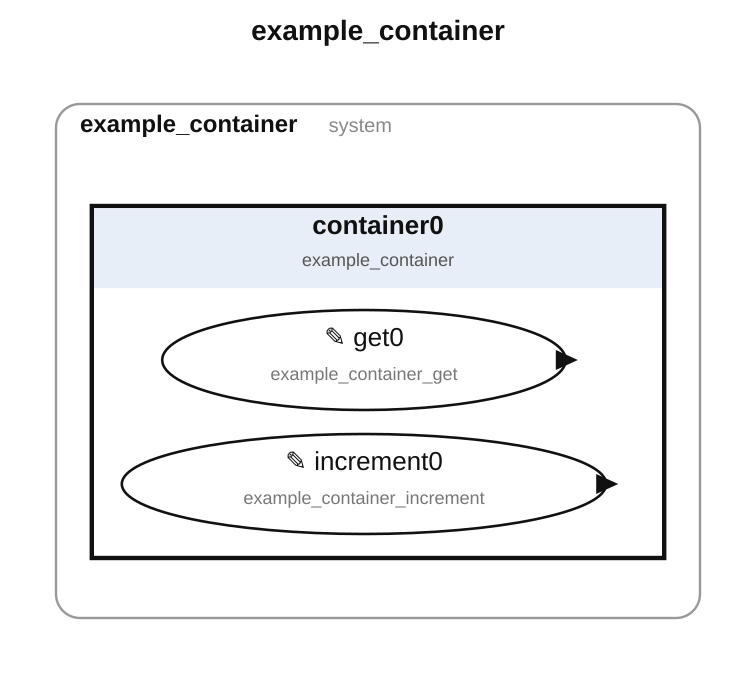
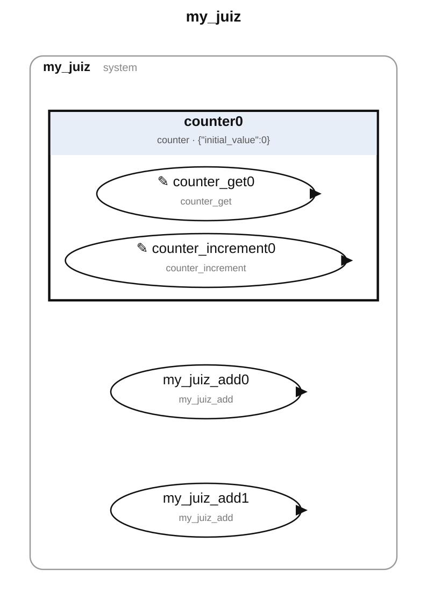
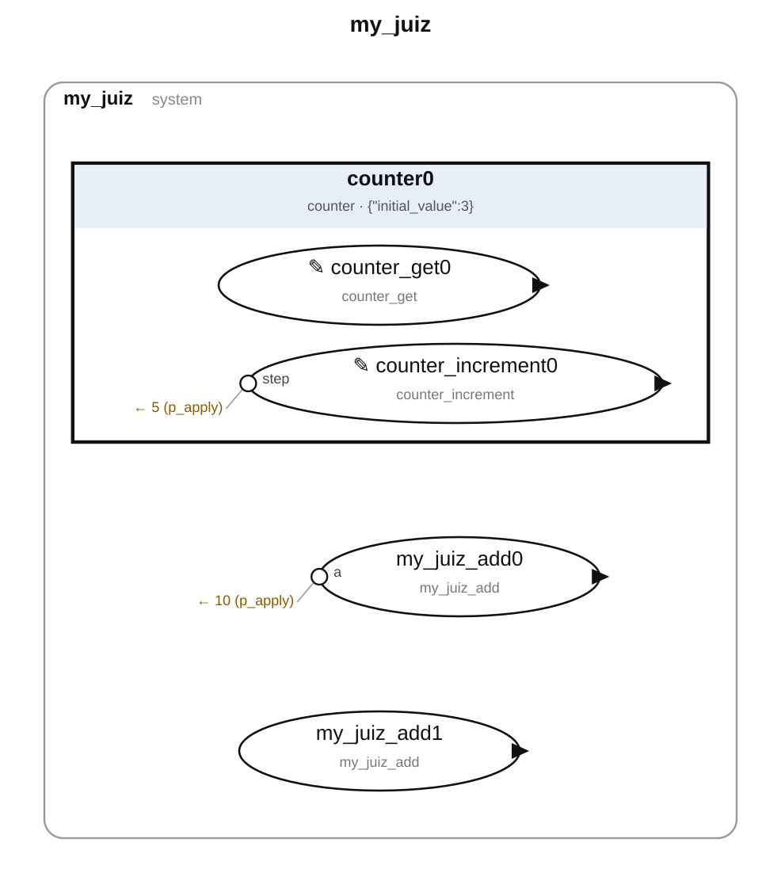
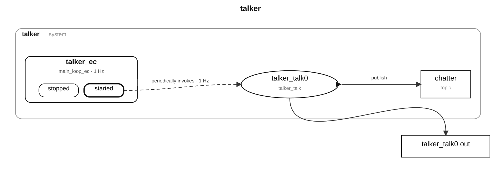
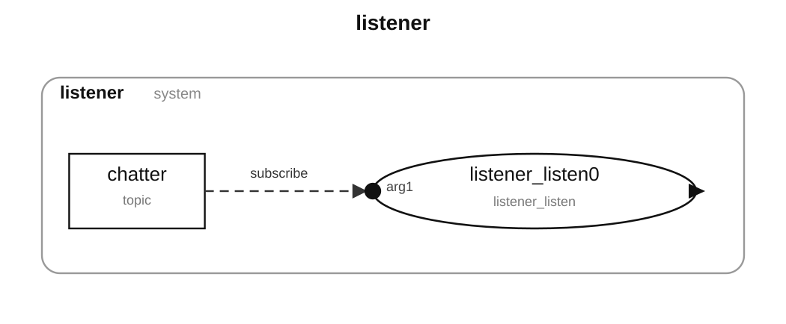
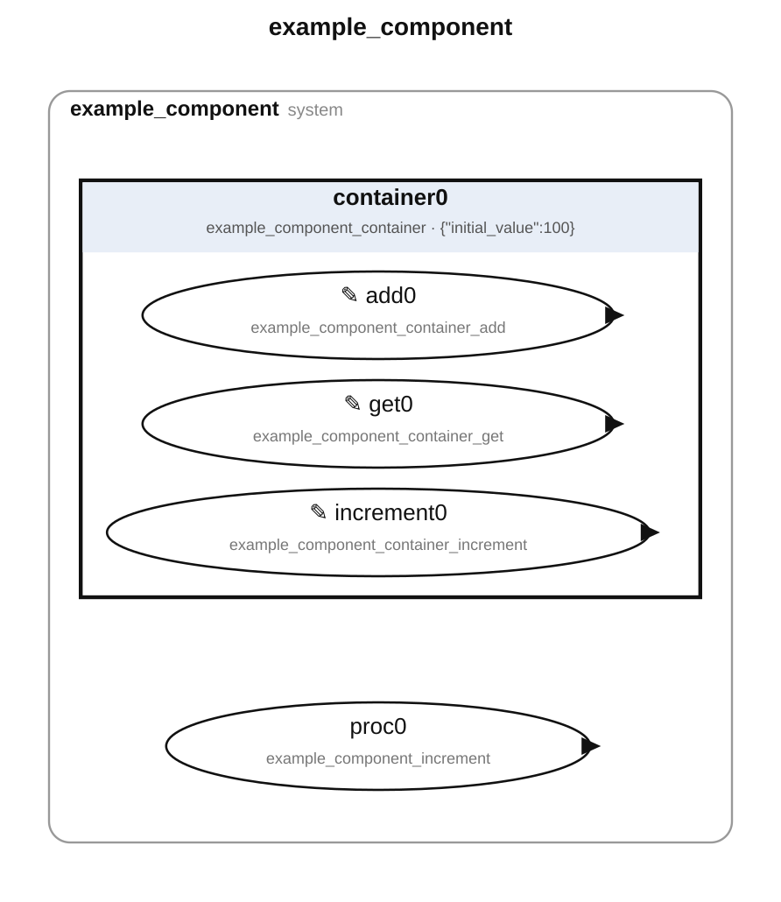
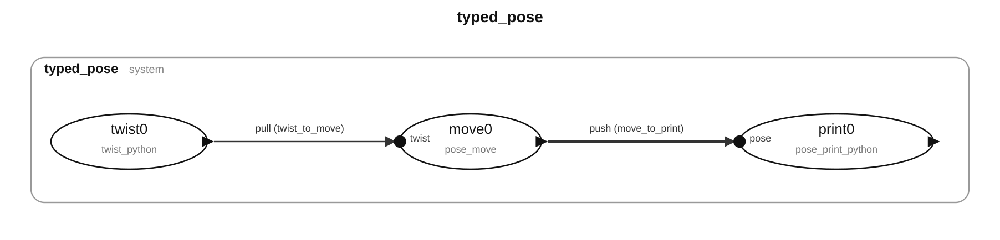

import { Tabs, TabItem } from '@astrojs/starlight/components';

[juiz_opm](https://github.com/OpenJUIZ/juiz_opm) は、juiz のシステムを **OPM**(Object-Process Methodology、ISO 19450)のモデルとして書き出すコマンドです。
設定ファイル(conf)や動いている System から、英語の文で読めるモデル(juiz-OPL)を作り、規則に合っているかを検査し、図にします。

図は **略式図** という 1 種類の描き方で描きます。Process は楕円、Container は箱、EC は状態を持つ箱、System は枠で、引数は楕円の縁の小さな丸です。
このサイトの [チュートリアル](/ja/tutorial/) の各章にある図も、このコマンドで各章の設定ファイルから描いたものです。


:::note[juiz とは別のコマンドです]
juiz_opm は `juiz` コマンドには入っていません。juiz を動かすのに juiz_opm は要りません。
:::

## 入れる

[Releases](https://github.com/OpenJUIZ/juiz_opm/releases) に、OS ごとのビルド済みのファイルがあります。展開してできる `juiz_opm`(Windows では `juiz_opm.exe`)を、PATH の通ったディレクトリに置きます。

<Tabs syncKey="os">
<TabItem label="Linux">

```sh
curl -LO https://github.com/OpenJUIZ/juiz_opm/releases/download/v0.1.0/juiz_opm-v0.1.0-x86_64-unknown-linux-gnu.tar.gz
tar xzf juiz_opm-v0.1.0-x86_64-unknown-linux-gnu.tar.gz
cp juiz_opm-v0.1.0-x86_64-unknown-linux-gnu/juiz_opm ~/.local/bin/
```

</TabItem>
<TabItem label="macOS">

Apple シリコンの Mac では `aarch64-apple-darwin`、Intel の Mac では `x86_64-apple-darwin` のファイルを使います。

```sh
curl -LO https://github.com/OpenJUIZ/juiz_opm/releases/download/v0.1.0/juiz_opm-v0.1.0-aarch64-apple-darwin.tar.gz
tar xzf juiz_opm-v0.1.0-aarch64-apple-darwin.tar.gz
cp juiz_opm-v0.1.0-aarch64-apple-darwin/juiz_opm /usr/local/bin/
```

</TabItem>
<TabItem label="Windows">

[juiz_opm-v0.1.0-x86_64-pc-windows-msvc.zip](https://github.com/OpenJUIZ/juiz_opm/releases/download/v0.1.0/juiz_opm-v0.1.0-x86_64-pc-windows-msvc.zip) を落として展開し、`juiz_opm.exe` を PATH の通ったフォルダに置きます。

</TabItem>
</Tabs>

Rust のツールチェーンがあれば、ソースから入れることもできます。

```sh
cargo install --git https://github.com/OpenJUIZ/juiz_opm juiz_opm
```

図を描くには、ほかに次の 2 つが要ります。モデルを作る・検査する・conf に戻すだけなら要りません。

| 要るもの | 使うところ | 入れ方の例 |
| --- | --- | --- |
| [Graphviz](https://graphviz.org/) の `dot` | 図の配置(SVG・PNG・DOT) | `sudo apt install graphviz`、`brew install graphviz` |
| librsvg の `rsvg-convert` | PNG に書き出すとき | `sudo apt install librsvg2-bin`、`brew install librsvg` |

入ったことを確かめます。

```sh
juiz_opm --version
juiz_opm --help
```

## 設定ファイルを図にする

[第 6 章](/ja/tutorial/component/) から使うサンプル集の `talker_listener.conf` を例にします。サンプル集のルートで実行してください。

```sh
juiz_opm from-conf talker_listener.conf -o talker_listener.opl   # モデルを作る
juiz_opm draw talker_listener.opl > talker_listener.svg          # 略式図(SVG)
juiz_opm draw -T png -o out/ talker_listener.opl                 # 略式図(PNG、out/ に書く)
```

`from-conf` は、conf を **juiz-OPL** に変えます。juiz-OPL は英語の文で、1 文が 1 つの事実を表します。

```text title="talker_listener.opl(一部)"
"talker0" is a process [role: process, name: talker0, type: talker].
"talker0" yields "talker0 out".
"talker0" invokes "listener0".

"listener0" is a process [role: process, name: listener0, type: listener].
"listener0" requires "talker0 out" [arg: arg1, arg_index: 0, connection: push, connection_name: con0].
```

`option` や `plugins` のように、システムの形ではなく起動のしかたを書いた項目はモデルに写しません。そのときは警告が出ますが、気にしなくてかまいません。
`--xml` を付けると、juiz-OPL の代わりに交換形式の XML で書き出します。

### 図に出るもの・出ないもの

conf には書かれていないことは、図にも出ません。

- **接続されていない引数**: conf に名前が出てこないので描かれません。`p_apply` で値を与えた引数と、接続先の引数だけが描かれます。
- **ContainerProcess が読むだけかどうか**: conf では分からないので、書き込み(✎)として描きます。

動いている System から作ると、juiz が知っている引数の名前・順・データ型も入ります(次の節)。

## 動いている System を図にする

`-d` で HTTP ブローカーを立ち上げて動かしている juiz から、そのときの System の形を取り出せます。

```sh
juiz -f talker_listener.conf -d &                                   # System を動かす
juiz_opm fetch http://127.0.0.1:8000 -o talker_listener.json         # スナップショットを取る
juiz_opm from-system talker_listener.json -o talker_listener.opl     # スナップショットからモデルを作る
juiz_opm from-conf --system talker_listener.json talker_listener.conf -o talker_listener.opl  # conf と併せる
```

## 検査する

```sh
juiz_opm check talker_listener.conf talker_listener.opl
```

OPM の規則(C1〜C12)と juiz の規則(J1〜J13)に合っているかを確かめます。終了の状態は、0 が問題なし(警告だけのときも 0)、1 が誤りあり、2 が使い方の誤りか読み書きの失敗です。

## 略式図の読み方

| 記号 | 意味 |
| --- | --- |
| 角の丸い灰色の枠、左上に名前と `system` | System(設定ファイルの `name`) |
| 楕円、中に名前、下に灰色で型名 | Process |
| 楕円の左の縁の小さな丸と引数名 | 引数。黒丸は接続が来ている引数、白丸はそうでない引数 |
| 茶色の `← 値 (p_apply)` | `p_apply` で与えた引数の値 |
| 楕円の右端の黒い三角 | 戻り値 |
| 太い線(ラベル `push (接続名)`) | push の接続。送り手が動くと、その出力を受け手に渡して受け手も動かす |
| 細い線(ラベル `pull (接続名)`) | pull の接続。受け手が動くときに、送り手を動かして値を取りに行く |
| 太枠の箱、上の帯に名前・型名・作るときの値 | Container |
| 箱の中の楕円、名前の前に ✎ か 👁 | ContainerProcess。✎ は Container を書き換える、👁 は読むだけ |
| 角の丸い箱、中に `stopped` と `started` | EC。太枠の状態が起動直後の状態(`auto_start`) |
| `started` からの破線(ラベル `periodically invokes · 周期`) | EC が started の間、つないだ Process を周期的に動かす |
| 太い青の線、中ほどに白抜きの三角 | Transform(Container どうしの位置関係。三角が親から子への向き) |

モデルは OPM のまま持っていて、略式図はそれを決まった規則でまとめて描いたものです。規則の詳しいところは juiz_opm の [略式図の仕様](https://github.com/OpenJUIZ/juiz_opm/blob/main/spec/diagram.md) にあります。

## チュートリアルのシステムの図

チュートリアルの各章で使う設定ファイル(Rust のもの)を、そのまま描いたものです。第 2・3 章はどの言語でも同じ図になり、第 4・5 章はほかの言語では型名(灰色の文字)だけが違います。

### 第 2 章: Container を足した app/app.conf

1 つの Container `counter0` に、ContainerProcess `counter_increment0` と `counter_get0` が結びついています。外には第 1 章の Process `my_juiz_add0` があります。→ [2. 状態を持つ](/ja/tutorial/container/)



### 第 3 章: インスタンスを増やした app/app.conf

同じ型の Process `my_juiz_add0`・`my_juiz_add1` と、Container `counter0`。→ [3. 設定ファイルでまとめて起動する](/ja/tutorial/config-file/)



同じ章の後半で `initial_value` と `p_apply` を足したあとの形です。



### 第 4 章: talker と listener の app/app.conf(Topic)

talker の juiz では EC `talker_ec` が `talker_talk0` を 1 秒ごとに動かし、出力を Topic `chatter` に publish します。listener の juiz では `listener_listen0` が `chatter` を引数 `arg1` で subscribe します。2 つの juiz をつなぐ `mastersystem` は、図には出てきません。→ [4. 別々のプロセスで動く Process をつなぐ](/ja/tutorial/multi-process/)





### 第 5 章: talker_listener.conf

EC `ec0` が `talker_talk0` を 1 秒ごとに動かし、`talker_talk0` の出力が push 接続 `con0` で `listener_listen0` の引数 `arg1` に渡ります。→ [5. 1 つの juiz で複数のライブラリをつなぐ](/ja/tutorial/connect/)


### 第 6 章: example_component.conf

Component から作った Process `proc0` と、初期値 100 の Container `container0`。→ [6. Component にまとめて配布する](/ja/tutorial/component/)



### 第 8 章: typed_pose.conf

`twist0` の出力を pull 接続で `move0` の引数 `twist` に、`move0` の出力を push 接続で `print0` の引数 `pose` に渡します。→ [8. データ型](/ja/tutorial/datatype/)



## そのほかの使い方

```sh
juiz_opm opx talker_listener.opl -o talker_listener.opz   # OPCAT・OPCloud で開けるファイルにする
juiz_opm to-conf talker_listener.opl -o out.conf           # モデルから conf に戻す
juiz_opm round-trip talker_listener.conf                   # conf → モデル → conf で同じになるか確かめる
```

コマンドの一覧は `juiz_opm --help` で、詳しい使い方は juiz_opm の [使い方](https://github.com/OpenJUIZ/juiz_opm/blob/main/docs/usage.md) にあります。
