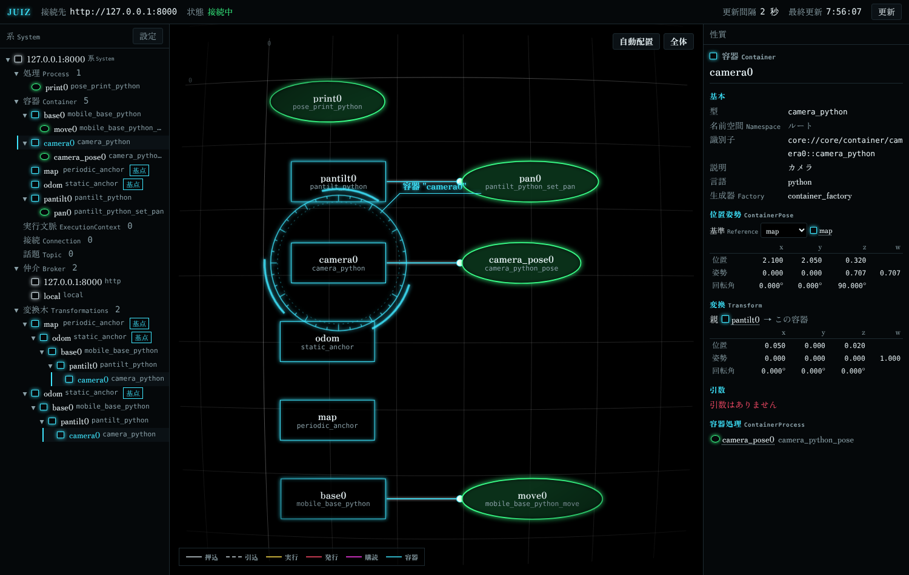

import { Tabs, TabItem } from '@astrojs/starlight/components';

Transformations を使うと、ロボットの部品(台車、腕の関節、雲台、カメラ、センサ)を Container で表したまま、**部品の位置姿勢と部品同士の位置関係**を juiz に計算させられます。
部品同士のつながり(**Transform**)と原点(**Anchor**)を設定ファイルに書けば、「地図から見たカメラの位置」「台車から見た雲台の向き」を、どの言語の ContainerProcess からでも読み書きできます。

```text
map (Anchor) → odom (Anchor) → base0 (台車) → pantilt0 (雲台) → camera0 (カメラ)
```

:::note[juiz 0.2.0 から使えます]
Transformations は juiz 0.2.0 で入った機能です。それより前の版では使えません。
:::

## 用語

| 用語 | 管理画面での表記 | 意味 |
|---|---|---|
| **ContainerPose** | 位置姿勢 | Container の位置そのもの。位置 (x, y, z) [m] と四元数 (x, y, z, w) の姿勢。**必ず基準の Container と組**で読み書きする(「どの Container から見た位置か」)。すべての Container が持つ |
| **Transform** | 変換 | Container 同士を結ぶ**向きのある**つながり。始点(親)から見た終点(子)の位置姿勢を、並進と回転で持つ |
| **Anchor** | 基点 | 座標の原点になる、juiz に組み込みの特別な Container。利用者の状態は持たない。1 つの System に何個あってもよい |
| PeriodicExecutionAnchor | 基点(周期更新) | 自分の周期 `rate` [Hz] で木をたどり、木の Container の ContainerPose を計算し直す Anchor。型名 `periodic_anchor` |
| StaticAnchor | 基点(静的) | 作られたとき・木の形や値が変わったとき・頼まれたときだけ計算し直す Anchor。型名 `static_anchor` |
| **Transformations Tree** | 変換木 | ある Anchor を根に、Transform を親から子へたどって届く Container の木 |
| Pose 通知 | | ある Container の ContainerPose が書かれたときに、登録した Process を呼ぶこと |

ROS の tf との違い: tf の frame は部品とは別の名前ですが、juiz では **Container そのものが座標系**です。Container の名前がそのまま座標系の名前になり、frame の名前を別に持ちません。

## 考え方

### 向きと四元数

Transform(P → C) は、ROS と同じく「子 C の座標を親 P の座標へ写す」変換です。並進 t は P から見た C の原点の位置、回転 q は P から見た C の向きなので、**Transform(P → C) の値は「P を基準にした C の ContainerPose」と同じ数**になります。

- 四元数の並びは **(x, y, z, w)**(w が最後)です。設定ファイル・JSON・C の構造体・関数の引数のどれでも同じで、ROS や `juiz_std.geometry.Quaternion` とも同じです。
- 回転なしは (0, 0, 0, 1) です。z 軸まわりに θ 回す四元数は (0, 0, sin(θ/2), cos(θ/2)) です。
- 保存するときに正規化されます。長さ 0 の四元数や NaN を含む値はエラー(`InvalidPoseValueError`)です。

### 計算のしかた

Anchor A の木の中では、親から順に Transform を掛けていきます。基準 R が Anchor でなくても、R と C を両方含む Anchor があれば相対の位置姿勢を求められます。

```text
pose_A(A) = 単位                                  (Anchor は自分から見て原点)
pose_A(C) = pose_A(親) ∘ Transform(親 → C)
pose_R(C) = pose_A(R)⁻¹ ∘ pose_A(C)               (R と C が同じ Anchor A の木にあるとき)
```

`pose_R(C)` は「R を基準にした C の ContainerPose」と読みます。値は `juiz_std.geometry` の型で表します([データ型](/ja/guides/datatype/))。

| 値 | 型 |
|---|---|
| ContainerPose | `juiz_std.geometry.Pose` `{"position": {x, y, z}, "orientation": {x, y, z, w}}` |
| 時刻と基準つきの ContainerPose(読み書きの戻り値) | `juiz_std.geometry.PoseStamped`。`header.frame_id` は基準 Container の名前、`header.stamp` は計算・書き込みの時刻 |
| Transform の値 | `juiz_std.geometry.Transform` `{"translation": {x, y, z}, "rotation": {x, y, z, w}}` |

`Transform` と `TransformStamped` は ROS 2 の `geometry_msgs` と同じ名前・同じ形です。

## 設定ファイルに書く

4 つの言語のサンプルリポジトリにある `transformations.conf` です(Rust 版。ほかの言語は `plugins:` と型名が違うだけです、[サンプル](#サンプル))。

```yaml
name: transformations
option:
  http_broker:
    start: true
    port: 8000
plugins:
  components:
    mobile_robot:
      language: rust
      path: "./target/debug"
processes:
  - type_name: pose_print
    name: print0
containers:
  - type_name: periodic_anchor   # 組み込みの Anchor。プラグインは要らない
    name: map
    rate: 10.0
  - type_name: static_anchor
    name: odom
  - type_name: mobile_base
    name: base0
    processes:
      - type_name: mobile_base_move
        name: move0
  - type_name: pantilt
    name: pantilt0
    processes:
      - type_name: pantilt_set_pan
        name: pan0
  - type_name: camera
    name: camera0
    processes:
      - type_name: camera_pose
        name: camera_pose0
# 親 → 子 の Transform。translation / rotation を省くと 0 と回転なし
transforms:
  # 自己位置推定で直す map → odom のずれ
  - source: map
    destination: odom
    translation: {x: 1.0, y: 2.0, z: 0.0}
  # move0 が set_pose で書き換える
  - source: odom
    destination: base0
  # 雲台の取り付け位置。pan0 が set_pose で向きを書き換える
  - source: base0
    destination: pantilt0
    translation: {x: 0.1, y: 0.0, z: 0.3}
  # カメラは雲台に固定 (Transform だけ)
  - source: pantilt0
    destination: camera0
    translation: {x: 0.05, y: 0.0, z: 0.02}
# Pose 通知: base0 の位置姿勢が書かれたら、odom から見た値を print0 の引数 pose に渡して呼ぶ
pose_listeners:
  - container: base0
    process: print0
    arg: pose
    reference: odom
```

この設定でできる木は次のとおりです。`odom` は自分の木の根であり、`map` の木の途中のノードでもあります(ROS の map / odom と同じ形)。

```text
map (PeriodicExecutionAnchor, 10 Hz)  … 10 Hz で木をたどって位置姿勢を計算し直す
└─ odom (StaticAnchor)                … 書き込みがあったときだけ計算し直す。map から (1, 2, 0) ずれている
   └─ base0 (台車)                     … move0 がオドメトリを set_pose で書く
      └─ pantilt0 (雲台)               … 台車の (0.1, 0, 0.3) に付く。pan0 がパン角を書く
         └─ camera0 (カメラ)           … 雲台の (0.05, 0, 0.02) に付く。Transform だけ
```

### Anchor

Anchor は `containers:` に普通の Container と同じく書きます。ID・[ネームスペース](/ja/guides/namespace/)・一覧・削除も Container と同じです。

| キー | 内容 |
|---|---|
| `type_name` | `periodic_anchor` か `static_anchor` |
| `name` | Anchor の名前。基準の名前として使う |
| `rate` | `periodic_anchor` の更新周期 [Hz]。省略時は 10.0 |

この版では Anchor に ContainerProcess は付けられません(`processes:` を書くとエラー)。

### `transforms:`

| キー | 必須 | 内容 |
|---|---|---|
| `source` | 必須 | 始点(親)の Container の名前か ID |
| `destination` | 必須 | 終点(子)の Container の名前か ID |
| `translation` | 任意 | 親から見た子の原点の位置 `{x, y, z}` [m]。省略時は 0 |
| `rotation` | 任意 | 親から見た子の向き `{x, y, z, w}`。省略時は回転なし |

Transform の ID は `transform://<始点の ID>|<終点の ID>` です。名前は他の設定と同じく[ネームスペース](/ja/guides/namespace/)の規則で解決します(`robot1/base0` など)。

### 木の規則

**どの Anchor から見ても、届く範囲が木になっていなければなりません。** 次のような Transform はエラー(`TransformTreeError`)になり、設定ファイルなら読み込みのエラー、API なら変更全体が拒まれます。

- 同じ Anchor から 2 通りの道で届く Container(親が 2 つ)。
- Anchor に戻ってくる輪。
- 同じ始点と終点の Transform を 2 本(`TransformAlreadyExistsError`。値を変えるときは update)。

1 つの Container が**別々の** Anchor の木に入るのはかまいません(`map → base0` と `world → base0` は、`map` と `world` が互いに届かなければよい)。どの Anchor からも届かない Transform もエラーにはなりません。

## ContainerProcess から読み書きする

ContainerProcess の中では、**自分の Container** の ContainerPose を、基準の名前を付けて読み書きします。サンプルの台車は、オドメトリを積分して `odom` から見た自分の位置姿勢を書きます。

<Tabs syncKey="lang">
<TabItem label="Rust">

`ContainerImpl` の `pose(reference)` で読み、`set_pose(reference, pose)` で書きます。どちらも `juiz_sdk::geometry::PoseStamped` を返します。

```rust
use juiz_sdk::geometry::{Pose, Quaternion, Vector3};
use juiz_sdk::prelude::*;

#[juiz_component_container_process(container_type = "mobile_base" arguments = {
    default = { vx = 0.0 omega = 0.0 dt = 1.0 reference = "odom" }
})]
fn mobile_base_move(
    c: &mut ContainerImpl<MobileBase>,
    vx: f64,
    omega: f64,
    dt: f64,
    reference: String,
) -> JuizResult<Capsule> {
    c.x += vx * c.theta.cos() * dt;
    c.y += vx * c.theta.sin() * dt;
    c.theta += omega * dt;
    let pose = Pose::new(Vector3::new(c.x, c.y, 0.0), Quaternion::from_rpy(0.0, 0.0, c.theta));
    // odom → base0 の Transform が書き換わり、Pose 通知が出る
    Ok(c.set_pose(&reference, pose)?.into())
}

#[juiz_component_container_process(container_type = "camera" arguments = {
    default = { reference = "map" }
})]
fn camera_pose(c: &mut ContainerImpl<Camera>, reference: String) -> JuizResult<Capsule> {
    Ok(c.pose(&reference)?.into())
}
```

幾何の型(`Vector3`・`Quaternion`・`Pose`・`Transform`・`PoseStamped`)は `juiz_sdk::geometry` にあり、合成(`*`)・逆(`inverse`)・`Quaternion::from_rpy` / `to_rpy` などを持ちます。`Value` や `Capsule` とは `From` / `TryFrom` で行き来できます。
プラグインを既定の C ABI で読んでも、`abi: rust` で読んでも同じ書き方です。

</TabItem>
<TabItem label="Python">

`juiz.pose(obj, reference)` で読み、`juiz.set_pose(obj, reference, pose)` で書きます。`obj` は ContainerProcess の第 1 引数(Container のオブジェクト)です。どちらも `juiz_std.geometry.PoseStamped` を返します。

```python
import math

from juiz import juiz_container_process, pose, set_pose
from juiz_std.geometry import Point3D, Pose, PoseStamped, Quaternion


def yaw_quaternion(yaw: float) -> Quaternion:
    """z 軸まわりに yaw [rad] 回す四元数 (x, y, z, w)"""
    return Quaternion(x=0.0, y=0.0, z=math.sin(yaw / 2), w=math.cos(yaw / 2))


@juiz_container_process(container_type="mobile_base_python")
def mobile_base_python_move(base, vx: float = 0.0, omega: float = 0.0, dt: float = 1.0,
                            reference: str = "odom") -> PoseStamped:
    base.x += vx * math.cos(base.theta) * dt
    base.y += vx * math.sin(base.theta) * dt
    base.theta += omega * dt
    p = Pose(position=Point3D(x=base.x, y=base.y, z=0.0), orientation=yaw_quaternion(base.theta))
    # odom → base0 の Transform が書き換わり、Pose 通知が出る
    return set_pose(base, reference, p)


@juiz_container_process(container_type="camera_python")
def camera_python_pose(camera, reference: str = "map") -> PoseStamped:
    return pose(camera, reference)
```

juiz は Container のオブジェクトに属性 `__juiz_pose__` を付けて、それを通して読み書きします。そのため Container の constructor は**普通のクラスのオブジェクト**を返してください(`__slots__` を持つクラスや dict には付けられず、`TransformationsNotAttachedError` になります)。
`set_pose` には `Pose`・`PoseStamped`・それぞれの辞書を渡せます。

</TabItem>
<TabItem label="C++">

`juiz/pose.h`(`juiz/juiz.h` から読み込まれます)の `juiz::pose(container, reference)` で読み、`juiz::set_pose(container, reference, pose)` で書きます。`container` は ContainerProcess が受け取った Container のポインタです。戻り値は `juiz_pose_stamped` で、辞書にするには `juiz::pose_to_value` を使います。

```cpp
#include <cmath>
#include "juiz/juiz.h"

// z 軸まわりに yaw [rad] 回す姿勢で、位置 (x, y, z) の juiz_pose を作る
static juiz_pose yaw_pose(double x, double y, double z, double yaw) {
    return juiz::make_pose(x, y, z, 0.0, 0.0, std::sin(yaw / 2), std::cos(yaw / 2));
}

std::optional<juiz::Value> mobile_base_cpp_move(MobileBase* base, const double vx, const double omega, const double dt,
                                                const std::string& reference) {
    base->x += vx * std::cos(base->theta) * dt;
    base->y += vx * std::sin(base->theta) * dt;
    base->theta += omega * dt;
    // odom → base0 の Transform が書き換わり、Pose 通知が出る
    auto p = juiz::set_pose(base, reference, yaw_pose(base->x, base->y, 0.0, base->theta));
    return juiz::pose_to_value(p, reference);
}
COMPONENT_CONTAINER_PROCESS_FACTORY(MobileBase, mobile_base_cpp_move_manif, mobile_base_cpp_move);

std::optional<juiz::Value> camera_cpp_pose(Camera* camera, const std::string& reference) {
    return juiz::pose_to_value(juiz::pose(camera, reference), reference);
}
COMPONENT_CONTAINER_PROCESS_FACTORY(Camera, camera_cpp_pose_manif, camera_cpp_pose);
```

失敗すると `juiz::TransformationsError` の子の例外(`juiz::NoCommonAnchorError` など)を投げます。捕まえなければ、その呼び出しのエラーとして返ります。
C から使うときは `juiz_sdk.h` の `juiz_container_pose_get` / `juiz_container_pose_set` に、entry point が受け取った `capsule_map*` を渡します。

</TabItem>
<TabItem label="Haskell">

`containerPose reference` で読み、`setContainerPose reference pose` で書きます。どちらも「**今呼ばれている ContainerProcess の Container**」が相手なので、Container の値は渡しません。

```haskell
-- | z 軸まわりに yaw [rad] 回す姿勢で、位置 (x, y, z) の ContainerPose を作る
yawPose :: (Double, Double, Double) -> Double -> ContainerPose
yawPose position yaw = ContainerPose position (0, 0, sin (yaw / 2), cos (yaw / 2))

move :: MobileBase -> Double -> Double -> Double -> Text -> IO Value
move (MobileBase ref) vx omega dt reference = do
  (x, y, theta) <- readIORef ref
  let x' = x + vx * cos theta * dt
      y' = y + vx * sin theta * dt
      theta' = theta + omega * dt
  writeIORef ref (x', y', theta')
  -- odom → base0 の Transform が書き換わり、Pose 通知が出る
  poseStampedToValue reference <$> setContainerPose reference (yawPose (x', y', 0) theta')

cameraPose :: Camera -> Text -> IO Value
cameraPose Camera reference = poseStampedToValue reference <$> containerPose reference
```

失敗すると `JuizError`(コード -901〜-905)を投げます。

</TabItem>
</Tabs>

C++・Haskell・C ABI の Rust では、読み書きの口は**その呼び出しの間だけ**使えます。ContainerProcess の中で立てた別のスレッドや、呼び出しの後から読み書きすると `TransformationsNotAttachedError` になります。

### 読む規則

`pose(C, R)` は次の順に値を決めます。

1. R が Anchor で、C がその木にあれば、その Anchor が計算しておいた値をそのまま返します(速い)。
2. そうでなければ、R と C の両方を含む Anchor を探して `pose_A(R)⁻¹ ∘ pose_A(C)` を返します。候補が複数あれば、木の中の R と C の深さの和が最小のものを使います。
3. 共通の Anchor が無ければ `NoCommonAnchorError` です。

### 書く規則

`set_pose(C, R, p)` は「C を、R から見て p の位置姿勢にする」書き込みです。**C の値そのものではなく、木の中の親 → C の Transform を書き換えます**。関節の角度を変えると、その先の部品も一緒に動くのと同じです。

- サンプルの雲台は、取り付け位置はそのままにして向きだけを変えます(`pose("base0")` で今の位置を読み、向きを変えて `set_pose("base0", ...)`)。カメラは雲台の子なので、何もしなくても雲台と一緒に向きが変わります。
- どの木にも入っていない Container への書き込みはエラー(`NoCommonAnchorError`)です。Transform は自動では作りません。先に設定ファイルか API で Transform を作ってください。
- 木の根の Anchor、基準自身、基準が自分の子孫になる書き込みはエラー(`PoseNotWritableError`)です。
- 戻り値は書いた後の `pose(C, R)` です。

## Anchor の更新

各 Container は「Anchor ごとの ContainerPose」を持っていて、Anchor が木をたどってこれを計算し直します。値は利用者の状態とは別に置かれるので、時間のかかる ContainerProcess が走っていても Anchor の更新は止まりません。

| | PeriodicExecutionAnchor(`periodic_anchor`) | StaticAnchor(`static_anchor`) |
|---|---|---|
| 計算し直すとき | `rate` [Hz] ごと | 作られたとき、木の Transform が作られた・消えた・値が変わったとき(`set_pose` を含む)、頼まれたとき |
| 書き込み直後の読み出し | 最大 1 周期古い | `set_pose` が戻った時点で新しい |
| 向いているもの | 地図のように、たくさんの部品が絶えず動く木 | 書き込みの少ない木、書いた直後の値が要るとき |

Periodic の木で今すぐ新しい値が欲しいときは、`juiz anchor update map`(API は `anchor/update`)で計算し直させられます。

## Pose 通知

設定ファイルの `pose_listeners:`(または API)で、「Container X の ContainerPose が書かれたら Process Y を呼ぶ」と登録できます。Y の引数には、X の位置姿勢が `juiz_std.geometry.PoseStamped` で渡ります。

| キー | 必須 | 内容 |
|---|---|---|
| `container` | 必須 | 見張る Container |
| `process` | 必須 | 呼ぶ Process。ContainerProcess や、ブローカー越しの別プロセスの Process でもよい |
| `arg` | Y の引数が 2 つ以上のとき | 位置姿勢を渡す引数の名前 |
| `reference` | 任意 | 渡す値の基準。省略時は書き込みで使われた基準 |
| `on_update` | 任意 | `true` なら、Anchor の更新で値が変わったときにも呼ぶ(既定 `false`)。このとき `reference` は必須 |

- 通知のきっかけは**明示的な書き込み**だけです: `set_pose`(ContainerProcess・API・CLI から)と、Transform の作成・値の変更・削除(終点の Container に通知)。Anchor の周期更新では呼びません(`on_update: true` を除く)。
- Y の引数の型が `juiz_std.geometry.PoseStamped` でも型なしでもないときは、登録のときにエラーになります。
- 通知で呼ばれた Process がまた `set_pose` しても、その書き込みからは通知を出さず、警告を 1 回出します(通知が回り続けないように)。
- Y は書き込んだスレッドで呼ばれ、Y のエラーは警告を出して捨てます(書き込みは成功のまま)。
- 書き込んでいる ContainerProcess と**同じ Container** の ContainerProcess を Y にすると、Container のロックを待って止まります。そういう登録はしないでください。

サンプルの `reference: odom` は、`map` だと Periodic の値が最大 1 周期古くなるため、Static の `odom` を基準にしています。

## 動かしてみる

サンプルリポジトリで部品をビルドしてから(手順は各リポジトリの README)、juiz を起動します。

```sh
juiz -f transformations.conf -d
```

別の端末で台車を前へ 1 m 動かし、雲台を 90 度回します。

<Tabs syncKey="lang">
<TabItem label="Rust">

```sh
juiz container-process call "http://127.0.0.1:8000/container_process/move0::mobile_base_move:base0" '{"vx": 1.0, "dt": 1.0}' -p
juiz container-process call "http://127.0.0.1:8000/container_process/pan0::pantilt_set_pan:pantilt0" '{"pan": 1.5707963267948966}' -p
```

</TabItem>
<TabItem label="Python">

```sh
juiz container-process call "http://127.0.0.1:8000/container_process/move0::mobile_base_python_move:base0" '{"vx": 1.0, "dt": 1.0}' -p
juiz container-process call "http://127.0.0.1:8000/container_process/pan0::pantilt_python_set_pan:pantilt0" '{"pan": 1.5707963267948966}' -p
```

</TabItem>
<TabItem label="C++">

```sh
juiz container-process call "http://127.0.0.1:8000/container_process/move0::mobile_base_cpp_move:base0" '{"vx": 1.0, "dt": 1.0}' -p
juiz container-process call "http://127.0.0.1:8000/container_process/pan0::pantilt_cpp_set_pan:pantilt0" '{"pan": 1.5707963267948966}' -p
```

</TabItem>
<TabItem label="Haskell">

```sh
juiz container-process call "http://127.0.0.1:8000/container_process/move0::mobile_base_hs_move:base0" '{"vx": 1.0, "dt": 1.0}' -p
juiz container-process call "http://127.0.0.1:8000/container_process/pan0::pantilt_hs_set_pan:pantilt0" '{"pan": 1.5707963267948966}' -p
```

</TabItem>
</Tabs>

1 つ目の呼び出しで、juiz を起動した端末に Pose 通知の出力が出ます(先頭の型名は言語ごとに違います)。

```text
pose_print: x=1.00 y=0.00 yaw=0.0deg (from odom)
```

カメラの位置姿勢を読みます。雲台が左へ 90 度回ったので、雲台の前 0.05 m にあるカメラは台車の左(y = 0.05)に来ます。`map` から見ると、`map` → `odom` のずれ (1, 2, 0) が足されます。

```sh
juiz container pose camera0 --reference odom
# => position: x=1.1, y=0.05, z=0.32 (PoseStamped の JSON)
juiz container pose camera0 --reference map
# => position: x=2.1, y=2.05, z=0.32
juiz anchor tree map
# map  position (0, 0, 0)  orientation (0, 0, 0, 1)
# └─ odom  position (1, 2, 0)  orientation (0, 0, 0, 1)
#    └─ base0  position (2, 2, 0)  orientation (0, 0, 0, 1)
#       └─ pantilt0  position (2.1, 2, 0.3)  orientation (0, 0, 0.7071067811865475, 0.7071067811865476)
#          └─ camera0  position (2.1, 2.05, 0.32)  orientation (0, 0, 0.7071067811865475, 0.7071067811865476)
```

`map` は Periodic なので、書き込みの直後に読むと最大 0.1 秒古い値が返ることがあります。

## CLI

サーバーは `-s` で指定します(既定 `http://127.0.0.1:8000`)。Container・Anchor は名前か ID で指定できます。

```text
juiz container pose <container> --reference <基準>                     # 読む(-r でもよい)。PoseStamped を JSON で出す
juiz container pose <container> --reference <基準> --set '<Pose の JSON>' # 書く
juiz container list --long                        # Anchor の行に「anchor: periodic (10 Hz)」「anchor: static」

juiz transform list [--long]                      # --long は「始点 -> 終点  translation (…)  rotation (…)」
juiz transform info <id | 始点 終点>
juiz transform create <始点> <終点> [--translation x,y,z] [--rotation x,y,z,w]
juiz transform update <id | 始点 終点> [--translation x,y,z] [--rotation x,y,z,w]
juiz transform delete <id | 始点 終点>

juiz anchor list
juiz anchor update <anchor>                       # 計算し直させる
juiz anchor tree <anchor> [--json]                # 木と、Anchor から見た各 Container の位置・向き
```

Transform は ID が長いので、始点と終点の 2 つの名前でも指せます。`--set` の例:

```sh
juiz container pose base0 --reference odom --set '{"position": {"x": 0.5, "y": 0, "z": 0}, "orientation": {"x": 0, "y": 0, "z": 0, "w": 1}}'
```

Pose 通知の CLI はありません(設定ファイル・API・pyjuiz で登録します)。実行中に Anchor を作るときは、API の `container/create`(型名 `periodic_anchor` / `static_anchor`)か pyjuiz の `create_anchor` を使います。

## HTTP API と pyjuiz

System の API に次のクラスがあり、HTTP・QUIC・IPC のどのブローカー越しにも呼べます。引数と戻り値は `juiz_std.geometry` の型として OpenAPI(`/docs`)にも載ります。

| クラス / 関数 | 方法 | 内容 |
|---|---|---|
| `container/pose` | READ(GET) | `identifier` の ContainerPose を `reference` から見て読む |
| `container/set_pose` | UPDATE(PATCH) | `identifier` を書く。ボディは `reference`・`pose` |
| `transform/list`・`transform/profile_full` | READ | Transform の一覧と中身 |
| `transform/create`・`transform/update`・`transform/destroy` | CREATE・UPDATE・DELETE | Transform を作る・値を変える・消す |
| `anchor/list`・`anchor/update` | READ・UPDATE | Anchor の一覧、計算し直し |
| `transformations/tree` | READ | `anchor` の木(各ノードの位置姿勢と親からの Transform) |
| `pose_listener/list`・`profile_full`・`create`・`destroy` | | Pose 通知の登録 |

```sh
curl "http://127.0.0.1:8000/api/container/pose?identifier=camera0&reference=map"
```

API の名前はルートのネームスペースから解決します。System を `--namespace robot1` で起動していても、名前には `robot1/camera0` のようにネームスペースを付けてください。

Python のクライアント(pyjuiz)では、`SystemProxy` と `ContainerProxy` から使えます。値は dict か `juiz_std.geometry` のオブジェクトで、`translation`・`rotation` はタプルでもかまいません。

```python
from juiz.proxy import SystemProxy, HttpProxy

system = SystemProxy(HttpProxy('localhost', 8000))
system.pose('camera0', 'map')                       # PoseStamped の dict
system.create_anchor('world', kind='periodic', rate=30.0)
system.create_transform('world', 'map', translation=(0.0, 0.0, 0.0))
system.tree('map')
system.pose_listeners()                             # 登録済みの Pose 通知の ID
system.create_pose_listener('camera0', 'print0', arg='pose', reference='map', on_update=True)
```

## 管理画面

[管理画面](/ja/guides/web-ui/)では、Anchor の容器に「基点」の印が付き、ツリーの分類「変換木」に Anchor ごとの木が入れ子で並びます。容器を選ぶと性質欄に次が出ます。

- **位置姿勢**: 基準を選んで、位置 (x, y, z)、四元数 (x, y, z, w)、回転角(ロール・ピッチ・ヨー [度])を表示します。
- **変換**: 親から来る Transform と、子へ出る Transform の値。
- Anchor なら種類(周期更新 / 静的)と周期、木の各ノードの位置。



3D の表示はまだありません。

## エラー

| エラー | いつ |
|---|---|
| `NoCommonAnchorError` | 基準と相手の両方を含む Anchor が無い(読み・書き)。どの木にも入っていない Container への書き込みもこれ |
| `PoseNotWritableError` | 木の根の Anchor・基準自身・基準が子孫になる Container への書き込み |
| `InvalidPoseValueError` | 長さ 0 の四元数、NaN・無限大 |
| `TransformTreeError` | 木の規則を破る Transform |
| `TransformAlreadyExistsError` | 同じ始点と終点の Transform |
| `TransformNotFoundError` | 指定の Transform が無い |
| `PoseListenerError` | Pose 通知の登録の不備(引数・型・二重登録) |
| `TransformationsNotAttachedError` | System に登録されていない Container、口の無いオブジェクト、呼び出しの外からの読み書き |

Python ではどれも `juiz.TransformationsError`(`RuntimeError` の子)の子の例外、C++ では `juiz::TransformationsError` の子の例外になります。

## できないこと

- **System をまたぐ Transform**: 木は 1 つの System(1 つの juiz のプロセス)の中で閉じます。サブシステムや別プロセスの Container とは Transform を結べません。
- 過去の時刻の位置姿勢の問い合わせ(tf2 の時刻つきバッファ)。
- 管理画面の 3D 表示。

## サンプル

どの言語のサンプルリポジトリにも `transformations.conf` と、台車・雲台・カメラと Pose 通知の受け手を 1 つにまとめた Component があります。木と数値は 4 言語で同じです。

| 言語 | リポジトリ | Component | 型の名前 |
|---|---|---|---|
| Rust | [juiz_examples_rust](https://github.com/OpenJUIZ/juiz_examples_rust) | `component/mobile_robot` | `mobile_base`・`pantilt`・`camera`・`pose_print` |
| Python | [juiz_examples_python](https://github.com/OpenJUIZ/juiz_examples_python) | `component/mobile_robot_python.py` | `mobile_base_python`・`pantilt_python`・`camera_python`・`pose_print_python` |
| C++ | [juiz_examples_cpp](https://github.com/OpenJUIZ/juiz_examples_cpp) | `component/mobile_robot_cpp` | `mobile_base_cpp`・`pantilt_cpp`・`camera_cpp`・`pose_print_cpp` |
| Haskell | [juiz_examples_haskell](https://github.com/OpenJUIZ/juiz_examples_haskell) | `component/MobileRobot.hs` | `mobile_base_hs`・`pantilt_hs`・`camera_hs`・`pose_print_hs` |

ContainerProcess の型名は、Container の型名に `_move`・`_set_pan`・`_pose` を付けたものです(`mobile_base_python_move` など)。
