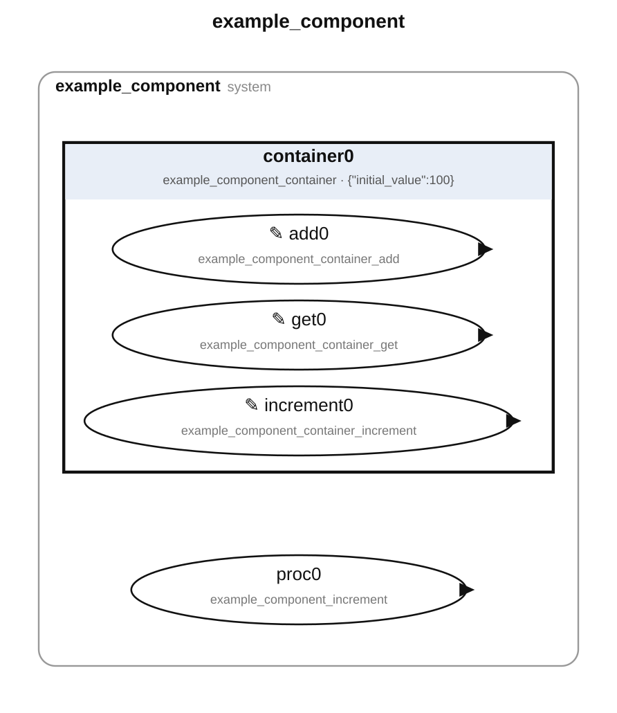

import { Aside, CardGrid, LinkCard } from '@astrojs/starlight/components';

第 1〜3 章の雛形では、Process・Container・ContainerProcess を 1 つのソースに書いて 1 つのライブラリにし、`app/app.conf` の `plugins` の `components` に 1 行書いて読み込みました。
一方、サンプル集の talker と listener は、1 つの型ごとに別々のファイル(ライブラリ)にして、`process_factories` に型を 1 つずつ並べて読み込みました。

実際に「このカメラを動かす部品一式」を誰かに渡すときに、ファイルがばらばらだと不便です。
この章では、雛形がとっていた形、つまり Process・Container・ContainerProcess を 1 つのライブラリにまとめた **Component** を、サンプル集の例で改めて読み、型ごとのファイルと比べます。

<Aside type="tip" title="この章で学ぶこと">
- Component は、複数の Process・Container・ContainerProcess を 1 つにまとめた**配布の単位**であること
- Component の中の型は、これまでと同じ型名で、同じようにインスタンスを作れること
- `plugins` の `components` には、型ではなく Component の名前を 1 つ書けばよいこと
</Aside>

この章からは、サンプル集をクローンしてビルドし、そのファイルを読みながら進めます。用意のしかたは、各言語のページの最初にあります。Component の書き方は言語ごとに違うので、使う言語を選んでください。

<CardGrid>
	<LinkCard title="Rust" href="/ja/tutorial/component/rust/" description="Component 用の属性マクロと juiz_component_manifest! で、1 つのクレートにまとめます。" />
	<LinkCard title="Python" href="/ja/tutorial/component/python/" description="デコレータを付けた関数を 1 つの .py ファイルに並べます。" />
	<LinkCard title="C++" href="/ja/tutorial/component/cpp/" description="複数の型を 1 つの共有ライブラリにまとめて公開します。" />
	<LinkCard title="Haskell" href="/ja/tutorial/component/haskell/" description="juizComponent で、複数の型を 1 つの共有ライブラリにまとめて公開します。" />
</CardGrid>

この章で使う Component には、どの言語でも次のものが入っています。どれも、これまでの章で作ったものと同じ働きです。

| 種類 | 働き |
| --- | --- |
| Process | 引数に 1 を足して返す(第 1 章の `my_juiz_add` と同じく、ふつうの Process) |
| Container | 整数値を 1 つ持つ(第 2 章のカウンタと同じ) |
| ContainerProcess | Container の値を読む・変える |

この章で使う設定ファイル `example_component.conf` のシステムを [juiz_opm](/ja/guides/juiz-opm/) の略式図で描くと、次のようになります(図の読み方は [システムを図にする](/ja/guides/juiz-opm/#略式図の読み方) にあります)。

