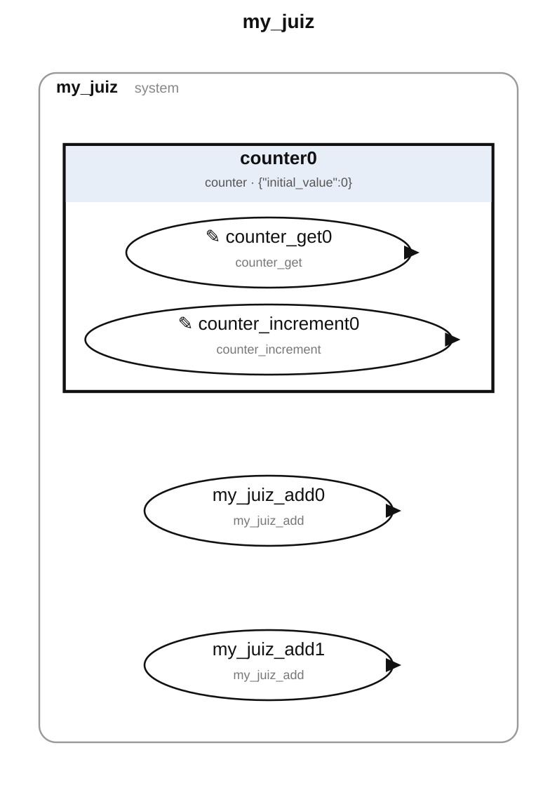
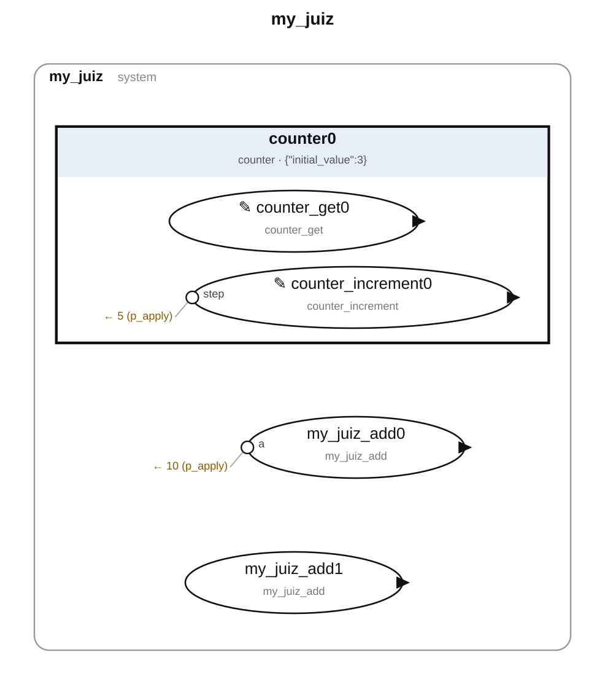

import { Tabs, TabItem, Aside } from '@astrojs/starlight/components';

第 1 章と第 2 章では、雛形の設定ファイル `app/app.conf` を `juiz -f` に渡して、Process と Container をまとめて起動しました。
実際のロボットでは、カメラやモータ、それを処理する Process など、たくさんの部品を一度に動かします。その組み立てを書くのが設定ファイルです。
この章では、`app/app.conf` を読み、自分で書き換えて、インスタンスを増やしたり初期値を渡したりします。

<Aside type="tip" title="この章で学ぶこと">
- 設定ファイルには「何を読み込むか」(`plugins`)と「何を作るか」(`processes` / `containers`)を分けて書くこと
- 1 つの型から、名前の違うインスタンスをいくつも作れること
- Container の初期値のような、インスタンスごとの設定を設定ファイルで渡せること
- `p_apply` で Process の引数に初期値を与えられること
- call・call_partial・execute で、渡さなかった引数に入る値が違うこと
</Aside>

## プロジェクトを用意する

第 2 章まで進めたプロジェクト `my_juiz` をそのまま使います。どの言語で進めていても、型名(`my_juiz_add`・`counter`・`counter_increment`・`counter_get`)は同じです。
この章ではソースは書き換えないので、ビルドし直す必要はありません。

## 設定ファイルを読む

第 2 章で Container を足したあとの `app/app.conf` は、次のようになっています(先頭のコメントは省いています)。

<Tabs syncKey="lang">
<TabItem label="Rust">

```yaml title="app/app.conf"
"name": "my_juiz"
"option":
  "http_broker":
    "start": true
    "port": 8000
"plugins":
  "components":
    "my_juiz":
      "language": "rust"
      "path": "plugins/{target}"
"processes":
  - "type_name": "my_juiz_add"
    "name": "my_juiz_add0"
"containers":
  - "type_name": "counter"
    "name": "counter0"
    "initial_value": 0
    "processes":
      - "type_name": "counter_increment"
        "name": "counter_increment0"
      - "type_name": "counter_get"
        "name": "counter_get0"
```

</TabItem>
<TabItem label="Python">

```yaml title="app/app.conf"
"name": "my_juiz"
"option":
  "http_broker":
    "start": true
    "port": 8000
"plugins":
  "components":
    "my_juiz":
      "language": "python"
      "path": "python"
"processes":
  - "type_name": "my_juiz_add"
    "name": "my_juiz_add0"
"containers":
  - "type_name": "counter"
    "name": "counter0"
    "initial_value": 0
    "processes":
      - "type_name": "counter_increment"
        "name": "counter_increment0"
      - "type_name": "counter_get"
        "name": "counter_get0"
```

</TabItem>
<TabItem label="C++">

```yaml title="app/app.conf"
"name": "my_juiz"
"option":
  "http_broker":
    "start": true
    "port": 8000
"plugins":
  "components":
    "my_juiz":
      "language": "c++"
      "path": "plugins/{target}"
"processes":
  - "type_name": "my_juiz_add"
    "name": "my_juiz_add0"
"containers":
  - "type_name": "counter"
    "name": "counter0"
    "initial_value": 0
    "processes":
      - "type_name": "counter_increment"
        "name": "counter_increment0"
      - "type_name": "counter_get"
        "name": "counter_get0"
```

</TabItem>
<TabItem label="Haskell">

```yaml title="app/app.conf"
"name": "my_juiz"
"option":
  "http_broker":
    "start": true
    "port": 8000
"plugins":
  "components":
    "my_juiz":
      "language": "haskell"
      "path": "plugins/{target}"
"processes":
  - "type_name": "my_juiz_add"
    "name": "my_juiz_add0"
"containers":
  - "type_name": "counter"
    "name": "counter0"
    "initial_value": 0
    "processes":
      - "type_name": "counter_increment"
        "name": "counter_increment0"
      - "type_name": "counter_get"
        "name": "counter_get0"
```

</TabItem>
<TabItem label="Zig">

```yaml title="app/app.conf"
"name": "my_juiz"
"option":
  "http_broker":
    "start": true
    "port": 8000
"plugins":
  "components":
    "my_juiz":
      "language": "zig"
      "path": "plugins/{target}"
"processes":
  - "type_name": "my_juiz_add"
    "name": "my_juiz_add0"
"containers":
  - "type_name": "counter"
    "name": "counter0"
    "initial_value": 0
    "processes":
      - "type_name": "counter_increment"
        "name": "counter_increment0"
      - "type_name": "counter_get"
        "name": "counter_get0"
```

</TabItem>
</Tabs>

言語によって違うのは、`plugins` の `language` と `path` の 2 行だけです。

設定ファイルは YAML で書きます。雛形ではキーも値も `"` で囲んでありますが、YAML なので、囲まずに `name: my_juiz` と書いてもかまいません(この章でも、書き足す所は雛形に合わせて `"` で囲みます)。
上から順に見ていきましょう。

### name と option

```yaml
"name": "my_juiz"
"option":
  "http_broker":
    "start": true
    "port": 8000
```

`name` はこのシステムの名前です。
`option` の `http_broker` は、HTTP ブローカーの設定です。`start: true` で立ち上げ、`port` で待ち受けるポートを決めます。ポートを変えたいときは、ここを書き換えます。

### plugins: 読み込む

`plugins` には、どのファイルから型を**読み込む**かを書きます。

```yaml
"plugins":
  "components":
    "my_juiz":
      "language": "rust"
      "path": "plugins/{target}"
```

`components` には、複数の型をまとめた **Component** のライブラリを書きます。キーが Component の名前で、`my_juiz` の中には、第 1 章の Process と第 2 章の Container・ContainerProcess の 4 つの型が入っています。

| 項目 | 意味 |
| --- | --- |
| `language` | ライブラリの言語です。`rust`・`python`・`c++`・`haskell`・`zig` のどれかを書きます |
| `path` | ライブラリを探すディレクトリです。相対パスは、設定ファイルのあるディレクトリ(`app/`)から数えます |

juiz は、`path` のディレクトリから、Component の名前に合ったファイルを探します。

<Tabs syncKey="lang">
<TabItem label="Rust">

`plugins/{target}` の `{target}` は、動かしているマシンのターゲット名(`juiz pkg target` で表示されるもの)に置き換わります。
Linux なら `app/plugins/x86_64-unknown-linux-gnu/libmy_juiz.so`、macOS なら `libmy_juiz.dylib`、Windows なら `my_juiz.dll` が読み込まれます。

</TabItem>
<TabItem label="Python">

`app/python` の中の `my_juiz.py` が読み込まれます。

</TabItem>
<TabItem label="C++">

`plugins/{target}` の `{target}` は、動かしているマシンのターゲット名(`juiz pkg target` で表示されるもの)に置き換わります。
Linux なら `app/plugins/x86_64-unknown-linux-gnu/libmy_juiz.so`、macOS なら `libmy_juiz.dylib`、Windows なら `my_juiz.dll` が読み込まれます。

</TabItem>
<TabItem label="Haskell">

`plugins/{target}` の `{target}` は、動かしているマシンのターゲット名(`juiz pkg target` で表示されるもの)に置き換わります。
Linux なら `app/plugins/x86_64-unknown-linux-gnu/libmy_juiz.so`、macOS なら `libmy_juiz.dylib` が読み込まれます。

</TabItem>
<TabItem label="Zig">

`plugins/{target}` の `{target}` は、動かしているマシンのターゲット名(`juiz pkg target` で表示されるもの)に置き換わります。
Linux なら `app/plugins/x86_64-unknown-linux-gnu/libmy_juiz.so`、macOS なら `libmy_juiz.dylib` が読み込まれます(`scripts/dev.sh` が隣に置いた libjuiz_sdk も一緒に使われます)。

</TabItem>
</Tabs>

`plugins` に書くだけでは、まだ何も動きません。juiz が型(作り方)を覚えるだけです。

<Aside type="note" title="型ごとに別のファイルにする書き方">
Component のほかに、1 つの型だけが入ったファイルを読み込むこともできます。Process は `process_factories`、Container は `container_factories` に、キーを**型名**にして書きます。

```yaml
plugins:
  process_factories:
    talker:
      path: "./target/debug"
```

この場合は、型名 `talker` からファイル名(`libtalker.so` など)を作って探します。第 6 章から使うサンプル集は、この書き方をしています。
2 つの書き方の違いは、第 6 章で扱います。
</Aside>

### processes と containers: 作る

`processes` と `containers` には、読み込んだ型から**インスタンスを作る**ことを書きます。

```yaml
"processes":
  - "type_name": "my_juiz_add"
    "name": "my_juiz_add0"
"containers":
  - "type_name": "counter"
    "name": "counter0"
    "initial_value": 0
    "processes":
      - "type_name": "counter_increment"
        "name": "counter_increment0"
      - "type_name": "counter_get"
        "name": "counter_get0"
```

- `type_name` には `plugins` で読み込んだ型名を、`name` には作るインスタンスの名前を書きます。
- `processes` では、型 `my_juiz_add` から Process のインスタンス `my_juiz_add0` を作っています。
- `containers` では、Container `counter0` を作り、その下の `processes` で、`counter0` に結びつく ContainerProcess `counter_increment0` と `counter_get0` を作っています。

雛形は「型名 + `0`」という名前を付けていますが、インスタンスの名前は好きに付けられます。名前は ID の一部になります。

## 同じ型からインスタンスを増やす

1 つの型から、名前の違うインスタンスをいくつも作れます。
`processes` に、同じ型 `my_juiz_add` のインスタンス `my_juiz_add1` を書き足してみましょう。

```yaml title="app/app.conf" ins={4-5}
"processes":
  - "type_name": "my_juiz_add"
    "name": "my_juiz_add0"
  - "type_name": "my_juiz_add"
    "name": "my_juiz_add1"
```

このシステムを [juiz_opm](/ja/guides/juiz-opm/) の略式図で描くと、次のようになります(図の読み方は [システムを図にする](/ja/guides/juiz-opm/#略式図の読み方) にあります)。



## 動かす

`juiz` を起動していたら Ctrl+C で止めて、起動し直します。どの言語でも同じコマンドです。

```sh
juiz -f app/app.conf -d
```

Python の場合は、第 1 章で作った venv を有効にしたターミナルで実行してください。

## 外から呼び出す

`juiz` を起動したまま別のターミナルを開き、Process の一覧を見てみます(表示される順番は実行ごとに変わることがあります)。

```sh
juiz process list
# => ["http://127.0.0.1:8000/process/my_juiz_add0::my_juiz_add", "http://127.0.0.1:8000/process/my_juiz_add1::my_juiz_add"]
```

同じ型 `my_juiz_add` のインスタンスが `my_juiz_add0` と `my_juiz_add1` の 2 つ、ID の「インスタンス名」の部分だけが違う形で並んでいます。
それぞれを呼び出してみましょう。

```sh
juiz process call "http://127.0.0.1:8000/process/my_juiz_add0::my_juiz_add" '{"a": 1, "b": 2}' -p
# => CapsulePtr((value:Value(3), option: []))
juiz process call "http://127.0.0.1:8000/process/my_juiz_add1::my_juiz_add" '{"a": 10, "b": 20}' -p
# => CapsulePtr((value:Value(30), option: []))
```

Container の ContainerProcess も、第 2 章と同じように呼び出せます。

```sh
juiz container-process call "http://127.0.0.1:8000/container_process/counter_increment0::counter_increment:counter0" '{"step": 2}' -p
# => CapsulePtr((value:Value(2), option: []))
```

`my_juiz_add0` と `my_juiz_add1` は同じ型から作られた別々のインスタンスですが、Process は状態を持たないので、どちらを呼んでも同じ引数なら同じ結果になります。

## Container に初期値を渡す

`containers` の項目には、`type_name` と `name` のほかに、Container を作る関数に渡す値も書けます。
雛形には、すでに `"initial_value": 0` が書かれています。カウンタを 3 から始めるように、ここを書き換えてみましょう。

```yaml title="app/app.conf" ins={4}
"containers":
  - "type_name": "counter"
    "name": "counter0"
    "initial_value": 3
    "processes":
```

この値は、第 2 章で読んだ Container を作る関数(Rust・Python では `counter` の引数 `initial_value`、C++ では `counter` が受け取る `args`、Haskell では `counter_create` の引数、Zig では `counter_create` の引数の struct)に渡されます。

`juiz` を Ctrl+C で止めて起動し直し、`counter_get` を呼び出すと `3` が返ってきます。

```sh
juiz container-process call "http://127.0.0.1:8000/container_process/counter_get0::counter_get:counter0" '{}' -p
# => CapsulePtr((value:Value(3), option: []))
```

コードを書き換えずに、設定ファイルだけで振る舞いの出発点を変えられました。

## Process の引数に初期値を渡す: p_apply

Container だけでなく、Process の引数にも設定ファイルで値を与えられます。
`processes` の項目と、`containers` の中の `processes` の項目に `p_apply` を書き、引数の名前と値を並べます。

`my_juiz_add0` の `a` を 10 に、`counter_increment0` の `step` を 5 にしてみましょう。

```yaml title="app/app.conf" ins={4-5,16-17}
"processes":
  - "type_name": "my_juiz_add"
    "name": "my_juiz_add0"
    "p_apply":
      "a": 10
  - "type_name": "my_juiz_add"
    "name": "my_juiz_add1"
"containers":
  - "type_name": "counter"
    "name": "counter0"
    "initial_value": 3
    "processes":
      - "type_name": "counter_increment"
        "name": "counter_increment0"
        "p_apply":
          "step": 5
      - "type_name": "counter_get"
        "name": "counter_get0"
```

`p_apply` の値は、インスタンスを作った直後にその引数へ入り、初期値になります。
この値が使われるのは、引数を渡さずに Process を**実行(execute)**したときです。次の章で使う Execution Context は、この方法で Process を動かします。
これまで使ってきた call では、`p_apply` の値は使われません。call で省いた引数には、型に書かれた既定値(`my_juiz_add` の `a` なら 0)が入ります。call でも `p_apply` の値を使いたいときは、あとで説明する **call_partial** を使います。

`juiz` を起動し直し、HTTP API の `execute` で引数を渡さずに実行してみましょう。どの言語でも同じコマンドです。

<Tabs syncKey="platform">
<TabItem label="Linux">

```sh
curl -X PATCH "http://127.0.0.1:8000/api/process/execute?identifier=core://core/process/my_juiz_add0::my_juiz_add" \
  -H "Content-Type: application/json" -d '{}'
# => 10
curl -X PATCH "http://127.0.0.1:8000/api/container_process/execute?identifier=core://core/container_process/counter_increment0::counter_increment:counter0" \
  -H "Content-Type: application/json" -d '{}'
# => 8
```

</TabItem>
<TabItem label="macOS">

```sh
curl -X PATCH "http://127.0.0.1:8000/api/process/execute?identifier=core://core/process/my_juiz_add0::my_juiz_add" \
  -H "Content-Type: application/json" -d '{}'
# => 10
curl -X PATCH "http://127.0.0.1:8000/api/container_process/execute?identifier=core://core/container_process/counter_increment0::counter_increment:counter0" \
  -H "Content-Type: application/json" -d '{}'
# => 8
```

</TabItem>
<TabItem label="Windows">

```powershell
curl.exe -X PATCH "http://127.0.0.1:8000/api/process/execute?identifier=core://core/process/my_juiz_add0::my_juiz_add" `
  -H "Content-Type: application/json" -d '{}'
# => 10
curl.exe -X PATCH "http://127.0.0.1:8000/api/container_process/execute?identifier=core://core/container_process/counter_increment0::counter_increment:counter0" `
  -H "Content-Type: application/json" -d '{}'
# => 8
```

</TabItem>
</Tabs>

`my_juiz_add0` は `a` に入った 10 と `b` の既定値 0 を足して `10` を、`counter_increment0` は初期値 3 に `step` の 5 を足して `8` を返しました。
`identifier` には、ブローカー自身の中にあるものを指す `core://core/...` という形の ID を使います(`juiz process list` で表示された ID の先頭 `http://127.0.0.1:8000` を `core://core` に置き換えたものです)。

`p_apply` に Process が持っていない引数の名前を書くと、`juiz` は起動時にエラーで止まります。
たとえば `step` を `stepp` と書き間違えると、次のようなエラーになります(途中の長い行は省いています)。

```text
Error:setup_objects() failed in setup in system.rs

Caused by:
    ...
    2: p_apply(arg_name='stepp', value=5)
    3: Can not find Process::Inlet(stepp)
```

書き間違いに、動かしてから気づくのではなく、起動したときに気づけます。

`initial_value` と `p_apply` を足したあとのシステムを略式図で描くと、次のようになります。



### p_apply の値を使って呼び出す: call_partial

call でも `p_apply` の値を使いたいときは、**call_partial** で呼び出します。
渡した引数はその値を使い、渡さなかった引数は `p_apply` の値で補って(`p_apply` がなければ既定値で補って)実行し、結果を返します。
渡した値で `p_apply` の値が書き換わることはありません。
`juiz` コマンドでは `call-partial` です。どの言語でも同じコマンドです。

```sh
juiz process call-partial "http://127.0.0.1:8000/process/my_juiz_add0::my_juiz_add" '{"b": 5}' -p
# => CapsulePtr((value:Value(15), option: []))
juiz process call "http://127.0.0.1:8000/process/my_juiz_add0::my_juiz_add" '{"b": 5}' -p
# => CapsulePtr((value:Value(5), option: []))
```

同じ `{"b": 5}` を渡しても、call_partial は `a` に `p_apply` の 10 を使って `15` を、call は既定値の 0 を使って `5` を返しました。
ContainerProcess では `juiz container-process call-partial` です(HTTP API では `api/process/call_partial`・`api/container_process/call_partial`)。

渡さなかった引数に何が入るかを、3 つの動かし方で比べると次のとおりです。

| 動かし方 | 渡した引数 | 渡さなかった引数 |
| --- | --- | --- |
| call | 使う | 型の既定値 |
| call_partial | 使う | `p_apply` の値(なければ既定値) |
| execute | (渡さない) | `p_apply` の値(なければ既定値) |

## やってみよう

- `processes` と `containers` を消して `plugins` だけ残した設定ファイルで起動し、`juiz process list` を見てみましょう。空のリスト `[]` が返ります。読み込んだだけでは、インスタンスは作られないことがわかります(試したら元に戻しておきましょう)。
- `containers` にもう 1 つ Container `counter1`(`initial_value` は 100)と、それに結びつく `counter_increment` / `counter_get` のインスタンスを書き足してみましょう。`counter0` と `counter1` は別々の値を持ちます。ContainerProcess の ID には Container の名前が入るので、`counter_get0` のような名前は Container ごとに同じでもかまいません。
- 第 1 章の「やってみよう」で `juiz pkg add process` を使って Process(`my_juiz_sub`)を足していたら、`app/app.conf` の `processes` にも `my_juiz_sub0` が足されているはずです。`juiz pkg add` は、型をソースに足すのと同時に、インスタンスを設定ファイルに書き足していたのです。

## まとめ

- 設定ファイルには、型を**読み込む** `plugins` と、そこから**インスタンスを作る** `processes` / `containers` を分けて書きます。
- `plugins` の `components` には、複数の型をまとめた Component のライブラリを書きます。型ごとのファイルは `process_factories` / `container_factories` に書きます。
- 1 つの型から、名前の違うインスタンスをいくつも作れます。インスタンスの名前は ID の一部になります。
- Container の初期値のような、インスタンスごとの設定も設定ファイルで渡せます。
- `p_apply` で Process の引数に初期値を与えられます。この値は、引数を渡さずに実行したとき(Execution Context から動かしたときなど)に使われます。call で使いたいときは call_partial を使います。
- 設定ファイルの項目は、[ガイドの「設定ファイル」](/ja/guides/config/) にまとめてあります。

次の章では、talker と listener の 2 つの雛形を作り、別々の juiz で起動してつなぎます。[別々のプロセスで動く Process をつなぐ: Topic](/ja/tutorial/multi-process/) に進みましょう。
