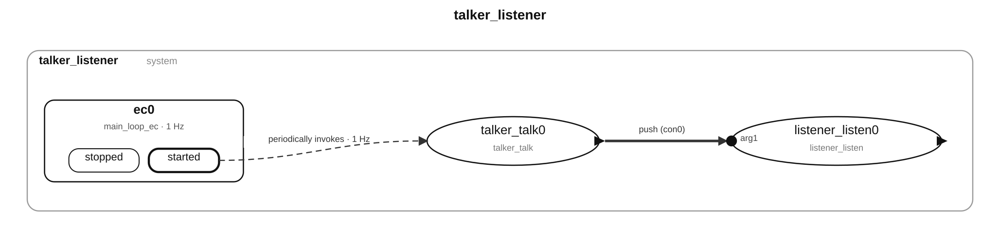

import { Tabs, TabItem, Aside } from '@astrojs/starlight/components';

第 4 章では、talker と listener を別々の juiz で起動して、HTTP でつなぎました。
いつも同じコンピュータで一緒に動かす部品なら、1 つの juiz に両方のライブラリを読み込んでつなぐこともできます。値は同じプロセスの中で受け渡されるので、通信の手間がかかりません。
この章では、第 4 章の 2 つのライブラリを 1 つの設定ファイルに並べて読み込み、`connections` と Execution Context でつなぎます。

<Aside type="tip" title="この章で学ぶこと">
- 別々に作ったライブラリを、1 つの juiz に並べて読み込めること
- 設定ファイルの `connections` で Process をつなぐこと(**connect**)と、`Push` / `Pull` の違い
- Process をいつ実行するかは、Process 自身ではなく **Execution Context**(EC)が決めること
- call と、EC による実行の違い
</Aside>

## 準備

第 4 章で作った `talker` と `listener` の 2 つの雛形を、そのまま使います。どちらも `scripts/dev.sh` でビルドして、`app/plugins/<ターゲット>/` にプラグインができている状態にしておいてください。

設定ファイルは、`talker` と `listener` のあるディレクトリ(2 つの雛形の 1 つ上)に作ります。この章のコマンドも、すべてそこで実行します。

## 設定ファイルを書く

`talker_listener.conf` を、次の内容で作ります。

```yaml title="talker_listener.conf"
name: talker_listener
option:
  http_broker:
    start: true
    port: 8000
plugins:
  components:
    talker:
      language: rust
      path: talker/app/plugins/{target}
    listener:
      language: rust
      path: listener/app/plugins/{target}
processes:
  - type_name: talker_talk
    name: talker_talk0
  - type_name: listener_listen
    name: listener_listen0
connections:
  - name: con0
    connection_type: Push
    source:
      name: talker_talk0
      type_name: talker_talk
    destination:
      name: listener_listen0
      type_name: listener_listen
    arg_name: arg1
ecs:
  - name: ec0
    type_name: main_loop_ec
    rate: 1.0
    bind:
      - name: talker_talk0
        type_name: talker_talk
    auto_start: true
```

第 4 章の 2 つの `app/app.conf` と比べると、次のところが違います。

- `plugins` の `components` に、`talker` と `listener` の 2 つのライブラリを並べています。`path` は、この設定ファイルのあるディレクトリからの相対パスです。`{target}` は、juiz が `juiz pkg target` と同じターゲット名(`x86_64-unknown-linux-gnu` など)に置き換えます。第 4 章の `app/app.conf` の `plugins/{target}` と同じ場所を、1 つ上のディレクトリから指しています。
- `processes` に、2 つの型のインスタンスを並べています。インスタンス名は第 4 章と同じです。
- 新しく `connections` があります。EC の名前は `ec0` にしました。

このシステムを [juiz_opm](/ja/guides/juiz-opm/) の略式図で描くと、次のようになります(図の読み方は [システムを図にする](/ja/guides/juiz-opm/#略式図の読み方) にあります)。



### connections: つなぐ

```yaml
connections:
  - name: con0
    connection_type: Push
    source:
      name: talker_talk0
      ...
    destination:
      name: listener_listen0
      ...
    arg_name: arg1
```

`connections` には、Process どうしのつながりを書きます。第 4 章で `juiz connection create` に渡したものと同じ内容です。

| 項目 | 内容 |
| --- | --- |
| `source` | 値を出す側の Process(インスタンス名と型名) |
| `destination` | 値を受け取る側の Process |
| `arg_name` | `destination` のどの引数に値を渡すか |
| `connection_type` | `Push` は、`source` が実行されたら、その出力を `destination` に渡してすぐ実行する(第 4 章の `-t push`) |

同じ juiz の中にいる相手なので、ID ではなくインスタンス名と型名で書けます。

### ecs: いつ動かすか

```yaml
ecs:
  - name: ec0
    type_name: main_loop_ec
    rate: 1.0
    bind:
      - name: talker_talk0
        ...
    auto_start: true
```

`ecs` には **Execution Context**(EC)を書きます。EC は、結びつけた Process を決まったタイミングで実行する役目を持ちます。

| 項目 | 内容 |
| --- | --- |
| `type_name` | EC の種類。`main_loop_ec` は、一定の周期で実行を繰り返す |
| `rate` | 1 秒あたりの実行回数 [Hz] |
| `bind` | この EC が実行する Process |
| `auto_start` | `true` なら、起動と同時に EC を動かし始める |

EC が実行するのは `talker_talk0` だけです。`listener_listen0` は、`talker_talk0` が実行されたときに Push のつながりを通って実行されます。

## 動かす

設定ファイルを `-f` で渡して起動します。

```sh
juiz -f talker_listener.conf -d
```

1 つのターミナルに、1 秒ごとに talker と listener が交互に表示されます。

```
talker: Hello, juiz!
listener: Hello, juiz!
talker: Hello, juiz!
listener: Hello, juiz!
...
```

Ctrl+C で止めるまで続きます。別のターミナルから、Process・つながり・EC の一覧も見られます。

```sh
juiz process list
# => ["http://127.0.0.1:8000/process/listener_listen0::listener_listen", "http://127.0.0.1:8000/process/talker_talk0::talker_talk"]
juiz connection list
# => ["connection://core://core/process/talker_talk0::talker_talk|arg1|core://core/process/listener_listen0::listener_listen"]
juiz ec list
# => ["http://127.0.0.1:8000/execution_context/ec0::main_loop_ec"]
```

2 つの Process が、同じ `http://127.0.0.1:8000` にいます。つながりの両端も `core://` で始まっていて、同じ juiz の中でつながっていることがわかります(第 4 章では、つなぐ先が `http://127.0.0.1:8000/...` でした)。
Process のコードは第 4 章から何も変えていません。別々の juiz にいても、同じ juiz にいても、同じようにつなげます。

## Push と Pull

つながりには、もう 1 つ `Pull` という種類があります。`talker_listener.conf` をコピーして、次の 2 か所を変えた `talker_listener_pull.conf` を作ってみましょう。

```yaml title="talker_listener_pull.conf(変えたところ)"
connections:
  - name: con0
    connection_type: Pull
    ...
ecs:
  - name: ec0
    ...
    bind:
      - name: listener_listen0
        type_name: listener_listen
```

```sh
juiz -f talker_listener_pull.conf -d
```

表示は Push のときと同じく、talker と listener が交互に出ます。ただし、動く順番の決まり方が逆です。

| 種類 | EC が実行するもの | 値の流れ方 |
| --- | --- | --- |
| `Push` | 送る側(talker) | talker が実行されると、出力を listener に押し出して、listener も実行する |
| `Pull` | 受け取る側(listener) | listener が実行されるとき、引数 `arg1` の値を取りに talker を実行する |

センサの値が出るたびに処理したいときは Push、処理する側の周期で最新の値を取りに行きたいときは Pull、のように使い分けます。

## call と比べる

EC を止めた状態で、talker を外から call してみましょう。
`talker_listener.conf` をコピーして `auto_start: false` に書き換えた設定ファイルを作り、それで起動し直します。

<Tabs syncKey="platform">
<TabItem label="Linux">

```sh
sed 's/auto_start: true/auto_start: false/' talker_listener.conf > talker_listener_stop.conf
juiz -f talker_listener_stop.conf -d
```

</TabItem>
<TabItem label="macOS">

```sh
sed 's/auto_start: true/auto_start: false/' talker_listener.conf > talker_listener_stop.conf
juiz -f talker_listener_stop.conf -d
```

</TabItem>
<TabItem label="Windows">

```powershell
(Get-Content talker_listener.conf) -replace 'auto_start: true', 'auto_start: false' | Set-Content talker_listener_stop.conf
juiz -f talker_listener_stop.conf -d
```

</TabItem>
</Tabs>

今度は、起動しても何も表示されません。EC が動いていないので、誰も Process を実行しないからです。
別のターミナルから talker と listener を call します。

```sh
juiz process call "http://127.0.0.1:8000/process/talker_talk0::talker_talk" '{}' -p
# => CapsulePtr((value:Value("Hello, juiz!"), option: []))
juiz process call "http://127.0.0.1:8000/process/listener_listen0::listener_listen" '{"arg1": "Hi"}' -p
# => CapsulePtr((value:Value("Hi"), option: []))
```

talker を call すると、`juiz` を起動したターミナルには `talker: Hello, juiz!` だけが出て、listener は何も表示しません。
call は「呼び出して結果を受け取る」だけで、その結果をつながった先には流しません。つながりに沿って値が流れるのは、EC が Process を実行したときです。
listener も、引数を渡して直接 call すれば、ふつうの Process として `listener: Hi` を表示して結果を返します。

こうして juiz には、Process の使い方が 2 つあります。

- **call**: 外から引数を渡して呼び出し、結果を受け取る。サーバー・クライアントのような使い方です。
- **connect**: Process の出力を別の Process の入力につなぎ、EC が決めたタイミングで流し続ける。ROS のような、データを流すロボット用ミドルウェアに近い使い方です。

同じ Process を、どちらの使い方でも使えます。Process のコードは、どちらで使われるのかを知る必要がありません。

## 別々の juiz か、1 つの juiz か

| | 別々の juiz(第 4 章) | 1 つの juiz(この章) |
| --- | --- | --- |
| 起動 | 部品ごとに `juiz` を起動する | `juiz` を 1 つ起動する |
| 値の受け渡し | HTTP などのブローカーを通る | 同じプロセスの中で渡す(速い) |
| 止まったとき | 片方が落ちても、もう片方は動き続ける | 一緒に止まる |
| 置き場所 | 別のコンピュータにも置ける | 同じコンピュータだけ |

どちらでも、Process のコードは同じです。動かし方を設定ファイルで選べます。

## やってみよう

- `rate` を `2.0` に変えて起動し直し、表示の間隔が半分になることを確かめてみましょう。
- Push のまま、`bind` の Process を `talker_talk0` から `listener_listen0` に変えてみましょう。listener は既定値の空の文字列を受け取って `listener: ` を表示し続け、talker は一度も実行されません。EC が実行するのは `bind` に書いた Process だけで、Push のつながりは `source` が実行されたときにしか働かないことがわかります。
- `connections` を消して、第 4 章と同じ `publishes` / `subscribes` を `processes` に書いてみましょう(`talker_talk0` に `publishes: [chatter]`、`listener_listen0` に `subscribes: {arg1: chatter}`)。Topic は、同じ juiz の中でも使えます。
- 第 3 章の `my_juiz` の `app/app.conf`(`my_juiz_add0` の `p_apply` が `a: 10`、`my_juiz_add1` もあるもの)に、`my_juiz_add0` の出力を `my_juiz_add1` の `a` につなぐ `connections` と、`my_juiz_add0` を動かす `ecs` を書き足してみましょう。管理画面で `my_juiz_add1` を見ると、引数 `a` に `my_juiz_add0` の結果の `10` が入っています(`juiz process info` でも確かめられます)。

## まとめ

- `plugins` の `components` に複数のライブラリを並べると、別々に作った部品を 1 つの juiz で動かせます。
- `connections` に書くと、Process の出力を別の Process の引数につなげます(connect)。`Push` では送る側が、`Pull` では受け取る側が実行されたときに値が流れます。
- Process をいつ実行するかは、Process 自身ではなく Execution Context(EC)が決めます。`main_loop_ec` は `rate` の周期で `bind` の Process を実行します。
- call は結果を受け取るだけで、つながりには値を流しません。値が流れるのは EC が Process を実行したときです。
- 設定ファイルの項目は、[ガイドの「設定ファイル」](/ja/guides/config/) にもまとめてあります。

次の章では、Process・Container・ContainerProcess を 1 つのライブラリにまとめた Component を、サンプル集の例で読みます。[Component にまとめて配布する(Rust)](/ja/tutorial/component/rust/) に進みましょう。
