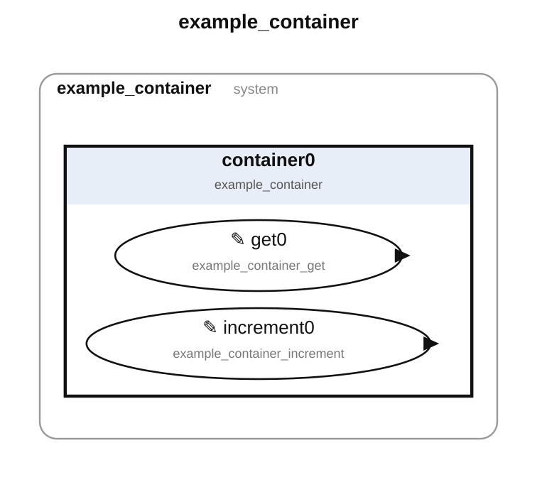

import { Aside, CardGrid, LinkCard } from '@astrojs/starlight/components';

第 1 章の Process は、同じ引数を渡せばいつも同じ結果を返す冪等な関数でした。
しかし、ロボットや IoT の部品を作っていると、カウンタの値やモータの現在位置、カメラの接続のように「覚えておきたいもの」が必ず出てきます。
この章では、整数を 1 つ覚えておくカウンタを題材に、juiz で状態を扱う方法を学びます。

<Aside type="tip" title="この章で学ぶこと">
- 状態は **Container** に置き、Process には持たせないこと
- 状態に触れるのは、Container に結びついた **ContainerProcess** だけであること
- 1 つの Container に、役割の違う ContainerProcess をいくつも結びつけられること
- `juiz pkg add container` で、第 1 章のプロジェクトに Container と ContainerProcess を足す方法
</Aside>

第 1 章で作ったプロジェクト `my_juiz` に、`juiz pkg add container counter` で Container と ContainerProcess を足し、足されたコードを読んでいきます。使う言語を選んでください。

<CardGrid>
	<LinkCard title="Rust" href="/ja/tutorial/container/rust/" description="状態の構造体と、#[juiz_component_container] などの付いた関数が src/lib.rs に足されます。" />
	<LinkCard title="Python" href="/ja/tutorial/container/python/" description="状態のクラスと、デコレータを付けた関数が .py ファイルに足されます。" />
	<LinkCard title="C++" href="/ja/tutorial/container/cpp/" description="状態のクラスと、マニフェストと組にした関数が .cpp ファイルに足されます。" />
	<LinkCard title="Haskell" href="/ja/tutorial/container/haskell/" description="IORef を包んだ状態の型と、マニフェストと組にした関数がモジュールに足されます。" />
	<LinkCard title="Zig" href="/ja/tutorial/container/zig/" description="状態の struct と、self で状態を受け取る関数がソースに足されます。*const で受けると readonly です。" />
</CardGrid>

この章で足すものは、どの言語でも次の 3 つです。

| 役割 | 型名 | 内容 |
| --- | --- | --- |
| Container | `counter` | カウンタの値を 1 つ持つ。作るときに初期値 `initial_value` を受け取る |
| ContainerProcess | `counter_increment` | Container の値に `step` を足して、足した後の値を返す |
| ContainerProcess | `counter_get` | Container の値をそのまま返す(読むだけの readonly) |

足したあとの `app/app.conf` のシステムを [juiz_opm](/ja/guides/juiz-opm/) の略式図で描くと、次のようになります(図の読み方は [システムを図にする](/ja/guides/juiz-opm/#略式図の読み方) にあります)。

