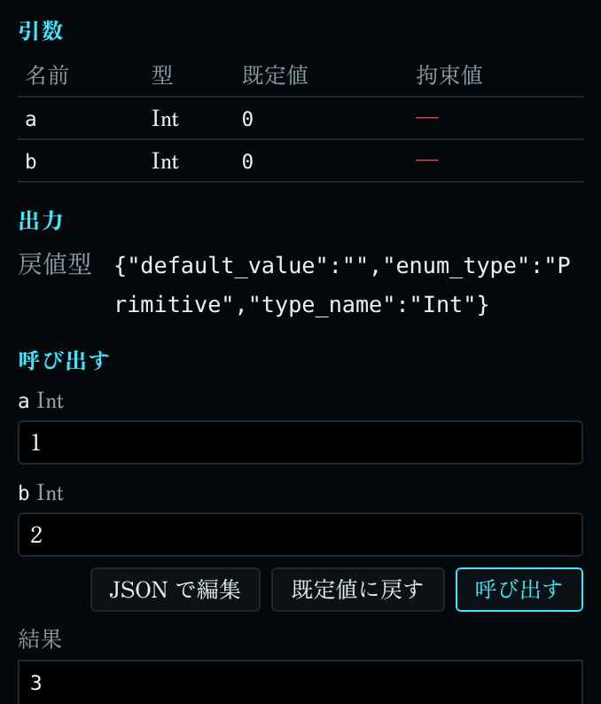

import { Aside, FileTree, Tabs, TabItem } from '@astrojs/starlight/components';

この章では、`juiz pkg create` で Python のプロジェクトの雛形を作り、その中の「2 つの数を足して返す」Process を動かします。
まず本体の Process のコードを読み、それから動かして、ブラウザとターミナルから呼び出します。最後に、雛形のほかのファイルを読みます。

<Aside type="tip" title="この章で学ぶこと">
- `juiz pkg create` で、Process を書く Python のプロジェクトの雛形を作る方法
- 雛形の中身(`app/python/my_juiz.py`・`pyproject.toml`・`app/app.conf`)の読み方
- Process は、引数を受け取って結果を返す冪等な関数であること
- Process には「型名」と「インスタンス名」があること
- 外から Process を呼び出して結果を受け取る使い方(call)
</Aside>

## 準備

Python 3.10 以降が必要です。Rust のツールチェーンは要りません。
`juiz` コマンドは、このあと作業用の venv に入れます。[インストール](/ja/getting-started/install/) の手順を先に済ませておく必要はありません。

作業用のディレクトリを作り、その中に venv(仮想環境)を作って `juiz-cli` を入れます。
`juiz-cli` を入れると、`juiz` コマンドと、Process を書くための pyjuiz(`import juiz`)の両方が入ります。

<Tabs syncKey="platform">
<TabItem label="Linux">

```sh
mkdir juiz_tutorial
cd juiz_tutorial
python3 -m venv .venv
source .venv/bin/activate
pip install juiz-cli==0.3.0
```

</TabItem>
<TabItem label="macOS">

```sh
mkdir juiz_tutorial
cd juiz_tutorial
python3 -m venv .venv
source .venv/bin/activate
pip install juiz-cli==0.3.0
```

</TabItem>
<TabItem label="Windows">

```powershell
mkdir juiz_tutorial
cd juiz_tutorial
python -m venv .venv
.venv\Scripts\activate
pip install juiz-cli==0.3.0
```

</TabItem>
</Tabs>

```sh
juiz --version
# => juiz 0.3.0
```

以降の手順は、この venv を有効にしたターミナルで実行してください。新しいターミナルを開いたら、`juiz_tutorial` で `source .venv/bin/activate`(Windows では `.venv\Scripts\activate`)を実行します。

<Aside type="note" title="cargo で入れた juiz を使うとき">
`cargo install juiz_app` で入れた `juiz` コマンドを使う場合は、`pip install juiz-cli==0.3.0` を飛ばしてください。このあとの `pip install -e .` で、Process を書くための pyjuiz だけが venv に入ります。
`juiz-cli` も入れると `juiz` コマンドが 2 つになり、どちらが動くかが PATH の順番で決まってしまいます。
</Aside>

## 雛形を作る

`juiz_tutorial` で、次のコマンドを打ちます。

```sh
juiz pkg create my_juiz -b python -t process
```

| 部分 | 意味 |
| --- | --- |
| `my_juiz` | プロジェクトの名前です。同じ名前のディレクトリが作られ、型名の頭にもなります。英小文字で始まり、英小文字・数字・`_` だけが使えます |
| `-b python` | 使う言語です(`rust` / `python` / `cpp` / `haskell`) |
| `-t process` | 入れる型の種類です。`process` では Process を 1 つだけ入れます。省略すると Container も入りますが、この章では Process だけから始めます |

作ると、次に打つコマンドが表示されます(venv は上で作ったので、ここに表示される `python3 -m venv .venv` は飛ばしてかまいません)。

```text
Created my_juiz (python, process) in ./my_juiz  [pyjuiz ==0.3.0]

Next steps:
  cd my_juiz
  python3 -m venv .venv
  . .venv/bin/activate
  pip install -e .                # installs pyjuiz
  juiz -f app/app.conf -d         # start (keep it running)
  ...
```

できたディレクトリに移り、`pyproject.toml` に書かれたパッケージを venv に入れます。

```sh
cd my_juiz
pip install -e .
```

以降のコマンドは、すべて `my_juiz` で実行します。

## プロジェクトの形

雛形には、次のファイルが入っています。

<FileTree>
- my_juiz/
  - pyproject.toml プロジェクトの設定(使うパッケージ)
  - app/
    - app.conf 起動の設定ファイル
    - juizapp.yaml 配布用のパッケージ(.juizapp)の情報
    - python/
      - my_juiz.py Process のコード
  - scripts/
    - pack.sh 配布用のパッケージを作る(Windows は pack.ps1)
  - README.md この雛形の使い方(英語)
  - .gitignore
</FileTree>

Python の Process は、ビルドしません。`juiz` コマンドが `.py` ファイルを直接読み込みます。
雛形では、`app/python/my_juiz.py` に書いた型を、`app/app.conf` に書いたとおりに読み込んで起動します。
まず、開発の本体である Process のコードから読みましょう。

## Process のコード: app/python/my_juiz.py

```python title="app/python/my_juiz.py"
from juiz import juiz_process


@juiz_process
def my_juiz_add(a: int = 0, b: int = 0) -> int:
    """Returns a + b."""
    return a + b
```

ファイルの先頭の説明(docstring)は省いています。

| 行 | 意味 |
| --- | --- |
| `from juiz import juiz_process` | pyjuiz から、Process を作るデコレータを読み込みます |
| `@juiz_process` | この関数を Process にします |
| `def my_juiz_add(a: int = 0, b: int = 0)` | 関数名 `my_juiz_add` が Process の**型名**です。引数の名前・型・既定値は、型ヒントと既定値から juiz が読み取ります。呼び出すときに省いた引数には、既定値が使われます |
| `-> int` | 出力の型です。引数と戻り値の型ヒントは省略できません |
| `"""Returns a + b."""` | 関数の説明(docstring)は、Process の説明として使われます。管理画面などに表示されます |

Process 本体は、`a + b` を返すだけの短い関数です。

このファイルには、デコレータを付けた関数をいくつも並べられます。それらは 1 つの **Component**(複数の型をまとめたもの)として読み込まれます。
この章では Process が 1 つだけですが、第 2 章で Container を同じファイルに足していきます。Component については第 6 章で詳しく扱います。

## Process は冪等な関数

`my_juiz_add` は、引数を受け取って結果を返すだけです。
外部の状態を読み書きしないので、同じ引数を渡せばいつも同じ結果が返ります(冪等)。
この性質のおかげで、Process はテストしやすく、あとでつないだり別のマシンに置いたりしても振る舞いが変わりません。

## 動かす

設定ファイル `app/app.conf` を `-f` で渡して、`juiz` を起動します。

```sh
juiz -f app/app.conf -d
```

| オプション | 意味 |
| --- | --- |
| `-f <ファイル>` | 設定ファイルを読み込み、そこに書かれたとおりにプラグインを読み込んで、インスタンスを作る |
| `-d` | 起動したまま待機する(Ctrl+C で終了) |

起動すると、`juiz 管理画面: http://localhost:8000/ui/` と表示されます。HTTP ブローカーが 8000 番ポートで待ち受けています。

## ブラウザから呼び出す

`juiz` を起動したまま、ブラウザで管理画面 `http://localhost:8000/ui/` を開きます。次のような画面が出ます。


画面は 3 つの部分に分かれています。

- **左の一覧**: 動いているものの一覧です。「処理 Process」の下に、インスタンス `my_juiz_add0` が型名 `my_juiz_add` と並んで出ています。
- **中央の図**: 系の図です。Process は楕円で描かれ、大きな字がインスタンス名、小さな字が型名です。
- **右の欄**: 選んだものの性質(詳しい情報)が出ます。まだ何も選んでいないので空です。

左の一覧か中央の図で `my_juiz_add0` をクリックすると、右の欄に Process の情報が出ます。
右の欄を下へスクロールすると「呼び出す」という見出しがあり、引数 `a`・`b` の入力欄が並んでいます。
`a` に `1`、`b` に `2` を入れて「呼び出す」ボタンを押してください。下の「結果」に `3` が出れば成功です。



右の欄のほかの部分も見ておきましょう。

- 「引数」の表には、引数の名前・型・既定値が並んでいます。既定値は、呼び出すときに省いた引数に使われる値で、コードの `default` に書いたものです(「拘束値」は第 3 章で扱います)。
- 「既定値に戻す」を押すと、入力欄が既定値(`0`)に戻ります。「JSON で編集」では、引数を JSON でまとめて書けます。
- 上のほうの「基本」には、型名と、この Process の識別子(ID)が出ています。

値を変えて、何度か呼び出してみてください。同じ引数なら、何度呼んでも同じ結果が返ります。
管理画面のほかの使い方は [ガイドの「管理画面」](/ja/guides/web-ui/) にあります。

## ターミナルから呼び出す

ブラウザでしたことは、ターミナルからもできます。`juiz` を起動したまま、別のターミナルを開いて venv を有効にし、`my_juiz` に移って Process を呼び出してみます。
まず、動いている Process の一覧を見ます。

```sh
juiz process list
# => ["http://127.0.0.1:8000/process/my_juiz_add0::my_juiz_add"]
```

表示された URL が、この Process の **ID** です。
`http://127.0.0.1:8000` は Process がいる場所(ブローカー)、`process/` の後ろは「インスタンス名`::`型名」を表しています。
[ネームスペース](/ja/guides/namespace/)を使うと、インスタンス名の前に `robot1/` のようにネームスペースが入ります。使わなければ上のとおりです。

この ID と引数を指定して、Process を呼び出します(call)。引数は JSON で渡します。

```sh
juiz process call "http://127.0.0.1:8000/process/my_juiz_add0::my_juiz_add" '{"a": 1, "b": 2}' -p
# => CapsulePtr((value:Value(3), option: []))
```

`1` と `2` を渡して `3` が返ってきました。`-p` は結果を表示するオプションです。
引数を省くと、既定値(`a` も `b` も `0`)が使われます。`'{"a": 5}'` を渡すと `5` が返ります。

<Aside type="caution" title="Windows PowerShell 5.1 で JSON を渡すとき">
Windows に最初から入っている Windows PowerShell 5.1 は、`'{"a": 1, "b": 2}'` の `"` を消して `juiz` に渡してしまいます。
`'{\"a\": 1, \"b\": 2}'` のように `"` の前に `\` を書いてください。PowerShell 7.3 以降では、上のとおりに書けば動きます。
</Aside>

何度呼び出しても、同じ引数なら同じ結果が返ることも確かめてみてください。

`juiz` コマンドも管理画面も、HTTP で同じ API を呼んでいるだけです。
つまり、HTTP を話せるプログラムなら、どの言語からでも Process を呼び出して結果を受け取れます。
これが、juiz をサーバー・クライアントのように使う **call** という使い方です。

## 雛形のほかのファイルを読む

Process のコードのほかに、雛形にはビルドと起動のためのファイルが入っています。

### プロジェクトの設定: pyproject.toml

```toml title="pyproject.toml"
[project]
name = "my-juiz"
version = "0.1.0"
description = "my_juiz: a juiz component"
requires-python = ">=3.10"
dependencies = [
    # Same version as the juiz that made this skeleton (juiz --version)
    "pyjuiz==0.3.0",
]

[build-system]
requires = ["setuptools>=77"]  # 77 or later reads license = "<SPDX expression>"
build-backend = "setuptools.build_meta"

[tool.setuptools]
# juiz loads app/python/my_juiz.py directly, so nothing is installed as a Python package
py-modules = []
```

| 項目 | 意味 |
| --- | --- |
| `[project]` の `name`・`version`・`description` | プロジェクトの名前・版・説明です |
| `requires-python` | 使える Python の版です。pyjuiz は Python 3.10 以降で動きます |
| `dependencies` | このプロジェクトで使うパッケージです。Process を書くための pyjuiz が書かれています |
| `[build-system]` | `pip install` がこのプロジェクトを扱うときに使う道具(setuptools)です |
| `[tool.setuptools]` の `py-modules = []` | このプロジェクトの `.py` ファイルは `juiz` が直接読み込むので、Python のパッケージとしてはインストールしない、という指定です |

**pyjuiz の版は、`juiz --version` で表示される版と同じにしておくのがおすすめです。** 雛形では、雛形を作った `juiz` と同じ版が `==` で固定して書かれています。
`juiz` を新しい版にしたときは、この 1 行も同じ版に書き換えて、`pip install -e .` し直してください。

`pip install -e .` で `my_juiz.egg-info` というディレクトリができますが、pip が使うものなので気にしなくてかまいません。

### 起動の設定ファイル: app/app.conf

`juiz -f` に渡した設定ファイルです(先頭のコメントは省いています)。

```yaml title="app/app.conf"
"name": "my_juiz"
"option":
  "http_broker":
    "start": true
    "port": 8000
"plugins":
  "components":
    "my_juiz":
      "language": "python"
      "path": "python"
"processes":
  - "type_name": "my_juiz_add"
    "name": "my_juiz_add0"
```

設定ファイルは YAML で書きます。ここでは、大まかに次のことが書かれています。

- `option`: HTTP ブローカーを 8000 番ポートで立ち上げる
- `plugins`: `python` ディレクトリから、Component `my_juiz` のファイル(`my_juiz.py`)を Python として**読み込む**(パスは、設定ファイルのあるディレクトリ `app/` からの相対です)
- `processes`: 読み込んだ型 `my_juiz_add` から、`my_juiz_add0` という名前の**インスタンスを作る**

ここで「読み込む」と「インスタンスを作る」が分かれていることに注目してください。
ファイルを読み込むと、juiz は Process の**型**(作り方)を覚えます。`processes` に書くと、その型から名前の付いた**インスタンス**を作ります。
呼び出すときの ID に入っていた `my_juiz_add0` がインスタンス名、`my_juiz_add` が型名です。
同じ型から、名前の違うインスタンスをいくつも作ることもできます(第 3 章で扱います)。

### scripts と app/juizapp.yaml

`scripts/pack.sh` と `app/juizapp.yaml` は、できあがった部品を `.juizapp` というファイル 1 つにまとめて配る(`juiz run` だけで動かせる)ためのものです。チュートリアルでは使いません。使い方は [アプリの配布(.juizapp)](/ja/guides/app-package/) にあります。

## やってみよう

- `app/python/my_juiz.py` を書き換えて、足す代わりに掛け算(`a * b`)を返すようにしてみましょう。Python はビルドが要らないので、`juiz` を起動し直すだけで、`{"a": 3, "b": 4}` に対して `12` が返ってくるはずです。
- `juiz pkg add process my_juiz_sub` を打つと、`app/python/my_juiz.py` と `app/app.conf` に Process `my_juiz_sub` が足されます(中身は `my_juiz_add` と同じ `a + b`)。足された関数を `a - b` に書き換え、`juiz` を起動し直して呼び出してみましょう。`juiz process list` に 2 つの Process が並びます。

## まとめ

- `juiz pkg create <名前> -b python` で、起動・呼び出しまでそのまま通るプロジェクトの雛形を作れます。pyjuiz の版も `juiz` にそろえて書かれます。
- Python の Process はビルドしません。`juiz` が `.py` ファイルを直接読み込みます。
- Process は、引数を受け取って結果を返すだけの冪等な関数です。`@juiz_process` を付けた関数の名前が型名になり、引数と出力の型は型ヒントから読み取られます。
- juiz はファイルを読み込んで Process の**型**を覚え、設定ファイルに書いたとおりに、そこから名前の付いた**インスタンス**を作ります。
- 動いている Process には URL の形をした ID があり、ID と引数を指定して外から呼び出せます(call)。

次の章では、このプロジェクトにカウンタの Container を足して、状態を持つ部品の書き方を学びます。[状態を持つ: Container と ContainerProcess(Python)](/ja/tutorial/container/python/) に進みましょう。
