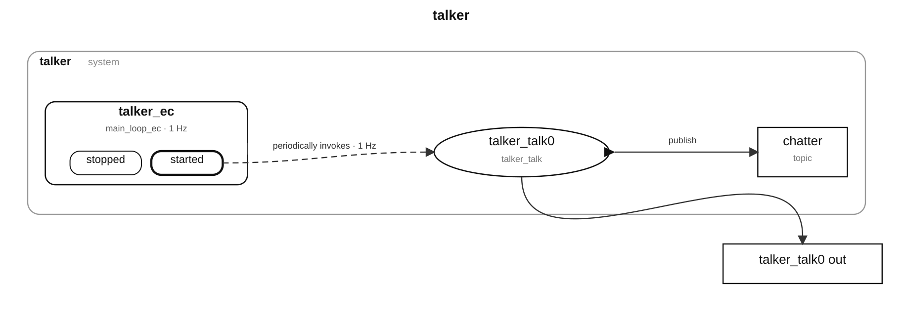
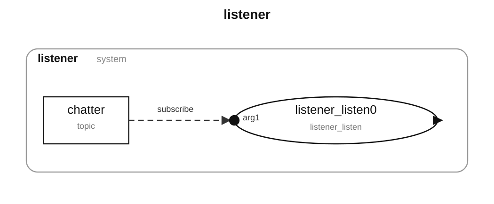

import { Tabs, TabItem, Aside } from '@astrojs/starlight/components';

ここまでは、外から Process を呼び出して結果を受け取る **call** という使い方をしてきました。
ロボットでは、それとは別に「カメラのプログラムが画像を出したら、それを処理のプログラムがすぐ受け取る」というように、あるプログラムの出力を別のプログラムの入力へ流し続けたい場面がよくあります。しかも、その 2 つは別々に作られ、別々に起動されることがほとんどです。
この章では、文字列を出す `talker` と、受け取った文字列を表示する `listener` を、**別々の雛形(パッケージ)** として作り、**別々の juiz** で起動してつなぎます。

<Aside type="tip" title="この章で学ぶこと">
- 別々に起動した juiz の Process も、ID(URL)を指定すればコマンドでつなげること(**connect**)
- Process を周期的に動かすのは **Execution Context**(EC)で、外から開始・停止できること
- **Topic** を使うと、設定ファイルに書くだけで、起動したときにつながること
</Aside>

## 準備

第 1 章の「準備」を済ませていれば、新しく入れるものはありません(`juiz` コマンド、GHC と cabal、`~/.juiz/sdk/0.3.4` の libjuiz_sdk、`~/juiz-0.3.4` の hsjuiz を使います)。Haskell の手順は Linux・macOS だけです。

作業は、第 1 章で `my_juiz` を作ったディレクトリ(`my_juiz` の 1 つ上)で行います。この章では、そこに `talker` と `listener` の 2 つの雛形を並べて作ります。

## 2 つの雛形を作る

```sh
juiz pkg create talker -b haskell -t process
juiz pkg create listener -b haskell -t process
```

第 1 章の `my_juiz` と同じ形の雛形が 2 つできます。中身はどちらも「`a + b` を返す Process」(`talker_add`・`listener_add`)なので、これを書き換えていきます。
型名の頭が雛形の名前になるので、talker の Process は `talker_talk`、listener の Process は `listener_listen` という型名にします。

## talker を書く

`talker/src/Talker.hs` を、次の内容に置き換えます。

```haskell title="talker/src/Talker.hs"
{-# LANGUAGE OverloadedStrings #-}
{-# LANGUAGE TemplateHaskell #-}
module Talker () where

import qualified Data.Text.IO as T
import System.IO (hFlush, stdout)

import Juiz

talker_component :: ComponentManifest
talker_component = componentManifest "talker"
  & description "talker: a juiz component"

-- | Process talker_talk
talker_talk_manifest :: ProcessManifest
talker_talk_manifest = processManifest "talker_talk"
  & description "Returns a greeting."

talker_talk :: IO Text
talker_talk = do
  T.putStrLn "talker: Hello, juiz!"
  hFlush stdout
  pure "Hello, juiz!"

juizComponent 'talker_component
  [ componentProcess 'talker_talk 'talker_talk_manifest
  ]
```

- 型名は、マニフェストの `processManifest "talker_talk"` に書いた `talker_talk` です。引数を足していないので、関数 `talker_talk` も引数を取りません。
- 文字を表示するので、関数の型は `IO Text` です(第 1 章の `my_juiz_add` のような純粋な関数でも、`IO` の付いた関数でも Process にできます)。`hFlush stdout` は、表示をためこまずにすぐ出すためのものです。
- 最後の `juizComponent` の一覧にも、新しい名前を書きます。

`Data.Text.IO` を使うので、`talker.cabal` と `listener.cabal` の `build-depends` に `text` を 1 行足します(GHC に付いてくるパッケージなので、取得はしません)。

```txt title="talker.cabal(listener.cabal も同じ)"
    build-depends:    base >=4.18 && <5
                    , hsjuiz
                    , text
```

次に、起動の設定ファイル `talker/app/app.conf` を、次のように書き換えます(先頭のコメントは省いています。残しておいてかまいません)。

```yaml title="talker/app/app.conf"
"name": "talker"
"option":
  "http_broker":
    "start": true
    "port": 8001
"plugins":
  "components":
    "talker":
      "language": "haskell"
      "path": "plugins/{target}"
"processes":
  - "type_name": "talker_talk"
    "name": "talker_talk0"
"ecs":
  - "type_name": "main_loop_ec"
    "name": "talker_ec"
    "rate": 1.0
    "bind":
      - "type_name": "talker_talk"
        "name": "talker_talk0"
    "auto_start": false
```

雛形から変えたのは 3 か所です。

| 変えたところ | 内容 |
| --- | --- |
| `port: 8001` | listener の juiz が 8000 番を使うので、talker の juiz は 8001 番で待ち受けます |
| `talker_add` → `talker_talk` | 型名と、インスタンス名 `talker_talk0` を、書き換えた Process に合わせます |
| `ecs` | **Execution Context**(EC)を 1 つ足します。EC は、`bind` に書いた Process を決まった周期(`rate` は 1 秒あたりの回数)で実行し続ける部品です。`auto_start: false` なので、起動しただけでは動き出しません |

talker は「呼ばれたら文字列を返す」だけの Process で、自分では動きません。周期的に動かす役目は EC が持ちます。EC について詳しくは第 5 章で扱います。

## listener を書く

`listener/src/Listener.hs` を、次の内容に置き換えます。

```haskell title="listener/src/Listener.hs"
{-# LANGUAGE OverloadedStrings #-}
{-# LANGUAGE TemplateHaskell #-}
module Listener () where

import qualified Data.Text.IO as T
import System.IO (hFlush, stdout)

import Juiz

listener_component :: ComponentManifest
listener_component = componentManifest "listener"
  & description "listener: a juiz component"

-- | Process listener_listen
listener_listen_manifest :: ProcessManifest
listener_listen_manifest = processManifest "listener_listen"
  & description "Prints the received string."
  & addStringArg "arg1" "the string to print" ""

listener_listen :: Text -> IO Text
listener_listen arg1 = do
  T.putStrLn ("listener: " <> arg1)
  hFlush stdout
  pure arg1

juizComponent 'listener_component
  [ componentProcess 'listener_listen 'listener_listen_manifest
  ]
```

- 型名は `listener_listen` です。`addStringArg "arg1" ...` で文字列の引数 `arg1`(既定値は空の文字列)を足し、関数はそれを `Text` で受け取ります。
- 受け取った文字列を表示して、そのまま返します。

`listener/app/app.conf` は、型名とインスタンス名だけを書き換えます(ポートは 8000 番のままです)。

```yaml title="listener/app/app.conf"
"name": "listener"
"option":
  "http_broker":
    "start": true
    "port": 8000
"plugins":
  "components":
    "listener":
      "language": "haskell"
      "path": "plugins/{target}"
"processes":
  - "type_name": "listener_listen"
    "name": "listener_listen0"
```

talker は誰に値を渡すのかを知りませんし、listener は誰から値が来るのかを知りません。どちらのコードにも、相手のことは書いてありません。

## ビルドする

2 つの雛形を、それぞれ `scripts/dev.sh` でビルドします。第 1 章と同じく、できあがったプラグインが各雛形の `app/plugins/<ターゲット>/` に置かれます。

```sh
cd talker
scripts/dev.sh
cd ../listener
scripts/dev.sh
cd ..
```

コードを書き換えたときは、その雛形で `scripts/dev.sh` を打ち直してください。

## 別々に起動する

ターミナルを 3 つ使います。どれも、`talker` と `listener` のあるディレクトリで開いておいてください。

| ターミナル | 役割 |
| --- | --- |
| 1 | listener を動かす `juiz`(8000 番) |
| 2 | talker を動かす `juiz`(8001 番) |
| 3 | つないだり、状態を見たりするコマンドを打つ |

ターミナル 1 で listener を、ターミナル 2 で talker を起動します。

```sh
# ターミナル 1
cd listener
juiz -f app/app.conf -d
```

```sh
# ターミナル 2
cd talker
juiz -f app/app.conf -d
```

どちらも、起動しただけでは何も表示しません。listener を実行する人も、talker の EC も、まだ動いていないからです。
ターミナル 3 から、それぞれの juiz にいる Process を見てみましょう。`-s` で問い合わせ先の juiz を指定します(指定しないと `http://127.0.0.1:8000` に問い合わせます)。

```sh
juiz process list
# => ["http://127.0.0.1:8000/process/listener_listen0::listener_listen"]
juiz -s http://127.0.0.1:8001 process list
# => ["http://127.0.0.1:8001/process/talker_talk0::talker_talk"]
```

ID の `http://127.0.0.1:8000` や `http://127.0.0.1:8001` の部分が、その Process がどの juiz にいるかを表しています。2 つの Process は、別々のプロセスの中にいます。

## コマンドでつなぐ

ターミナル 3 で、talker の出力を listener の引数 `arg1` につなぎます。

```sh
juiz connection create -t push "http://127.0.0.1:8001/process/talker_talk0::talker_talk" arg1 "http://127.0.0.1:8000/process/listener_listen0::listener_listen"
```

引数は、つなぐ元(source)の ID、つなぐ先の引数名、つなぐ先(destination)の ID の順です。
`-t push` は、「つなぐ元が実行されたら、その出力をつなぐ先の引数に渡して、つなぐ先もすぐ実行する」というつなぎ方です。
このように Process の出力を別の Process の入力につなぐ使い方を、juiz では **connect** と呼びます。

つながりは、値を送り出す talker の側が持っています。8001 番に問い合わせると確かめられます。

```sh
juiz -s http://127.0.0.1:8001 connection list
# => ["connection://core://core/process/talker_talk0::talker_talk|arg1|http://127.0.0.1:8000/process/listener_listen0::listener_listen"]
```

つなぐ先が `http://127.0.0.1:8000/...` になっています。talker の juiz は、listener が別の juiz にいることを知っていて、HTTP で値を届けます。

## EC を動かす

まだ何も表示されないのは、talker を実行する EC が止まっているからです。ターミナル 3 から EC の ID を調べて、開始します。

```sh
juiz -s http://127.0.0.1:8001 ec list
# => ["http://127.0.0.1:8001/execution_context/talker_ec::main_loop_ec"]
juiz -s http://127.0.0.1:8001 ec start "http://127.0.0.1:8001/execution_context/talker_ec::main_loop_ec"
```

`ec start` と `ec stop` では、ID に加えて `-s` も付けてください(付けないと、`broker_proxy` が見つからないというエラーになります)。

開始したとたん、ターミナル 2 には talker の表示が、ターミナル 1 には listener の表示が、1 秒ごとに出始めます。

```
talker: Hello, juiz!
talker: Hello, juiz!
...
```

```
listener: Hello, juiz!
listener: Hello, juiz!
...
```

別々に作って別々に起動した 2 つのプログラムが、動いたままつながりました。止めるときは、同じように `ec stop` を打ちます。

```sh
juiz -s http://127.0.0.1:8001 ec stop "http://127.0.0.1:8001/execution_context/talker_ec::main_loop_ec"
```

ターミナル 1 と 2 の表示が止まります。確かめたら、ターミナル 1 と 2 の juiz を Ctrl+C で止めてください。

## Topic で、起動するだけでつながるようにする

コマンドでつなぐ方法は、動いているシステムを試しに組み替えるのには便利ですが、起動するたびに打ち直すのは手間です。それに、`connection create` には相手の ID(どの juiz の、どのインスタンスか)を書く必要がありました。
そこで、**Topic** を使って、設定ファイルに書くだけで起動時につながるようにします。

Topic は、名前の付いた「話題」です。Process の出力をある Topic に流すことを **publish**(発行)、ある Topic に流れてきた値を引数で受け取ることを **subscribe**(購読)と呼びます。
publish する側と subscribe する側は、互いの ID を知りません。同じ名前の Topic を使っていれば、値が届きます。

### talker: publishes と mastersystem

`talker/app/app.conf` を、次のように書き換えます。

```yaml title="talker/app/app.conf"
"name": "talker"
"option":
  "http_broker":
    "start": true
    "port": 8001
"mastersystem":
  "broker_type": "http"
  "broker_name": "127.0.0.1:8000"
"plugins":
  "components":
    "talker":
      "language": "haskell"
      "path": "plugins/{target}"
"processes":
  - "type_name": "talker_talk"
    "name": "talker_talk0"
    "publishes":
      - "chatter"
"ecs":
  - "type_name": "main_loop_ec"
    "name": "talker_ec"
    "rate": 1.0
    "bind":
      - "type_name": "talker_talk"
        "name": "talker_talk0"
    "auto_start": true
```

| 足したところ | 内容 |
| --- | --- |
| `publishes` | `talker_talk0` の出力を、Topic `chatter` に流します。Topic の名前は自由に付けられます |
| `mastersystem` | talker の juiz を、8000 番の juiz(listener の juiz)の**サブシステム**としてつなぎます。Topic の値は、こうしてつながった juiz の間で届きます |
| `auto_start: true` | 起動と同時に EC を動かし始めます |

### listener: subscribes

`listener/app/app.conf` の Process に、`subscribes` を足します。

```yaml title="listener/app/app.conf"
"name": "listener"
"option":
  "http_broker":
    "start": true
    "port": 8000
"plugins":
  "components":
    "listener":
      "language": "haskell"
      "path": "plugins/{target}"
"processes":
  - "type_name": "listener_listen"
    "name": "listener_listen0"
    "subscribes":
      "arg1": "chatter"
```

`subscribes` には「どの引数に、どの Topic の値を入れるか」を書きます。ここでは、Topic `chatter` に流れてきた値を引数 `arg1` に入れて、`listener_listen0` を実行します。

2 つの設定ファイルを [juiz_opm](/ja/guides/juiz-opm/) の略式図で描くと、次のようになります。talker の juiz は `talker_talk0` の出力を `chatter` に publish し、listener の juiz は `chatter` を subscribe します。





### 起動する

listener を先に、talker を後に起動します。

```sh
# ターミナル 1
cd listener
juiz -f app/app.conf -d
```

```sh
# ターミナル 2
cd talker
juiz -f app/app.conf -d
```

今度は、talker を起動したとたんに、コマンドを何も打たなくても、ターミナル 1 に listener の表示が出始めます。

<Aside type="caution" title="起動する順番">
`mastersystem` に書いた相手(8000 番の listener の juiz)が先に動いていないと、talker の juiz はサブシステムとしてつながれず、`system_add_subsystem()が失敗` という ERROR を出します。そのときは、talker を Ctrl+C で止めて、起動し直してください。
</Aside>

talker の juiz がサブシステムとしてつながったので、ターミナル 3 から 8000 番に問い合わせると、両方の juiz の Process が一覧に出ます。

```sh
juiz process list
# => ["http://127.0.0.1:8000/process/listener_listen0::listener_listen", "http://127.0.0.1:8001/process/talker_talk0::talker_talk"]
```

### connect と Topic

| | connect(`connection create`) | Topic(`publishes` / `subscribes`) |
| --- | --- | --- |
| 相手の指定 | 相手の ID を書く | Topic の名前だけを書く |
| いつつながるか | コマンドを打ったとき(設定ファイルの `connections` なら起動時) | 起動したとき |
| 1 対多 | つながりを 1 本ずつ作る | 同じ Topic を subscribe すれば何個でも受け取れる |
| 向いている場面 | 動いているシステムを試しに組み替える、特定の相手につなぐ | センサの値を配るなど、送る側が受け取る側を知らなくてよいとき |

## サンプル集の talker と listener

サンプル集 [juiz_examples_haskell](https://github.com/OpenJUIZ/juiz_examples_haskell) にも、talker と listener があります。書き方は少し違います(サンプル集では型ごとに別のファイルにしています)が、やっていることは同じです。第 6 章からはサンプル集を使います。

## やってみよう

- Topic の形で動かしたまま、ターミナル 2 の talker を Ctrl+C で止めて、もう一度起動してみましょう。listener の表示は止まりますが、talker を起動し直すと、何も打たなくても再び表示が始まります。コマンドでつないだときは、つながりを持っていた talker を起動し直すと、つなぎ直しが要りました。
- 4 つ目のターミナルで、listener をもう 1 つ起動してみましょう(`cd listener` して `juiz -f app/app.conf -d`)。8000 番と 8001 番は使われているので、この juiz は自動的に 8002 番で待ち受け、8000 番の juiz のサブシステムになります。Topic `chatter` を subscribe しているので、2 つの listener の両方に表示が出ます。
- listener の `subscribes` の Topic 名を `chatter2` に変えて起動し直してみましょう。名前が合わないので、何も届きません。

## まとめ

- 別々の雛形で作り、別々の juiz で起動した Process も、ID を指定すれば `juiz connection create` でつなげます(connect)。つながりは、値を送り出す側が持ちます。
- Process を周期的に動かすのは Execution Context(EC)です。`ecs` に書いて作り、`juiz ec start` / `ec stop` で外から開始・停止できます。
- 設定ファイルの `publishes` と `subscribes` で同じ名前の Topic を使い、`mastersystem` で juiz どうしをつなげば、起動するだけで値が届きます。送る側と受け取る側は、互いの ID を知りません。

次の章では、この 2 つのライブラリを、1 つの juiz に読み込んでつなぎます。[1 つの juiz で複数のライブラリをつなぐ(Haskell)](/ja/tutorial/connect/haskell/) に進みましょう。
