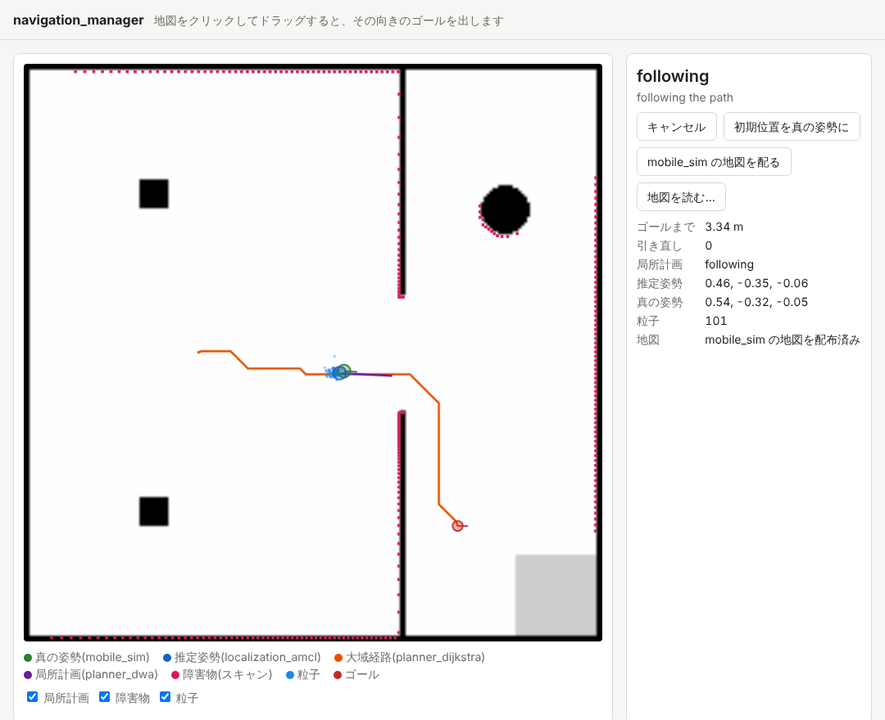

import { Aside, Tabs, TabItem } from '@astrojs/starlight/components';

From here on, you try **autonomous navigation**: you give a goal on the map, and the robot decides its own way and drives there.
First run the stack on the simulator's own map; on the next page you switch to the map you built on page 2.

<Aside type="caution" title="Stop the apps of pages 1–3">
teleop_twist uses port 8002, the same as localization_amcl here. If teleop_twist, mapper_gmapping or mobile_sim is still running, the ports or IPC names clash and the stack does not start. Stop them with Ctrl+C in terminals 3, 2 and 1, in that order.
</Aside>

## The apps

| App | Role | Screen |
| --- | --- | --- |
| [mobile_sim](https://github.com/OpenJUIZ/mobile_sim) | The mobile robot simulator, the same one as on pages 1–3 | http://localhost:8000/ |
| [localization_amcl](https://github.com/OpenJUIZ/localization_amcl) | Estimates the robot's position from the map, scans and odometry with AMCL (a particle filter) | http://localhost:8002/ |
| [planner_dijkstra](https://github.com/OpenJUIZ/planner_dijkstra) | Finds the route from the current position to the goal on the map (the global path) with Dijkstra's algorithm | http://localhost:8003/ |
| [planner_dwa](https://github.com/OpenJUIZ/planner_dwa) | Computes velocity commands that follow the global path while avoiding obstacles in front of the robot, with DWA (Dynamic Window Approach) | http://localhost:8004/ |
| navigation_hub ([navigation_manager](https://github.com/OpenJUIZ/navigation_manager)) | Puts the four apps above into one tree and relays topics | http://localhost:8006/ |
| navigation_manager (same repository) | Takes a goal, has a path planned and followed, and decides when the robot has arrived. You give goals on its screen | http://localhost:8005/ |

The first five are the `.juizapp` packages you downloaded in [Overview and setup](/try/). navigation_manager is a Python program that calls each app over HTTP from outside juiz; you installed it with pip in the setup.

The screens of these apps are in Japanese. These pages give the English meaning of the labels you need.

## How they fit together

navigation_hub is the root, and the other four apps form one tree under it.

```text
navigation_hub (8006) ─┬─ localization_amcl (8002) ── mobile_sim (8000)
                       ├─ planner_dijkstra (8003)
                       └─ planner_dwa (8004)

navigation_manager (8005) ── HTTP ──▶ each app
```

While the robot heads for a goal, two kinds of exchange run at the same time.

- **Topics** (streamed periodically): the scans `scan` and odometry `odom` of mobile_sim, the position `amcl_pose` estimated by localization_amcl, and the velocity commands `cmd_vel` of planner_dwa. navigation_hub receives them and publishes them again for the other apps.
- **HTTP calls** (called once, when needed): navigation_manager passes the goal to planner_dijkstra to get a global path, and passes that path to planner_dwa. Distributing maps and canceling also go this way.

<Aside type="note" title="Why a root is needed">
In juiz (as of 0.2.5), topics travel along the tree of Systems (the subsystem links).
If every app had only mobile_sim as its subsystem, the `amcl_pose` of localization_amcl would not reach planner_dijkstra or planner_dwa ([juiz#449](https://github.com/OpenJUIZ/juiz/issues/449)).
So the apps form one tree with navigation_hub as the root, and the root relays the topics. The start order is fixed too, so here you use a command that starts the whole stack.
</Aside>


## Starting the stack

In terminal 1, pass the five `.juizapp` packages you downloaded to `navigation-manager stack`. The order does not matter.

<Tabs syncKey="platform">
<TabItem label="Linux">

```sh
navigation-manager stack mobile_sim-0.3.5.juizapp \
    localization_amcl-0.1.3.juizapp planner_dijkstra-0.2.2.juizapp \
    planner_dwa-0.1.2.juizapp navigation_hub-0.3.4.juizapp
```

</TabItem>
<TabItem label="macOS">

```sh
navigation-manager stack mobile_sim-0.3.5.juizapp \
    localization_amcl-0.1.3.juizapp planner_dijkstra-0.2.2.juizapp \
    planner_dwa-0.1.2.juizapp navigation_hub-0.3.4.juizapp
```

</TabItem>
<TabItem label="Windows">

```powershell
navigation-manager stack mobile_sim-0.3.5.juizapp `
    localization_amcl-0.1.3.juizapp planner_dijkstra-0.2.2.juizapp `
    planner_dwa-0.1.2.juizapp navigation_hub-0.3.4.juizapp
```

</TabItem>
</Tabs>

It starts the apps one by one, and it is ready when it prints `running.` (paths are omitted below).

```text
started mobile_sim (:8000)
started localization_amcl (:8002)
started planner_dijkstra (:8003)
started planner_dwa (:8004)
started navigation_hub (:8006)
topics reach the leaves through navigation_hub
started navigation_manager (:8005)
running. open http://localhost:8005/ . Ctrl-C to stop
```

`navigation-manager stack` starts the apps in a fixed order.

| Order | App | How it is started |
| --- | --- | --- |
| 1 | mobile_sim | `juiz run` |
| 2 | localization_amcl | `juiz run`. Connects to mobile_sim, which it depends on, over IPC |
| 3, 4 | planner_dijkstra, planner_dwa | `juiz run --depend mobile_sim=none --remap old=new ...`. Starts them as leaves of the navigation_hub tree (see below) |
| 5 | navigation_hub | `juiz run`. The root starts last (if it starts first, it cannot connect to the leaves) |
| 6 | navigation_manager | Starts itself (Python) |

The `.juizapp` packages of planner_dijkstra and planner_dwa both say that they depend on mobile_sim. A plain `juiz run` would connect them to mobile_sim, giving mobile_sim two parents, and the topics would stop arriving. So two options of `juiz run` start them as leaves:

- `--depend mobile_sim=none`: do not connect to mobile_sim, which the app depends on
- `--remap old=new`: rename a topic written in the conf (for example `--remap amcl_pose=nav/amcl_pose`). The pairs come from `leaves/<app name>.yaml` in the `.juizapp` of navigation_hub

Nothing is extracted from the `.juizapp`, and no conf is rewritten. The part of planner_dwa that serves its screen (the bridge that reads AMCL and the planner over HTTP) is turned off by setting the environment variables `DWA_BRIDGE_AMCL_URL` and `DWA_BRIDGE_PLANNER_URL` to empty.

At the end it checks that topics reach the leaves through the root (`topics reach the leaves through navigation_hub`).
If they do not reach the leaves yet, which can happen on the first start, it restarts navigation_hub by itself. You then see lines like the following; as long as `topics reach the leaves …` follows, everything is fine.

```text
started navigation_hub (:8006)
topics do not reach the leaves yet; restarting navigation_hub
started navigation_hub (:8006)
topics reach the leaves through navigation_hub
```

The log of each app goes to a temporary directory, printed as `logs:` in the first lines.

## Giving a goal

Open http://localhost:8005/ in a browser. This is the screen of navigation_manager.



**Click a free spot on the map, drag towards the direction the robot should face, and release.** That becomes the goal.
The robot starts moving, and the state at the top right changes as follows.

| State | Meaning |
| --- | --- |
| `idle` | Waiting for a goal |
| `planning` | planner_dijkstra is computing the global path |
| `following` | planner_dwa is driving the robot along the path |
| `succeeded` | Reached the goal (within 0.25 m and 0.35 rad) |
| `failed` | No path was found, or the robot got stuck, and three replans did not help |
| `canceled` | Stopped with the cancel button |

The panel on the right is labeled in Japanese: キャンセル (cancel), 初期位置を真の姿勢に (set the initial pose to the true pose), mobile_sim の地図を配る (distribute the mobile_sim map), 地図を読む… (load a map…).

The drawing on the map:

| Drawing | Meaning |
| --- | --- |
| Green circle | The true position (from mobile_sim, for checking) |
| Blue circle and blue dots | The position estimated by localization_amcl, and its particles |
| Orange line | The global path computed by planner_dijkstra |
| Purple line | The trajectory planner_dwa is about to follow (the local plan) |
| Pink dots | Obstacles seen in the scan |
| Red circle | The goal |

Pressing キャンセル (cancel) while driving stops the robot there. After it stops you can give another goal.

<Aside type="note" title="Goals near obstacles">
planner_dijkstra plans with the size of the robot in mind. The center of the robot never comes closer to an obstacle than "radius 0.2 m + margin 0.05 m", and the path prefers to stay up to 0.6 m away from walls, so it goes through the middle of the doorway.
If you put a goal right next to a wall or a pillar (closer than 0.25 m), the goal is moved to the nearest place the robot can reach, and the state shows `the goal is too close to obstacles: moved to (x, y)`.
A goal on an obstacle cannot be planned and ends in `failed` (`the goal is on an obstacle`).
</Aside>

## What is happening

From the goal to the arrival, the following happens in order.

1. The screen sends the goal to navigation_manager (`POST /api/goal`).
2. navigation_manager calls the ContainerProcess `planner_set_goal` of planner_dijkstra over HTTP. planner_dijkstra computes the global path from the estimated position `amcl_pose`, which it receives on a topic, to the goal, and returns it.
3. navigation_manager passes the path to `dwa_set_path` of planner_dwa.
4. At 10 Hz, planner_dwa picks a velocity that "follows the path and avoids obstacles" from the estimated position, the odometry and the scan, and publishes it on `cmd_vel`. navigation_hub relays it to mobile_sim, and the robot moves.
5. As the robot moves, localization_amcl matches the scans against the map, corrects the estimated position, and publishes `amcl_pose`.
6. At 5 Hz, navigation_manager reads the estimated position and the state of planner_dwa, and stops planner_dwa when the goal is reached. If the robot gets stuck, it replans.

Goals and paths are "call once and get a result", so they are HTTP calls; positions and velocities are "streamed", so they are topics.

You can also give goals over HTTP, not just from the screen. Try it in terminal 2.

<Tabs syncKey="platform">
<TabItem label="Linux">

```sh
curl -X POST localhost:8005/api/goal -H 'Content-Type: application/json' -d '{"x": -2.0, "y": 0.0, "theta": 0.0}'
curl -X POST localhost:8005/api/cancel
```

</TabItem>
<TabItem label="macOS">

```sh
curl -X POST localhost:8005/api/goal -H 'Content-Type: application/json' -d '{"x": -2.0, "y": 0.0, "theta": 0.0}'
curl -X POST localhost:8005/api/cancel
```

</TabItem>
<TabItem label="Windows">

```powershell
Invoke-RestMethod -Method Post -Uri http://localhost:8005/api/goal -ContentType application/json -Body '{"x": -2.0, "y": 0.0, "theta": 0.0}'
Invoke-RestMethod -Method Post -Uri http://localhost:8005/api/cancel
```

</TabItem>
</Tabs>

`x` and `y` are in meters and `theta` in radians, all in the map frame `map`.

## Stopping

Press Ctrl+C in terminal 1, and all the apps stop in the reverse order of starting.

## Summary

- `navigation-manager stack` starts the six apps in a fixed order.
- Dragging on the map gives a goal. The state goes `planning` → `following` → `succeeded`.
- Goals and paths are called once over HTTP; positions and velocities are streamed on topics.

Next is [5. Driving on your own map](/try/own-map/).
