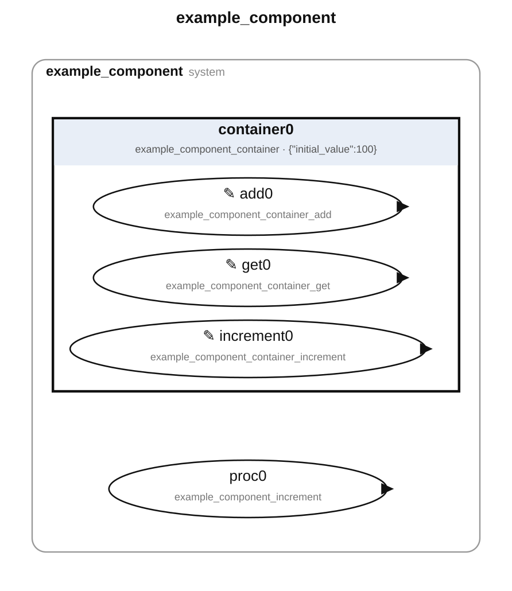

import { Aside, CardGrid, LinkCard } from '@astrojs/starlight/components';

In the skeleton of chapters 1 to 3, you wrote the Process, Container and ContainerProcesses in one source, built them into one library, and loaded it with one line under `components` in `plugins` of `app/app.conf`.
The talker and listener in the example repository, on the other hand, are separate files (libraries), one per type, loaded by listing the types one by one under `process_factories`.

When you want to hand someone "the full set of parts for this camera", scattered files are inconvenient.
In this chapter you take another look at the form the skeleton used, the **Component**, which bundles Processes, Containers and ContainerProcesses into one library, using the example repository, and compare it with one file per type.

<Aside type="tip" title="What you will learn">
- A Component is the **unit of distribution** that bundles several Processes, Containers and ContainerProcesses
- Types inside a Component keep their type names, and you create instances from them the same way as before
- `components` in `plugins` takes a single Component name instead of each type
</Aside>

From this chapter on, you clone and build the example repository and read its files. Each language page starts with how to prepare it. How you write a Component differs by language, so pick your language.

<CardGrid>
	<LinkCard title="Rust" href="/tutorial/component/rust/" description="Bundle everything into one crate with the Component attribute macros and juiz_component_manifest!." />
	<LinkCard title="Python" href="/tutorial/component/python/" description="Put the decorated functions side by side in one .py file." />
	<LinkCard title="C++" href="/tutorial/component/cpp/" description="Publish several types from one shared library." />
	<LinkCard title="Haskell" href="/tutorial/component/haskell/" description="Publish several types from one shared library with juizComponent." />
</CardGrid>

In every language, the Component used in this chapter contains the following. Each works the same as what you built in the earlier chapters.

| Kind | What it does |
| --- | --- |
| Process | Adds 1 to its argument and returns it (an ordinary Process, like `my_juiz_add` in chapter 1) |
| Container | Holds one integer (same as the counter in chapter 2) |
| ContainerProcess | Reads or changes the Container's value |

Drawn as an abbreviated diagram with [juiz_opm](/guides/juiz-opm/), the system in `example_component.conf`, used in this chapter, looks like this (see [Drawing a system](/guides/juiz-opm/#reading-the-abbreviated-diagram) for how to read it).

