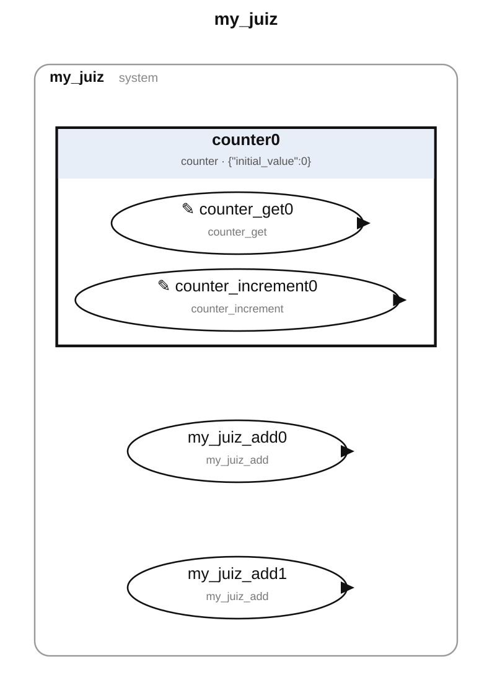
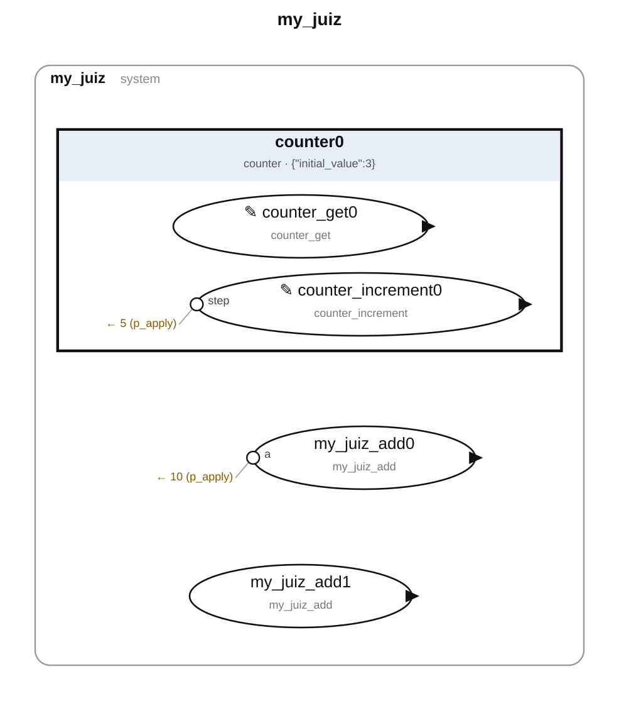

import { Tabs, TabItem, Aside } from '@astrojs/starlight/components';

In chapters 1 and 2 you passed the skeleton's configuration file `app/app.conf` to `juiz -f` and started the Process and the Container together.
A real robot runs many parts at once: cameras, motors, and the Processes that handle their data. The configuration file is where you write how they are put together.
In this chapter you read `app/app.conf` and edit it yourself to add instances and pass initial values.

<Aside type="tip" title="What you will learn">
- A configuration file separates "what to load" (`plugins`) from "what to create" (`processes` / `containers`)
- One type can produce several instances with different names
- Per-instance settings, such as a Container's initial value, can be passed in the configuration file
- `p_apply` gives initial values to a Process's arguments
- call, call_partial and execute fill in the arguments you leave out differently
</Aside>

## Prepare the project

Use `my_juiz`, the project from chapter 2, as is. Whichever language you use, the type names (`my_juiz_add`, `counter`, `counter_increment` and `counter_get`) are the same.
This chapter does not change the source, so there is no need to rebuild.

## Read the configuration file

After adding the Container in chapter 2, `app/app.conf` looks like this (the comment at the top is left out).

<Tabs syncKey="lang">
<TabItem label="Rust">

```yaml title="app/app.conf"
"name": "my_juiz"
"option":
  "http_broker":
    "start": true
    "port": 8000
"plugins":
  "components":
    "my_juiz":
      "language": "rust"
      "path": "plugins/{target}"
"processes":
  - "type_name": "my_juiz_add"
    "name": "my_juiz_add0"
"containers":
  - "type_name": "counter"
    "name": "counter0"
    "initial_value": 0
    "processes":
      - "type_name": "counter_increment"
        "name": "counter_increment0"
      - "type_name": "counter_get"
        "name": "counter_get0"
```

</TabItem>
<TabItem label="Python">

```yaml title="app/app.conf"
"name": "my_juiz"
"option":
  "http_broker":
    "start": true
    "port": 8000
"plugins":
  "components":
    "my_juiz":
      "language": "python"
      "path": "python"
"processes":
  - "type_name": "my_juiz_add"
    "name": "my_juiz_add0"
"containers":
  - "type_name": "counter"
    "name": "counter0"
    "initial_value": 0
    "processes":
      - "type_name": "counter_increment"
        "name": "counter_increment0"
      - "type_name": "counter_get"
        "name": "counter_get0"
```

</TabItem>
<TabItem label="C++">

```yaml title="app/app.conf"
"name": "my_juiz"
"option":
  "http_broker":
    "start": true
    "port": 8000
"plugins":
  "components":
    "my_juiz":
      "language": "c++"
      "path": "plugins/{target}"
"processes":
  - "type_name": "my_juiz_add"
    "name": "my_juiz_add0"
"containers":
  - "type_name": "counter"
    "name": "counter0"
    "initial_value": 0
    "processes":
      - "type_name": "counter_increment"
        "name": "counter_increment0"
      - "type_name": "counter_get"
        "name": "counter_get0"
```

</TabItem>
<TabItem label="Haskell">

```yaml title="app/app.conf"
"name": "my_juiz"
"option":
  "http_broker":
    "start": true
    "port": 8000
"plugins":
  "components":
    "my_juiz":
      "language": "haskell"
      "path": "plugins/{target}"
"processes":
  - "type_name": "my_juiz_add"
    "name": "my_juiz_add0"
"containers":
  - "type_name": "counter"
    "name": "counter0"
    "initial_value": 0
    "processes":
      - "type_name": "counter_increment"
        "name": "counter_increment0"
      - "type_name": "counter_get"
        "name": "counter_get0"
```

</TabItem>
</Tabs>

Only the two lines `language` and `path` under `plugins` differ by language.

Configuration files are written in YAML. The skeleton puts `"` around keys and values, but since it is YAML you can also write them without, as in `name: my_juiz` (this chapter follows the skeleton and uses `"` in the lines you add).
Let's go through it from the top.

### name and option

```yaml
"name": "my_juiz"
"option":
  "http_broker":
    "start": true
    "port": 8000
```

`name` is the name of this system.
`http_broker` under `option` configures the HTTP broker: `start: true` starts it, and `port` sets the port it listens on. Change it here when you want another port.

### plugins: loading

`plugins` says which files to **load** types from.

```yaml
"plugins":
  "components":
    "my_juiz":
      "language": "rust"
      "path": "plugins/{target}"
```

`components` lists libraries of **Components**, which bundle several types. The key is the Component name; `my_juiz` holds four types: the Process from chapter 1 and the Container and ContainerProcesses from chapter 2.

| Item | Meaning |
| --- | --- |
| `language` | The language of the library: one of `rust`, `python`, `c++` and `haskell` |
| `path` | The directory to look for the library in. A relative path counts from the directory of the configuration file (`app/`) |

juiz looks in the `path` directory for the file that matches the Component name.

<Tabs syncKey="lang">
<TabItem label="Rust">

`{target}` in `plugins/{target}` is replaced with the target name of the machine you run on (what `juiz pkg target` prints).
On Linux `app/plugins/x86_64-unknown-linux-gnu/libmy_juiz.so` is loaded, on macOS `libmy_juiz.dylib`, and on Windows `my_juiz.dll`.

</TabItem>
<TabItem label="Python">

`my_juiz.py` in `app/python` is loaded.

</TabItem>
<TabItem label="C++">

`{target}` in `plugins/{target}` is replaced with the target name of the machine you run on (what `juiz pkg target` prints).
On Linux `app/plugins/x86_64-unknown-linux-gnu/libmy_juiz.so` is loaded, on macOS `libmy_juiz.dylib`, and on Windows `my_juiz.dll`.

</TabItem>
<TabItem label="Haskell">

`{target}` in `plugins/{target}` is replaced with the target name of the machine you run on (what `juiz pkg target` prints).
On Linux `app/plugins/x86_64-unknown-linux-gnu/libmy_juiz.so` is loaded, and on macOS `libmy_juiz.dylib`.

</TabItem>
</Tabs>

Writing `plugins` alone does not run anything yet. juiz only learns the types (how to make them).

<Aside type="note" title="One file per type">
Besides Components, you can also load a file that holds just one type. Write Processes under `process_factories` and Containers under `container_factories`, with the **type name** as the key.

```yaml
plugins:
  process_factories:
    talker:
      path: "./target/debug"
```

In this case juiz builds the file name (`libtalker.so` and so on) from the type name `talker`. The examples used in chapter 4 are written this way.
Chapter 5 covers the difference between the two ways.
</Aside>

### processes and containers: creating

`processes` and `containers` say which **instances to create** from the loaded types.

```yaml
"processes":
  - "type_name": "my_juiz_add"
    "name": "my_juiz_add0"
"containers":
  - "type_name": "counter"
    "name": "counter0"
    "initial_value": 0
    "processes":
      - "type_name": "counter_increment"
        "name": "counter_increment0"
      - "type_name": "counter_get"
        "name": "counter_get0"
```

- `type_name` is a type name loaded through `plugins`, and `name` is the name of the instance to create.
- `processes` creates a Process instance `my_juiz_add0` from the type `my_juiz_add`.
- `containers` creates the Container `counter0`, and its `processes` create the ContainerProcesses `counter_increment0` and `counter_get0`, bound to `counter0`.

The skeleton names them "type name + `0`", but you can name instances however you like. The name becomes part of the ID.

## Create more instances from the same type

One type can produce several instances with different names.
Add an instance `my_juiz_add1` of the same type `my_juiz_add` to `processes`.

```yaml title="app/app.conf" ins={4-5}
"processes":
  - "type_name": "my_juiz_add"
    "name": "my_juiz_add0"
  - "type_name": "my_juiz_add"
    "name": "my_juiz_add1"
```

Drawn as an abbreviated diagram with [juiz_opm](/guides/juiz-opm/), this system looks like this (see [Drawing a system](/guides/juiz-opm/#reading-the-abbreviated-diagram) for how to read it).



## Run it

If `juiz` is running, stop it with Ctrl+C and start it again. The command is the same in every language.

```sh
juiz -f app/app.conf -d
```

For Python, run it in a terminal where the venv from chapter 1 is active.

## Call it from outside

Leave `juiz` running, open another terminal and list the Processes (the order may change from run to run).

```sh
juiz process list
# => ["http://127.0.0.1:8000/process/my_juiz_add0::my_juiz_add", "http://127.0.0.1:8000/process/my_juiz_add1::my_juiz_add"]
```

Two instances of the same type `my_juiz_add`, `my_juiz_add0` and `my_juiz_add1`, are listed; their IDs differ only in the instance name.
Call each of them.

```sh
juiz process call "http://127.0.0.1:8000/process/my_juiz_add0::my_juiz_add" '{"a": 1, "b": 2}' -p
# => CapsulePtr((value:Value(3), option: []))
juiz process call "http://127.0.0.1:8000/process/my_juiz_add1::my_juiz_add" '{"a": 10, "b": 20}' -p
# => CapsulePtr((value:Value(30), option: []))
```

You can call the Container's ContainerProcesses as in chapter 2.

```sh
juiz container-process call "http://127.0.0.1:8000/container_process/counter_increment0::counter_increment:counter0" '{"step": 2}' -p
# => CapsulePtr((value:Value(2), option: []))
```

`my_juiz_add0` and `my_juiz_add1` are separate instances made from the same type, but a Process has no state, so either one gives the same result for the same arguments.

## Pass an initial value to a Container

Besides `type_name` and `name`, a `containers` entry can hold values passed to the function that makes the Container.
The skeleton already has `"initial_value": 0`. Change it so the counter starts at 3.

```yaml title="app/app.conf" ins={4}
"containers":
  - "type_name": "counter"
    "name": "counter0"
    "initial_value": 3
    "processes":
```

This value is passed to the function that makes the Container, which you read in chapter 2 (the argument `initial_value` of `counter` in Rust and Python, the `args` that `counter` takes in C++, and the argument of `counter_create` in Haskell).

Stop `juiz` with Ctrl+C, start it again, and call `counter_get`; it returns `3`.

```sh
juiz container-process call "http://127.0.0.1:8000/container_process/counter_get0::counter_get:counter0" '{}' -p
# => CapsulePtr((value:Value(3), option: []))
```

You changed the starting point of the behavior with the configuration file alone, without touching the code.

## Pass initial values to a Process's arguments: p_apply

Not only Containers: you can give values to a Process's arguments in the configuration file too.
Write `p_apply` in a `processes` entry, or in a `processes` entry inside `containers`, and list argument names and values.

Set `a` of `my_juiz_add0` to 10 and `step` of `counter_increment0` to 5.

```yaml title="app/app.conf" ins={4-5,16-17}
"processes":
  - "type_name": "my_juiz_add"
    "name": "my_juiz_add0"
    "p_apply":
      "a": 10
  - "type_name": "my_juiz_add"
    "name": "my_juiz_add1"
"containers":
  - "type_name": "counter"
    "name": "counter0"
    "initial_value": 3
    "processes":
      - "type_name": "counter_increment"
        "name": "counter_increment0"
        "p_apply":
          "step": 5
      - "type_name": "counter_get"
        "name": "counter_get0"
```

A `p_apply` value goes into that argument right after the instance is created, and becomes its initial value.
It is used when the Process is **executed** without arguments. The Execution Context in the next chapter runs Processes this way.
The call you have used so far does not use `p_apply` values. Arguments left out of a call take the defaults written in the type (0 for `a` of `my_juiz_add`). To use the `p_apply` values in a call as well, use **call_partial**, described below.

Restart `juiz` and execute them without arguments through the `execute` HTTP API. The command is the same in every language.

<Tabs syncKey="platform">
<TabItem label="Linux">

```sh
curl -X PATCH "http://127.0.0.1:8000/api/process/execute?identifier=core://core/process/my_juiz_add0::my_juiz_add" \
  -H "Content-Type: application/json" -d '{}'
# => 10
curl -X PATCH "http://127.0.0.1:8000/api/container_process/execute?identifier=core://core/container_process/counter_increment0::counter_increment:counter0" \
  -H "Content-Type: application/json" -d '{}'
# => 8
```

</TabItem>
<TabItem label="macOS">

```sh
curl -X PATCH "http://127.0.0.1:8000/api/process/execute?identifier=core://core/process/my_juiz_add0::my_juiz_add" \
  -H "Content-Type: application/json" -d '{}'
# => 10
curl -X PATCH "http://127.0.0.1:8000/api/container_process/execute?identifier=core://core/container_process/counter_increment0::counter_increment:counter0" \
  -H "Content-Type: application/json" -d '{}'
# => 8
```

</TabItem>
<TabItem label="Windows">

```powershell
curl.exe -X PATCH "http://127.0.0.1:8000/api/process/execute?identifier=core://core/process/my_juiz_add0::my_juiz_add" `
  -H "Content-Type: application/json" -d '{}'
# => 10
curl.exe -X PATCH "http://127.0.0.1:8000/api/container_process/execute?identifier=core://core/container_process/counter_increment0::counter_increment:counter0" `
  -H "Content-Type: application/json" -d '{}'
# => 8
```

</TabItem>
</Tabs>

`my_juiz_add0` returned `10`, the sum of the 10 in `a` and the default 0 of `b`, and `counter_increment0` returned `8`, the initial value 3 plus the `step` of 5.
`identifier` takes an ID of the form `core://core/...`, which points to something inside the broker itself (the ID shown by `juiz process list` with its leading `http://127.0.0.1:8000` replaced by `core://core`).

If `p_apply` names an argument the Process does not have, `juiz` stops with an error at start-up.
For example, if you mistype `step` as `stepp`, you get an error like this (the long lines in the middle are left out).

```text
Error:setup_objects() failed in setup in system.rs

Caused by:
    ...
    2: p_apply(arg_name='stepp', value=5)
    3: Can not find Process::Inlet(stepp)
```

You notice the typo when it starts, not after it is already running.

Drawn as an abbreviated diagram, the system after adding `initial_value` and `p_apply` looks like this.



### Calling with the p_apply values: call_partial

To use the `p_apply` values in a call too, call the Process with **call_partial**.
Arguments you pass are used as given; arguments you leave out are filled in from the `p_apply` values (or from the defaults when there is no `p_apply` value), and the result is returned.
The values you pass do not overwrite the `p_apply` values.
In the `juiz` command it is `call-partial`. The command is the same for every language.

```sh
juiz process call-partial "http://127.0.0.1:8000/process/my_juiz_add0::my_juiz_add" '{"b": 5}' -p
# => CapsulePtr((value:Value(15), option: []))
juiz process call "http://127.0.0.1:8000/process/my_juiz_add0::my_juiz_add" '{"b": 5}' -p
# => CapsulePtr((value:Value(5), option: []))
```

With the same `{"b": 5}`, call_partial used the `p_apply` value 10 for `a` and returned `15`, while call used the default 0 and returned `5`.
For a ContainerProcess, use `juiz container-process call-partial` (in the HTTP API, `api/process/call_partial` and `api/container_process/call_partial`).

Here is what goes into the arguments you leave out, for the three ways of running a Process.

| How it runs | Arguments you pass | Arguments you leave out |
| --- | --- | --- |
| call | used | the type's defaults |
| call_partial | used | the `p_apply` values (or the defaults) |
| execute | (none passed) | the `p_apply` values (or the defaults) |

## Try it yourself

- Start with a configuration file that keeps only `plugins`, removing `processes` and `containers`, and look at `juiz process list`. It returns an empty list `[]`. Loading alone does not create instances (put it back afterwards).
- Add another Container `counter1` (with `initial_value` 100) to `containers`, with instances of `counter_increment` and `counter_get` bound to it. `counter0` and `counter1` keep separate values. The ID of a ContainerProcess includes the Container's name, so names like `counter_get0` can be the same for each Container.
- If you added a Process (`my_juiz_sub`) with `juiz pkg add process` in the "Try it yourself" of chapter 1, `processes` in `app/app.conf` should also have `my_juiz_sub0`. `juiz pkg add` adds the type to the source and, at the same time, writes an instance into the configuration file.

## Summary

- A configuration file separates `plugins`, which **loads** types, from `processes` / `containers`, which **create instances** from them.
- `components` in `plugins` lists Component libraries that bundle several types. One-type files go under `process_factories` / `container_factories`.
- One type can produce several instances with different names. The instance name becomes part of the ID.
- Per-instance settings, such as a Container's initial value, can be passed in the configuration file.
- `p_apply` gives initial values to a Process's arguments. They are used when the Process runs without arguments (for example, when an Execution Context runs it). To use them in a call, use call_partial.
- The configuration file items are summarized in the [Configuration file guide](/guides/config/).

In the next chapter you add connections between Processes, and when to run them, to the configuration file. Move on to [Connecting Processes: connect and Execution Context](/tutorial/connect/).
