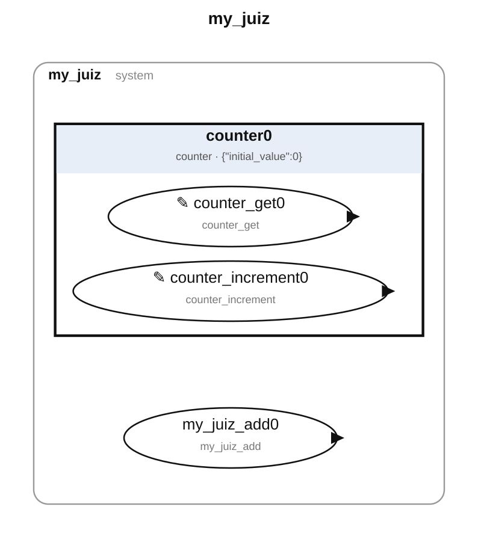

import { Aside, CardGrid, LinkCard } from '@astrojs/starlight/components';

The Process in chapter 1 was an idempotent function that always returns the same result for the same arguments.
But when you build parts for robots and IoT devices, you always end up with things you want to remember: a counter value, the current position of a motor, a connection to a camera.
In this chapter you learn how juiz handles state, using a counter that remembers one integer as the example.

<Aside type="tip" title="What you will learn">
- State lives in a **Container**, never in a Process
- Only the **ContainerProcesses** bound to a Container touch its state
- One Container can have several ContainerProcesses with different roles
- How to add a Container and ContainerProcesses to the project from chapter 1 with `juiz pkg add container`
</Aside>

You add a Container and ContainerProcesses to the project `my_juiz` from chapter 1 with `juiz pkg add container counter`, and read the code that was added. Pick your language.

<CardGrid>
	<LinkCard title="Rust" href="/tutorial/container/rust/" description="A state struct and functions with #[juiz_component_container] and friends are added to src/lib.rs." />
	<LinkCard title="Python" href="/tutorial/container/python/" description="A state class and decorated functions are added to the .py file." />
	<LinkCard title="C++" href="/tutorial/container/cpp/" description="A state class and functions paired with manifests are added to the .cpp file." />
	<LinkCard title="Haskell" href="/tutorial/container/haskell/" description="A state type wrapping an IORef and functions paired with manifests are added to the module." />
</CardGrid>

In every language, you add these three:

| Role | Type name | What it does |
| --- | --- | --- |
| Container | `counter` | Holds one counter value. Takes the initial value `initial_value` when created |
| ContainerProcess | `counter_increment` | Adds `step` to the Container's value and returns the new value |
| ContainerProcess | `counter_get` | Returns the Container's value as is (readonly: it only reads) |

Drawn as an abbreviated diagram with [juiz_opm](/guides/juiz-opm/), the system in `app/app.conf` after the addition looks like this (see [Drawing a system](/guides/juiz-opm/#reading-the-abbreviated-diagram) for how to read it).

