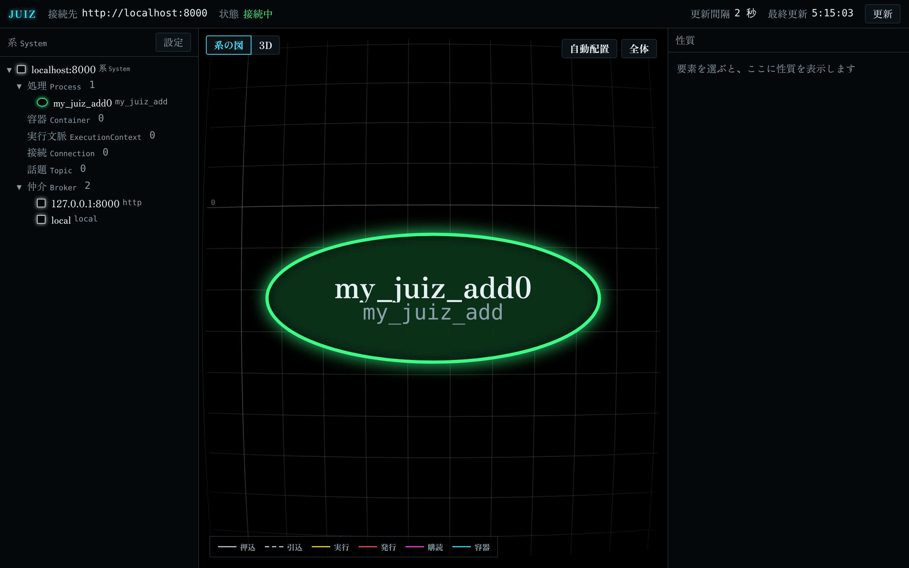

import { Aside, FileTree, Tabs, TabItem } from '@astrojs/starlight/components';

In this chapter you create a Python project skeleton with `juiz pkg create` and run the Process in it, which adds two numbers and returns the sum.
You first read the Process code, which is the heart of the project, then run it and call it from a browser and from a terminal. Finally you read the other files in the skeleton.

<Aside type="tip" title="What you will learn">
- How to create a Python project skeleton for writing Processes with `juiz pkg create`
- How to read the skeleton (`app/python/my_juiz.py`, `pyproject.toml` and `app/app.conf`)
- A Process is an idempotent function that takes arguments and returns a result
- A Process has a "type name" and an "instance name"
- How to call a Process from outside and get the result back (call)
</Aside>

## Before you start

You need Python 3.10 or later. You do not need the Rust toolchain.
You install the `juiz` command into a working venv below, so you do not have to follow [Installation](/getting-started/install/) first.

Make a working directory, create a venv (virtual environment) in it, and install `juiz-cli`.
`juiz-cli` installs both the `juiz` command and pyjuiz (`import juiz`), the package for writing Processes.

<Tabs syncKey="platform">
<TabItem label="Linux">

```sh
mkdir juiz_tutorial
cd juiz_tutorial
python3 -m venv .venv
source .venv/bin/activate
pip install juiz-cli==0.2.11
```

</TabItem>
<TabItem label="macOS">

```sh
mkdir juiz_tutorial
cd juiz_tutorial
python3 -m venv .venv
source .venv/bin/activate
pip install juiz-cli==0.2.11
```

</TabItem>
<TabItem label="Windows">

```powershell
mkdir juiz_tutorial
cd juiz_tutorial
python -m venv .venv
.venv\Scripts\activate
pip install juiz-cli==0.2.11
```

</TabItem>
</Tabs>

```sh
juiz --version
# => juiz 0.2.11
```

Run the following steps in a terminal where this venv is active. When you open a new terminal, run `source .venv/bin/activate` (`.venv\Scripts\activate` on Windows) in `juiz_tutorial`.

<Aside type="note" title="If you use juiz installed with cargo">
If you use the `juiz` command installed with `cargo install juiz_app`, skip `pip install juiz-cli==0.2.11`. The `pip install -e .` below installs only pyjuiz, the package for writing Processes, into the venv.
Installing `juiz-cli` as well gives you two `juiz` commands, and which one runs depends on the order in PATH.
</Aside>

## Create the skeleton

In `juiz_tutorial`, run the following command.

```sh
juiz pkg create my_juiz -b python -t process
```

| Part | Meaning |
| --- | --- |
| `my_juiz` | The project name. A directory with this name is created, and it also starts the type names. It must start with a lowercase letter and contain only lowercase letters, digits and `_` |
| `-b python` | The language (`rust` / `python` / `cpp` / `haskell`) |
| `-t process` | The kind of types to put in. `process` puts in just one Process. Without it a Container is added too, but this chapter starts with a Process only |

When it is created, the next commands to run are shown (you already made the venv above, so you can skip the `python3 -m venv .venv` shown here).

```text
Created my_juiz (python, process) in ./my_juiz  [pyjuiz ==0.2.11]

Next steps:
  cd my_juiz
  python3 -m venv .venv
  . .venv/bin/activate
  pip install -e .                # installs pyjuiz
  juiz -f app/app.conf -d         # start (keep it running)
  ...
```

Go into the new directory and install the packages listed in `pyproject.toml` into the venv.

```sh
cd my_juiz
pip install -e .
```

Run all the following commands in `my_juiz`.

## The shape of the project

The skeleton contains the following files.

<FileTree>
- my_juiz/
  - pyproject.toml project settings (packages used)
  - app/
    - app.conf the start-up configuration file
    - juizapp.yaml information for the distribution package (.juizapp)
    - python/
      - my_juiz.py the Process code
  - scripts/
    - pack.sh make the distribution package (pack.ps1 on Windows)
  - README.md how to use this skeleton
  - .gitignore
</FileTree>

Python Processes are not built. The `juiz` command loads the `.py` file directly.
In the skeleton, the types written in `app/python/my_juiz.py` are loaded and started as written in `app/app.conf`.
Start with the Process code, the heart of what you develop.

## The Process code: app/python/my_juiz.py

```python title="app/python/my_juiz.py"
from juiz import juiz_process


@juiz_process
def my_juiz_add(a: int = 0, b: int = 0) -> int:
    """Returns a + b."""
    return a + b
```

The docstring at the top of the file is left out.

| Line | Meaning |
| --- | --- |
| `from juiz import juiz_process` | Imports the decorator that makes a Process from pyjuiz |
| `@juiz_process` | Makes this function a Process |
| `def my_juiz_add(a: int = 0, b: int = 0)` | The function name `my_juiz_add` becomes the **type name** of the Process. juiz reads the argument names, types and default values from the type hints and defaults. Arguments left out of a call take the default values |
| `-> int` | The output type. Type hints for the arguments and the return value are required |
| `"""Returns a + b."""` | The docstring is used as the description of the Process, shown in the web UI and elsewhere |

The Process itself is a short function that returns `a + b`.

You can put many decorated functions in this file. They are loaded together as one **Component** (a bundle of several types).
In this chapter there is only one Process, but in chapter 2 you add a Container to the same file. Chapter 6 covers Components in detail.

## A Process is an idempotent function

`my_juiz_add` only takes arguments and returns a result.
It does not read or write any outside state, so the same arguments always give the same result (it is idempotent).
Thanks to this, Processes are easy to test, and they behave the same when you later connect them or move them to another machine.

## Run it

Start `juiz`, passing the configuration file `app/app.conf` with `-f`.

```sh
juiz -f app/app.conf -d
```

| Option | Meaning |
| --- | --- |
| `-f <file>` | Read the configuration file, load the plugins and create the instances written in it |
| `-d` | Keep running (stop with Ctrl+C) |

On start-up it prints `juiz 管理画面: http://localhost:8000/ui/` (the address of the web UI). The HTTP broker is listening on port 8000.

## Call it from a browser

Leave `juiz` running and open the web UI at `http://localhost:8000/ui/` in a browser. You see a screen like this.



The UI labels are in Japanese, with the English names used on this site shown in small type next to them. The screen has three parts.

- **The list on the left**: what is running. Under "処理 Process" (Process) you see the instance `my_juiz_add0` next to its type name `my_juiz_add`.
- **The diagram in the middle**: a diagram of the system. A Process is drawn as an ellipse; the large text is the instance name and the small text is the type name.
- **The panel on the right**: the properties (details) of what you select. It is empty because nothing is selected yet.

Click `my_juiz_add0` in the list or in the diagram, and its details appear in the right panel.
Scroll the right panel down to the heading "呼び出す" (Call), where you find input fields for the arguments `a` and `b`.
Enter `1` for `a` and `2` for `b`, then press the "呼び出す" (Call) button. If `3` appears under "結果" (Result), it worked.


Look at the rest of the panel as well.

- The "引数" (Arguments) table lists each argument's name, type and default value (既定値). The default is what is used for an argument you leave out when calling, and it is the `default` you wrote in the code. ("拘束値", the bound value, is covered in chapter 3.)
- "既定値に戻す" (Reset to defaults) puts the default values (`0`) back in the fields. "JSON で編集" (Edit as JSON) lets you write all the arguments as JSON.
- "基本" (Basics) near the top shows the type name and the identifier (ID) of this Process.

Change the values and call it a few times. With the same arguments, you always get the same result.
See the [Web UI guide](/guides/web-ui/) for more on the web UI.

## Call it from a terminal

Whatever you did in the browser, you can also do from a terminal. Leave `juiz` running, open another terminal, activate the venv, go to `my_juiz` and call the Process.
First, list the running Processes.

```sh
juiz process list
# => ["http://127.0.0.1:8000/process/my_juiz_add0::my_juiz_add"]
```

The URL shown is the **ID** of this Process.
`http://127.0.0.1:8000` is where the Process lives (the broker), and the part after `process/` is "instance name`::`type name".
With [namespaces](/guides/namespace/), a namespace such as `robot1/` comes before the instance name. Without them, it looks as above.

Call the Process with this ID and arguments (call). Arguments are passed as JSON.

```sh
juiz process call "http://127.0.0.1:8000/process/my_juiz_add0::my_juiz_add" '{"a": 1, "b": 2}' -p
# => CapsulePtr((value:Value(3), option: []))
```

You passed `1` and `2` and got `3` back. `-p` prints the result.
Arguments you leave out take their default values (`0` for both `a` and `b`). Passing `'{"a": 5}'` returns `5`.

<Aside type="caution" title="Passing JSON in Windows PowerShell 5.1">
Windows PowerShell 5.1, which comes with Windows, drops the `"` in `'{"a": 1, "b": 2}'` before passing it to `juiz`.
Write a `\` before each `"`, as in `'{\"a\": 1, \"b\": 2}'`. In PowerShell 7.3 or later, the command above works as written.
</Aside>

Check that calling it again with the same arguments always gives the same result.

Both the `juiz` command and the web UI just call the same API over HTTP.
That means any program that speaks HTTP, in any language, can call a Process and get the result back.
This is **call**, the way of using juiz like a server and client.

## Read the other files in the skeleton

Besides the Process code, the skeleton contains files for building and starting it.

### The project settings: pyproject.toml

```toml title="pyproject.toml"
[project]
name = "my-juiz"
version = "0.1.0"
description = "my_juiz: a juiz component"
requires-python = ">=3.10"
dependencies = [
    # Same version as the juiz that made this skeleton (juiz --version)
    "pyjuiz==0.2.11",
]

[build-system]
requires = ["setuptools>=77"]  # 77 or later reads license = "<SPDX expression>"
build-backend = "setuptools.build_meta"

[tool.setuptools]
# juiz loads app/python/my_juiz.py directly, so nothing is installed as a Python package
py-modules = []
```

| Item | Meaning |
| --- | --- |
| `name`, `version`, `description` in `[project]` | The project's name, version and description |
| `requires-python` | The Python versions it works with. pyjuiz runs on Python 3.10 or later |
| `dependencies` | The packages this project uses: pyjuiz, for writing Processes |
| `[build-system]` | The tool (setuptools) `pip install` uses to handle this project |
| `py-modules = []` in `[tool.setuptools]` | `juiz` loads the `.py` files of this project directly, so they are not installed as a Python package |

**Keep the pyjuiz version the same as the one `juiz --version` shows.** The skeleton pins it with `==` to the version of the `juiz` that created it.
When you update `juiz`, change this line to the same version too, and run `pip install -e .` again.

`pip install -e .` creates a `my_juiz.egg-info` directory; pip uses it, so you can ignore it.

### The start-up configuration file: app/app.conf

This is the configuration file you passed to `juiz -f` (the comment at the top is left out).

```yaml title="app/app.conf"
"name": "my_juiz"
"option":
  "http_broker":
    "start": true
    "port": 8000
"plugins":
  "components":
    "my_juiz":
      "language": "python"
      "path": "python"
"processes":
  - "type_name": "my_juiz_add"
    "name": "my_juiz_add0"
```

Configuration files are written in YAML. Roughly, this one says:

- `option`: start the HTTP broker on port 8000
- `plugins`: **load** the file of the Component `my_juiz` (`my_juiz.py`) from the `python` directory as Python (the path is relative to `app/`, the directory of the configuration file)
- `processes`: **create an instance** named `my_juiz_add0` from the loaded type `my_juiz_add`

Notice that "loading" and "creating an instance" are separate steps.
When juiz loads a file, it learns the Process **type** (how to make one). What you write in `processes` creates named **instances** from that type.
In the ID you called, `my_juiz_add0` is the instance name and `my_juiz_add` is the type name.
You can also create several instances with different names from the same type (covered in chapter 3).

### scripts and app/juizapp.yaml

`scripts/pack.sh` and `app/juizapp.yaml` are for bundling the finished building block into a single `.juizapp` file to hand out (it runs with just `juiz run`). The tutorial does not use them; see [Distributing apps (.juizapp)](/guides/app-package/).

## Try it yourself

- Change `app/python/my_juiz.py` to return the product (`a * b`) instead of the sum. Python needs no build, so just restart `juiz`; `{"a": 3, "b": 4}` should now give `12`.
- Run `juiz pkg add process my_juiz_sub`. It adds a Process `my_juiz_sub` to `app/python/my_juiz.py` and `app/app.conf` (its body is `a + b`, the same as `my_juiz_add`). Change the added function to `a - b`, restart `juiz`, and call it. `juiz process list` shows two Processes.

## Summary

- `juiz pkg create <name> -b python` creates a project skeleton that starts and answers calls as is. The pyjuiz version is written to match `juiz`.
- Python Processes are not built. `juiz` loads the `.py` file directly.
- A Process is an idempotent function that only takes arguments and returns a result. The name of the function with `@juiz_process` becomes the type name, and the argument and output types are read from the type hints.
- juiz loads a file to learn a Process **type**, and creates named **instances** from it as written in the configuration file.
- A running Process has an ID shaped like a URL, and you can call it from outside with that ID and arguments (call).

In the next chapter you add a counter Container to this project and learn how to write building blocks that keep state. Move on to [Keeping state: Container and ContainerProcess (Python)](/tutorial/container/python/).
