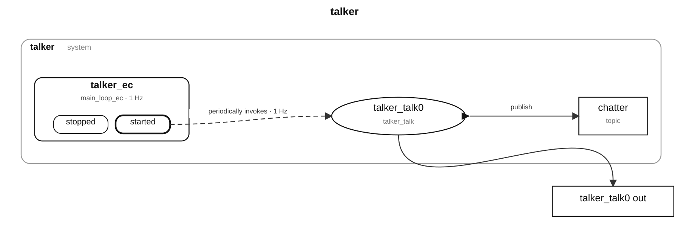
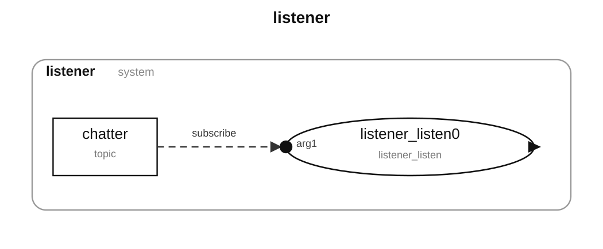

import { Tabs, TabItem, Aside } from '@astrojs/starlight/components';

So far you have used **call**: calling a Process from outside and getting the result back.
Robots often need something else too: "as soon as the camera program outputs an image, the processing program receives it", that is, keep feeding one program's output into another program's input. And the two programs are usually written separately and started separately.
In this chapter you make a `talker` that outputs a string and a `listener` that prints the string it receives as **two separate skeletons (packages)**, start them in **two separate juiz instances**, and connect them.

<Aside type="tip" title="What you will learn">
- Processes in separately started juiz instances can be connected with a command by giving their IDs (URLs) (**connect**)
- An **Execution Context** (EC) runs a Process periodically, and you can start and stop it from outside
- With a **Topic**, writing it in the configuration files is enough to connect them when they start
</Aside>

## Prepare

If you finished "Prepare" in chapter 1, there is nothing new to install (you use the `juiz` command, GHC and cabal, libjuiz_sdk in `~/.juiz/sdk/0.3.4` and hsjuiz in `~/juiz-0.3.4`). The Haskell steps are for Linux and macOS only.

Work in the directory where you made `my_juiz` in chapter 1 (one level above `my_juiz`). In this chapter you make two skeletons, `talker` and `listener`, side by side there.

## Make two skeletons

```sh
juiz pkg create talker -b haskell -t process
juiz pkg create listener -b haskell -t process
```

You get two skeletons of the same shape as `my_juiz` in chapter 1. Both contain a Process that returns `a + b` (`talker_add` and `listener_add`), which you now rewrite.
Type names start with the skeleton's name, so the talker's Process gets the type name `talker_talk`, and the listener's Process `listener_listen`.

## Write the talker

Replace `talker/src/Talker.hs` with the following.

```haskell title="talker/src/Talker.hs"
{-# LANGUAGE OverloadedStrings #-}
{-# LANGUAGE TemplateHaskell #-}
module Talker () where

import qualified Data.Text.IO as T
import System.IO (hFlush, stdout)

import Juiz

talker_component :: ComponentManifest
talker_component = componentManifest "talker"
  & description "talker: a juiz component"

-- | Process talker_talk
talker_talk_manifest :: ProcessManifest
talker_talk_manifest = processManifest "talker_talk"
  & description "Returns a greeting."

talker_talk :: IO Text
talker_talk = do
  T.putStrLn "talker: Hello, juiz!"
  hFlush stdout
  pure "Hello, juiz!"

juizComponent 'talker_component
  [ componentProcess 'talker_talk 'talker_talk_manifest
  ]
```

- The type name is `talker_talk`, written in the manifest as `processManifest "talker_talk"`. The manifest adds no arguments, so the function `talker_talk` takes none.
- It prints text, so its type is `IO Text` (a pure function like `my_juiz_add` in chapter 1 and a function in `IO` can both be a Process). `hFlush stdout` prints the line right away instead of buffering it.
- Write the new names in the list of `juizComponent` at the end too.

It uses `Data.Text.IO`, so add one line `text` to `build-depends` in `talker.cabal` and `listener.cabal` (the package comes with GHC, so nothing is downloaded).

```txt title="talker.cabal (listener.cabal is the same)"
    build-depends:    base >=4.18 && <5
                    , hsjuiz
                    , text
```

Next, change the start-up configuration file `talker/app/app.conf` as follows (the comments at the top are left out; you may keep them).

```yaml title="talker/app/app.conf"
"name": "talker"
"option":
  "http_broker":
    "start": true
    "port": 8001
"plugins":
  "components":
    "talker":
      "language": "haskell"
      "path": "plugins/{target}"
"processes":
  - "type_name": "talker_talk"
    "name": "talker_talk0"
"ecs":
  - "type_name": "main_loop_ec"
    "name": "talker_ec"
    "rate": 1.0
    "bind":
      - "type_name": "talker_talk"
        "name": "talker_talk0"
    "auto_start": false
```

Three things changed from the skeleton.

| Change | Meaning |
| --- | --- |
| `port: 8001` | The listener's juiz uses port 8000, so the talker's juiz listens on 8001 |
| `talker_add` → `talker_talk` | The type name and the instance name `talker_talk0` follow the rewritten Process |
| `ecs` | Adds an **Execution Context** (EC). An EC keeps running the Processes in `bind` at a fixed rate (`rate` is the number of runs per second). With `auto_start: false`, it does not start running when juiz starts |

The talker only returns a string when it is called; it does not run by itself. Running it periodically is the EC's job. Chapter 5 covers ECs in more detail.

## Write the listener

Replace `listener/src/Listener.hs` with the following.

```haskell title="listener/src/Listener.hs"
{-# LANGUAGE OverloadedStrings #-}
{-# LANGUAGE TemplateHaskell #-}
module Listener () where

import qualified Data.Text.IO as T
import System.IO (hFlush, stdout)

import Juiz

listener_component :: ComponentManifest
listener_component = componentManifest "listener"
  & description "listener: a juiz component"

-- | Process listener_listen
listener_listen_manifest :: ProcessManifest
listener_listen_manifest = processManifest "listener_listen"
  & description "Prints the received string."
  & addStringArg "arg1" "the string to print" ""

listener_listen :: Text -> IO Text
listener_listen arg1 = do
  T.putStrLn ("listener: " <> arg1)
  hFlush stdout
  pure arg1

juizComponent 'listener_component
  [ componentProcess 'listener_listen 'listener_listen_manifest
  ]
```

- The type name is `listener_listen`. `addStringArg "arg1" ...` adds a string argument `arg1` (default: an empty string), and the function receives it as `Text`.
- It prints the string it receives and returns it as is.

In `listener/app/app.conf`, change only the type name and the instance name (the port stays 8000).

```yaml title="listener/app/app.conf"
"name": "listener"
"option":
  "http_broker":
    "start": true
    "port": 8000
"plugins":
  "components":
    "listener":
      "language": "haskell"
      "path": "plugins/{target}"
"processes":
  - "type_name": "listener_listen"
    "name": "listener_listen0"
```

The talker does not know whom it passes its value to, and the listener does not know where its value comes from. Neither piece of code mentions the other.

## Build

Build each skeleton with `scripts/dev.sh`. As in chapter 1, the plugin is put in `app/plugins/<target>/` of each skeleton.

```sh
cd talker
scripts/dev.sh
cd ../listener
scripts/dev.sh
cd ..
```

When you change the code, run `scripts/dev.sh` again in that skeleton.

## Start them separately

You use three terminals. Open all of them in the directory that holds `talker` and `listener`.

| Terminal | Role |
| --- | --- |
| 1 | the `juiz` that runs the listener (port 8000) |
| 2 | the `juiz` that runs the talker (port 8001) |
| 3 | commands to connect and inspect |

Start the listener in terminal 1 and the talker in terminal 2.

```sh
# terminal 1
cd listener
juiz -f app/app.conf -d
```

```sh
# terminal 2
cd talker
juiz -f app/app.conf -d
```

Neither prints anything yet: nothing runs the listener, and the talker's EC is not running.
From terminal 3, look at the Processes in each juiz. `-s` chooses the juiz to ask (without it, `http://127.0.0.1:8000` is asked).

```sh
juiz process list
# => ["http://127.0.0.1:8000/process/listener_listen0::listener_listen"]
juiz -s http://127.0.0.1:8001 process list
# => ["http://127.0.0.1:8001/process/talker_talk0::talker_talk"]
```

The `http://127.0.0.1:8000` and `http://127.0.0.1:8001` parts of the IDs tell which juiz each Process lives in. The two Processes are in different processes.

## Connect them with a command

In terminal 3, connect the talker's output to the listener's argument `arg1`.

```sh
juiz connection create -t push "http://127.0.0.1:8001/process/talker_talk0::talker_talk" arg1 "http://127.0.0.1:8000/process/listener_listen0::listener_listen"
```

The arguments are the source ID, the argument name at the destination, and the destination ID, in that order.
`-t push` means "when the source runs, pass its output to the destination's argument and run the destination right away".
Connecting a Process's output to another Process's input like this is called **connect** in juiz.

The connection is held by the talker, the side that sends the value. Ask port 8001 to see it.

```sh
juiz -s http://127.0.0.1:8001 connection list
# => ["connection://core://core/process/talker_talk0::talker_talk|arg1|http://127.0.0.1:8000/process/listener_listen0::listener_listen"]
```

The destination is `http://127.0.0.1:8000/...`. The talker's juiz knows the listener lives in another juiz, and delivers the value over HTTP.

## Run the EC

Nothing is printed yet because the EC that runs the talker is stopped. From terminal 3, look up the EC's ID and start it.

```sh
juiz -s http://127.0.0.1:8001 ec list
# => ["http://127.0.0.1:8001/execution_context/talker_ec::main_loop_ec"]
juiz -s http://127.0.0.1:8001 ec start "http://127.0.0.1:8001/execution_context/talker_ec::main_loop_ec"
```

For `ec start` and `ec stop`, add `-s` as well as the ID (without it you get an error that the `broker_proxy` cannot be found).

As soon as it starts, terminal 2 prints the talker's line and terminal 1 prints the listener's line, once a second.

```
talker: Hello, juiz!
talker: Hello, juiz!
...
```

```
listener: Hello, juiz!
listener: Hello, juiz!
...
```

Two programs written and started separately are now connected while running. To stop, run `ec stop` the same way.

```sh
juiz -s http://127.0.0.1:8001 ec stop "http://127.0.0.1:8001/execution_context/talker_ec::main_loop_ec"
```

Terminals 1 and 2 stop printing. When you have seen it, stop the juiz in terminals 1 and 2 with Ctrl+C.

## Connect on start-up with a Topic

Connecting with commands is handy for trying out changes to a running system, but typing them again on every start is tedious. Also, `connection create` needed the other side's ID (which juiz, which instance).
So now use a **Topic** to make them connect on start-up, just by writing it in the configuration files.

A Topic is a named channel. Sending a Process's output to a Topic is called **publish**, and receiving the values that flow on a Topic in an argument is called **subscribe**.
The publishing side and the subscribing side do not know each other's IDs. As long as they use the same Topic name, the values arrive.

### talker: publishes and mastersystem

Change `talker/app/app.conf` as follows.

```yaml title="talker/app/app.conf"
"name": "talker"
"option":
  "http_broker":
    "start": true
    "port": 8001
"mastersystem":
  "broker_type": "http"
  "broker_name": "127.0.0.1:8000"
"plugins":
  "components":
    "talker":
      "language": "haskell"
      "path": "plugins/{target}"
"processes":
  - "type_name": "talker_talk"
    "name": "talker_talk0"
    "publishes":
      - "chatter"
"ecs":
  - "type_name": "main_loop_ec"
    "name": "talker_ec"
    "rate": 1.0
    "bind":
      - "type_name": "talker_talk"
        "name": "talker_talk0"
    "auto_start": true
```

| Added | Meaning |
| --- | --- |
| `publishes` | Sends the output of `talker_talk0` to the Topic `chatter`. You can name a Topic freely |
| `mastersystem` | Joins the talker's juiz to the juiz on port 8000 (the listener's) as a **subsystem**. Topic values are delivered between juiz instances joined like this |
| `auto_start: true` | Starts the EC as soon as juiz starts |

### listener: subscribes

Add `subscribes` to the Process in `listener/app/app.conf`.

```yaml title="listener/app/app.conf"
"name": "listener"
"option":
  "http_broker":
    "start": true
    "port": 8000
"plugins":
  "components":
    "listener":
      "language": "haskell"
      "path": "plugins/{target}"
"processes":
  - "type_name": "listener_listen"
    "name": "listener_listen0"
    "subscribes":
      "arg1": "chatter"
```

`subscribes` says "which argument receives the values of which Topic". Here, values that flow on the Topic `chatter` go into the argument `arg1`, and `listener_listen0` runs.

Drawn as abbreviated diagrams by [juiz_opm](/guides/juiz-opm/), the two configuration files look like this. The talker's juiz publishes the output of `talker_talk0` to `chatter`, and the listener's juiz subscribes to `chatter`.





### Start them

Start the listener first and the talker second.

```sh
# terminal 1
cd listener
juiz -f app/app.conf -d
```

```sh
# terminal 2
cd talker
juiz -f app/app.conf -d
```

This time, as soon as the talker starts, terminal 1 starts printing the listener's line without any command.

<Aside type="caution" title="Start-up order">
If the juiz named in `mastersystem` (the listener's juiz on port 8000) is not running yet, the talker's juiz cannot join it as a subsystem and prints an ERROR saying `system_add_subsystem()` failed. In that case, stop the talker with Ctrl+C and start it again.
</Aside>

Now that the talker's juiz has joined as a subsystem, asking port 8000 from terminal 3 lists the Processes of both juiz instances.

```sh
juiz process list
# => ["http://127.0.0.1:8000/process/listener_listen0::listener_listen", "http://127.0.0.1:8001/process/talker_talk0::talker_talk"]
```

### connect and Topic

| | connect (`connection create`) | Topic (`publishes` / `subscribes`) |
| --- | --- | --- |
| How you name the other side | its ID | only the Topic name |
| When they connect | when you run the command (on start-up for `connections` in a configuration file) | on start-up |
| One to many | one connection at a time | any number of subscribers to the same Topic receive it |
| Good for | trying out changes to a running system, connecting to a specific partner | distributing sensor values and the like, when the sender need not know the receivers |

## The talker and listener in the example repository

The example repository [juiz_examples_haskell](https://github.com/OpenJUIZ/juiz_examples_haskell) also has a talker and a listener. They are written a little differently (one file per type there), but do the same thing. From chapter 6 on you use the example repository.

## Try it yourself

- With the Topic version running, stop the talker in terminal 2 with Ctrl+C and start it again. The listener stops printing, but when the talker comes back it starts again without any command. When you connected them with a command, restarting the talker, which held the connection, meant connecting again.
- In a fourth terminal, start another listener (`cd listener` and `juiz -f app/app.conf -d`). Ports 8000 and 8001 are taken, so this juiz automatically listens on 8002 and becomes a subsystem of the juiz on 8000. It subscribes to the Topic `chatter`, so both listeners print.
- Change the Topic name in the listener's `subscribes` to `chatter2` and restart it. The names no longer match, so nothing arrives.

## Summary

- Processes made from separate skeletons and started in separate juiz instances can be connected with `juiz connection create` by giving their IDs (connect). The sending side holds the connection.
- An Execution Context (EC) runs Processes periodically. You create one in `ecs`, and start and stop it from outside with `juiz ec start` / `ec stop`.
- When `publishes` and `subscribes` in the configuration files use the same Topic name, and `mastersystem` joins the juiz instances, values arrive just by starting them. The sender and the receiver do not know each other's IDs.

In the next chapter you load these two libraries into one juiz and connect them. Move on to [Connecting several libraries in one juiz (Haskell)](/tutorial/connect/haskell/).
